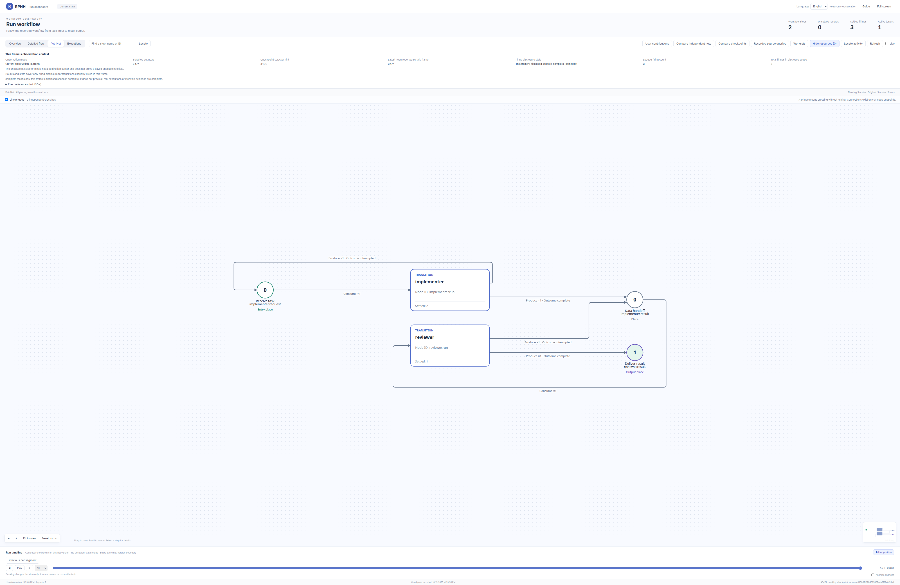

# RPNH Harness

English | [中文](README_ZH.md)

RPNH is a provider-neutral agent execution framework for **building, running and
reusing workflows that combine language models and native tools**.

A typed **PetriNet** makes task dependencies and resource requirements executable:
a step can run only after its declared prerequisites are satisfied, and settled
outputs feed later work. A durable **Registry** connects workflow definitions,
resource versions, execution records and checkpoints.

[First run](docs/guides/getting-started.md) ·
[Technical report](docs/technical-report.md) · [Examples](examples/README.md) ·
[Documentation](docs/index.md)

## What you can do

- **Compose agents, tools and workflow modules.** Define supported workflows
  directly or use the built-in Designer. Connect registered operations through
  typed dependencies, parallel branches and all-input joins, and compose
  reusable modules through explicit interfaces.
- **Coordinate independent tasks through versioned resources.** Run tasks with
  their own Registry and result. Give agents explicit access to the materials
  and resource versions they need for each handoff.
- **Review and merge workflow definitions.** Propose and compare supported
  definition revisions, resolve conflicts, then explicitly adopt a chosen
  revision into a run.
- **Package and reuse a working method.** Share supported definitions with their
  inputs and environment requirements, so another project can prepare and run
  them with its own Registry, local configuration and authorization.

The [technical report](docs/technical-report.md) explains composition,
definition-specific merge contracts and how revisions enter execution.

**Inspect and continue real runs.** The [read-only Viewer](docs/guides/viewer.md)
shows structure, recorded inputs, outputs and workspace versions.
[Resume owner-stopped work](docs/guides/checkpoint-recovery.md) from its latest
committed checkpoint, or explicitly reopen a checkpoint in the active net
lineage. Earlier history is retained; reopening does not undo external effects.

## One-command installation

Requires **Linux/WSL2, Python 3.11+ with venv, Git, curl and Bash**.
[Review the installer](scripts/install.sh), then run:

```bash
bash -c 'set -e; installer=$(mktemp); curl -fsSL https://raw.githubusercontent.com/Deng-0119/RPNH/main/scripts/install.sh -o "$installer"; bash "$installer"; rm -- "$installer"'
```

This installs current public source and the demo plugin into
`~/.local/share/rpnh/{source,venv}`. It refuses an existing destination, uses no
sudo, and changes neither system Python nor shell startup files. Network access
is needed; no model is called. [Custom directory, pinned commit and manual installation](docs/guides/installation.md).

## Example: add two numbers and inspect the run

After the default installation, run this zero-model example. Local subprocess
and Unix-socket permissions are required:

```bash
cd "$HOME/.local/share/rpnh/source"
. ../venv/bin/activate
RUN_DIR="$(mktemp -d)/add-run"
rpnh plugins --config examples/native_plugin/plugins.json run demo/add \
  --input examples/native_plugin/input.json --run-dir "$RUN_DIR"
rpnh net --run "$RUN_DIR" --view --no-open
```

The input is `2 + 3`; expected output contains `output.value: 5` and a terminal-evidence
reference. The last command prints the local read-only Viewer URL. Keep the run
directory for later inspection.


Existing capture of a completed native-tool run, not a model run or a new test
of this revision. [Example details](examples/native_plugin/README.md) ·
[More workflows](examples/workflow_patterns/README.md).

For conversation, configure your provider and exact model with the
[model guide](docs/guides/models.md), then run `rpnh --frontend basic`.
No provider is preselected.

## See RPNH in a complete project

| Goal | Example | What to expect |
|---|---|---|
| Combine agents with existing code | [Hybrid summary](examples/hybrid_summary/README.md) | Agent → native calculation → Agent; scripted by default, with an explicitly selected live-model route |
| Collaborate on and reuse a project | [Project collaboration](examples/project_collaboration/README.md) | Controlled contributors resolve a definition conflict; implementer/reviewer agents execute the task, including an independent receiver run |
| Coordinate independent roles around shared resources | [Multi-user release handoff](examples/multiuser_release_handoff/README.md) | Four task Registries and a separate resource Source; recorded role handoffs and resource versions |

[](examples/project_collaboration/figures/source-petri.png)

**Recorded project run:** an Implementer hands work to a Reviewer in the official
read-only Viewer. The walkthrough connects this execution to definition revisions,
explicit adoption and independent receiver reuse. This is a historical capture;
[the complete case](examples/project_collaboration/README.md) retains its
provenance and validation scope.

## Compatibility and releases

Current source retains version `0.1.0rc3`, but the October 30
[v0.1.0rc3 wheel and DSH plugin](https://github.com/Deng-0119/RPNH/releases/tag/v0.1.0rc3)
do **not** include the November 1 source fixes; see the
[source/release boundary](docs/guides/compatibility.md).

- **Codex:** default 0.163.0; 0.166.0 is an explicitly selected candidate.
- **OpenCode:** default 1.19.4; 2.2.5 is only an opt-in REST/authentication/non-durable events
  subset, not a complete native frontend.
- **DSH Web frontend:** pinned 0.2.1-rc.2 official Web UI bound to one RPNH
  MainSession. Follow the [Web guide](docs/guides/dsh.md).
- **Stock DSH operator plugin:** manual pairing with DSH 0.2.2-alpha.2 to
  inspect existing RPNH tasks, with optional controls; not a qualified managed
  upgrade. Follow the [operator guide](integrations/dsh/operator/README.md).

These integrations have bounded compatibility, not blanket support across versions.

## Learn more

[Documentation](docs/index.md) · [Examples](examples/README.md) ·
[Technical report](docs/technical-report.md) ·
[Architecture](docs/architecture/design.md) · [Contributing](CONTRIBUTING.md)

## License

[MIT](LICENSE). Third-party components retain their own licenses; see
[third-party notices](THIRD_PARTY_NOTICES.md).
