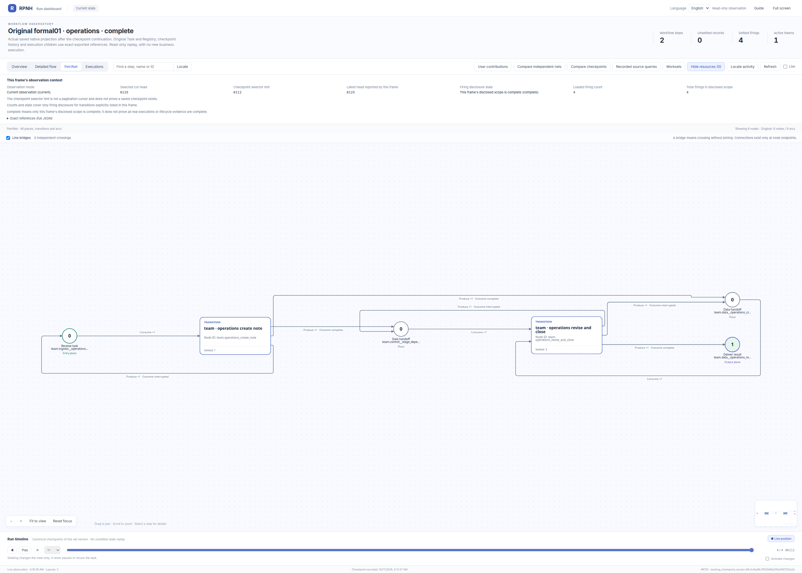
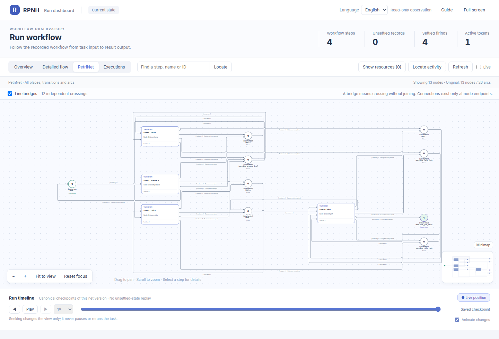

# RPNH Harness

English | [中文](README_ZH.md)

[Quick start](#quick-start) · [Actual PN](#see-a-multi-agent-run) · [Examples](#example-catalog) · [Full example index](examples/README.md) ·
[Frontends](#frontends-and-host-integrations) · [Documentation hub](docs/index.md) · [Contribute](CONTRIBUTING.md)

RPNH is a provider-neutral agent execution framework for composing language
models, native tools and reusable workflows. A durable **Registry** records
execution and resource history; a typed **Petri net** determines when work is
eligible to run and how settled outputs enable later steps.

The same runtime supports a conversational main session, isolated child tasks,
multi-Agent workflows, versioned workspace resources and read-only inspection.
Basic, Codex, OpenCode and DSH are presentation or host surfaces around that
runtime—not separate owners of model, workspace or recovery state.

| At a glance | Current boundary |
|---|---|
| Platform | Linux or WSL2, Python 3.11+ |
| Source candidate | `0.1.0rc2` development candidate; older public binaries are `v0.1.0rc1` |
| Installation | Source checkout or GitHub Release wheel/sdist |
| Models | User-owned provider and exact-model catalog; no route is preselected |
| Execution | Main session plus independent task/workflow Registries |
| Observation | Terminal projections and a local read-only PetriNet dashboard |
| Recovery | Owner-stop resume and user-selected checkpoint reopen |

## Start here

- **Try RPNH for the first time:** follow [Quick start](#quick-start) to install, run a zero-model tool and open the Viewer. The [first-run tutorial](docs/guides/getting-started.md) walks through the full path.
- **Copy and co-create a project:** use the [project collaboration example](examples/project_collaboration/README.md) and its [import-to-execution guide](docs/guides/project-entry.md).
- **Build an application or integrate existing code:** start with [customization and plugins](docs/guides/customization.md), then use the [Python API index](docs/reference/api-index.md), [CLI reference](docs/reference/cli.md) and [source map](docs/guides/repository-layout.md).
- **Understand the design first:** read the [technical report](docs/technical-report.md). Use the [documentation hub](docs/index.md) for task-based routes and [curated results](docs/results/README.md) for recorded conditions and scores.

### Project preview: copy, co-create and reuse

The [project collaboration example](examples/project_collaboration/README.md) merges two controlled contributors' revisions, then runs implementer/reviewer agents at the source and an independent receiver. This is the original source run's completed business PN. The example uses authorized live models and controlled principals under one trusted OS user; see [project and result scope](#project-collaboration-and-result-scope) for dates, scores and conditions.

[](examples/project_collaboration/figures/source-petri.png)

[Full-size PN](examples/project_collaboration/figures/source-petri.png) · [Exact observation and provenance](examples/project_collaboration/figures/source-petri.json) · [Capture record](examples/project_collaboration/figures/provenance.json)


## Multi-user release handoff: independent agents and shared resources

The [complete example](examples/multiuser_release_handoff/README.md) follows four controlled participants with independent Tasks, Registries and private agent PNs, plus a separate fifth Source Registry for resource control. Native checkpoint restoration completed v2, SQL, the QA checklist, incident and final handoffs; the final read-only audit passed 98/98 required checks. Source is not an agent. Original failures and two optional UNKNOWN history-coverage checks remain explicit.

[Actual role PNs and Source details](examples/multiuser_release_handoff/figures/README.md) · [Original task and run prerequisites](examples/multiuser_release_handoff/RUNNING.md) · [Exact historical results and limits](examples/multiuser_release_handoff/RESULTS.md). New model runs require authorization; this is not an official benchmark score, deployment or executed rollback validation.

[](examples/multiuser_release_handoff/figures/operations-petri.png)

## Quick start

Goal: run a local tool on Linux/WSL2 with Python 3.11+ and inspect its registered result in the Viewer. Installation and the first two steps need no model or API credential; model setup comes in step 3. For checkpoints and common fixes, use the [first-run tutorial](docs/guides/getting-started.md) and [troubleshooting](docs/guides/troubleshooting.md).

Choose the source or release deliberately:

- **Current source:** this checkout is the `0.1.0rc2` development candidate. Build
  it from the selected source commit; no new rc2 binary release is claimed here.
- **Older binaries:** the [`v0.1.0rc1` prerelease](https://github.com/Deng-0119/RPNH/releases/tag/v0.1.0rc1)
  contains the 2026-09-29 wheel/sdist. These do not contain later `main` features.
- **Historical benchmark snapshot:** [`benchmark-baseline-2026-10-06`](https://github.com/Deng-0119/RPNH/releases/tag/benchmark-baseline-2026-10-06)
  is source-only at `f58a0f061d1daf4c09fc96c43237c613cc43f439`; it is not a new
  runtime binary release or proof that every runtime journey passed.

On Linux or WSL2, use the selected reviewed source checkout and run from its
root. An ordinary clone of public `main` does not retrieve unpublished candidate
changes. Record the selected commit and use a fresh environment; see
[installation](docs/guides/installation.md) for wheel and upgrade checks.

For a first checkout:

```bash
git clone https://github.com/Deng-0119/RPNH.git
cd RPNH
```

If you already have a checkout, start here from its root:

```bash
git rev-parse HEAD
python3 -m venv .venv
. .venv/bin/activate
python -m pip install .
rpnh --help
rpnh config init
rpnh config build
rpnh config build --check
```

These commands do not call a model. The initial provider/model catalog is
empty. Add an authorized provider and exact model through the
[model configuration guide](docs/guides/models.md); all supported configuration
keys and their defaults are indexed in the
[configuration reference](docs/guides/configuration.md).

### 1. Run a local tool without a model

The bundled `demo/add` plugin exercises admission, execution, registered output
and terminal evidence:

```bash
python -m pip install ./examples/native_plugin
rpnh plugins --config examples/native_plugin/plugins.json check
DEMO_ROOT="$(mktemp -d "${TMPDIR:-/tmp}/rpnh-demo.XXXXXX")"
RUN_DIR="$DEMO_ROOT/run"
rpnh plugins --config examples/native_plugin/plugins.json run demo/add \
  --input examples/native_plugin/input.json --run-dir "$RUN_DIR"
```

The input is `{"left": 2, "right": 3}` and the returned JSON contains
`output.value` equal to `5`, the run directory and a terminal-evidence reference.

### 2. Inspect the run

```bash
: "${RUN_DIR:?Set an existing run directory}"
rpnh net --run "$RUN_DIR"
rpnh net --run "$RUN_DIR" --show-resources
rpnh net --run "$RUN_DIR" --resources-only
rpnh net --run "$RUN_DIR" --view --no-open
```

The default terminal projection hides resource places. Explicit resource views
show only resources declared by the actual net. The final command starts the
local read-only dashboard and prints its loopback address. See the
[dashboard tutorial](docs/guides/viewer.md) for every view, control and symbol.

### 3. Start a model-backed main session

After building an authorized execution profile:

```bash
rpnh --frontend basic
```

Use `/agent` for an independent task, `/workflow` to ask the Designer to create
a workflow, and `/tasks` to list children. `/switch` changes the selected task;
`/task ID status` and `/task ID result` inspect its state and output.
`/task ID checkpoints` lists committed cuts, and `/task ID reopen CHECKPOINT
[:: REASON]` appends a new execution generation from a user-selected cut in the
same Registry/run. See [usage](docs/guides/usage.md) and the
[checkpoint recovery procedure](docs/guides/checkpoint-recovery.md).

## See a multi-agent run

This dashboard comes from the checked-in `parallel` example after a completed
Registry run. `prepare` enables two independent Agents; `join` becomes eligible
only after both registered products are available.

[](examples/workflow_patterns/assets/parallel-petrinet.png)

After completing [Quick start](#quick-start), reproduce it without a provider or
API credential:

```bash
DEMO_ROOT="$(mktemp -d "${TMPDIR:-/tmp}/rpnh-readme.XXXXXX")"
python -m examples.workflow_patterns.run \
  --scenario parallel --run-dir "$DEMO_ROOT/parallel"
rpnh net --run "$DEMO_ROOT/parallel" --view --no-open
```

The PetriNet above shows the same run's transitions, handoff places, fan-out arcs and all-input join. The Viewer supports zoom, pan, node/arc details and checkpoint inspection. Its brief Overview shows task agents and handoffs; see the [Viewer guide](docs/guides/viewer.md) and [same-run original Overview](examples/workflow_patterns/assets/parallel-overview.png).

Overview identities come from exact registered bindings or clearly marked declarations; an external display annotation does not confirm an agent. Overview edges retain structural path provenance. The full PN still determines guards and all-input joins; a path alone does not prove firing order.

These are real graph projections with aggregate execution state and controls;
only run-specific checkpoint identities and local timestamps were removed from
the public images. The dashboard is read-only. Registry terminal evidence and a
registered final result—not a picture or process exit—establish completion.

## What RPNH provides

- **Agents and existing code in one workflow.** Model nodes can reason and
  communicate while native plugins perform calculations or existing business
  logic against declared inputs and outputs.
- **Explicit concurrency and joins.** Petri-net places, arcs and tokens express
  fan-out, synchronization, resource reads and completion conditions without
  reducing execution to a serial chat transcript.
- **Independent work with one entry point.** The main session can create,
  inspect, message, stop and reopen child tasks. Each child retains its own
  Registry, execution state and result.
- **Versioned workspace evidence.** Resource versions connect inputs and
  products to their executions. Settlement records per-path create, update and
  delete history while preserving conflicts between concurrent revisions.
- **Provider- and frontend-neutral ownership.** Users configure their own model
  routes. Supported frontends share RPNH execution semantics instead of
  reimplementing provider, Registry, workspace or recovery behavior.

## Example catalog

Start with one of the three recommended paths below, or browse [all source examples](#all-source-examples) directly. The [complete source example index](examples/README.md) adds figures, model requirements and run preparation.

### Recommended starting points

| What to try | Start with | Run preparation |
|---|---|---|
| Check your local installation | [Native add plugin](examples/native_plugin/README.md) | Local plugin; no model calls |
| Understand agent parallelism and handoffs | [Workflow patterns](examples/workflow_patterns/README.md) | Scripted by default; no model credentials |
| Co-create and independently run a complete project | [Project collaboration](examples/project_collaboration/README.md) | Authorized live profile; controlled contributors |

### All source examples

These direct links cover all 24 entries in the full index, grouped by modeled object. Each page retains its own run requirements, figure provenance and result scope.

- **Agent and role workflows:** [Project collaboration](examples/project_collaboration/README.md) · [Agent-network co-building](examples/user_collaboration/agent_cobuild/README.md) · [Hybrid summary](examples/hybrid_summary/README.md) · [Workflow patterns](examples/workflow_patterns/README.md) · [Task workspace](examples/task_workspace/README.md) · [Native net operations](examples/net_operations/README.md) · [JB steering packet](examples/jb_steering_packet/README.md) · [3-DOF powered descent](examples/three_dof_powered_descent/README.md) · [HarnessAudit Office](examples/harnessaudit_office/README.md) · [RRSI v0.6](examples/rrsi_v06/README.md) · [AutomationBench](examples/automationbench/README.md) · [ERP-Bench](examples/erp_bench/README.md) · [SlopCodeBench pilot](examples/slopcodebench/README.md).
- **Tool, SDK and validation fixtures:** [Native plugin](examples/native_plugin/README.md) · [Package reuse](examples/package_reuse/README.md) · [Atomic tool pipeline](examples/tool_pipeline/README.md) · [SQL query validation](examples/query_validation/README.md) · [Multi-source data merge](examples/tool_pipeline/multi_source/README.md) · [Synthetic iteration](examples/rsi_workflows/README.md) · [Example evidence contract](examples/example_validation/README.md).
- **Native input and authority fixtures:** [Mock refund approval](examples/approval_workflow/README.md) · [Controlled quote](examples/a2a_quote/README.md).
- **Historical contribution and business evidence:** [Route mechanisms and results](examples/user_collaboration/README.md#historical-route-planning-mechanism-evidence) · [Native billing mechanism fixture](examples/user_collaboration/native_billing/README.md).

Choose by modeled object: agent workflows describe task responsibilities and handoffs; domain algorithms and business systems are tools or external environments. ERP, 3-DOF, JB, HarnessAudit, AutomationBench, SlopCodeBench and RRSI remain genuine agent/role workflows. RRSI custom registered-host role PNs can have genuine agent bindings without using stock AgentLoop. Pure-tool pipelines, native-input gates, author principals and annotations do not become agents merely through Registry lineage.

Each example page identifies whether its figures show an actual run or an initial
declaration, with the corresponding provenance and evidence scope. A declaration
view does not establish execution; consult each page for recorded results and
Viewer commands for new runs. The
[complete example guide](docs/guides/examples.md) records commands, expected
results and evidence boundaries for calculation, document, serial, parallel,
long-process and independent-task examples. The
[source example index](examples/README.md) provides the repository-level map.

A wheel built from this source candidate exports `native_plugin`,
`hybrid_summary` (including its shared fixture and plugin), `compose_serial` and
`package_reuse`, as well as the default provider-neutral `adapter_task`.
Installed export entry points: [adapter_task](cpn/examples/adapter_task/README.md); [compose_serial](examples/net_operations/README.md) creates a definition without executing a workflow. These are named exports, not additional source-index entries.
Follow [export and customization](docs/guides/examples.md#export-an-example-and-make-it-yours)
or the complete [runnable v2 package tutorial](docs/guides/package-reuse-example.md).
The older rc1 wheel contains only the adapter export. Exporting never configures
a provider or contacts a model:

```bash
EXAMPLE_ROOT="$(mktemp -d "${TMPDIR:-/tmp}/rpnh-example-parent.XXXXXX")/adapter-task"
rpnh examples list
rpnh examples export --output "$EXAMPLE_ROOT"
```

The exported guides share one task and expected semantic result across hosts.
A model call occurs only after the user supplies an authorized execution profile
and submits the task; raw runs remain private.

## Execution and recovery model

A declared operation is admitted before dispatch. Its returned products are
registered and settled before downstream work relies on them, and a declared
terminal binding identifies the final result. Frontends and the dashboard read
the same durable records.

Harness-owned file materialization and workspace finalization run as subordinate
execution Petri nets inside the same Registry. They separate implementation
mechanics from the Designer-authored business graph while preserving exact
checkpoint-to-result evidence. Registry validation enforces identity, ordering,
references and atomic closure; retry, remediation and whether a failed tool
action is acceptable remain explicit runtime or application policy.

An owner stop checkpoints the current run without turning unfinished work into
success. `resume` continues the latest owner-stopped cut. `reopen` selects any
committed checkpoint and appends a new execution generation while retaining
later history and files as immutable evidence. Rolling a main conversation back
to its previous completed turn does not delete independent child Registries.
Unknown provider submissions are recorded rather than silently replayed.

See the [architecture](docs/architecture/design.md) and
[runtime reference](docs/reference/runtime-registry.md) for token semantics,
workspace settlement, execution nets and workflow revision.

## Frontends and host integrations

| Entry | Purpose |
|---|---|
| `rpnh --frontend basic` | Built-in terminal for the main session and independent task controls |
| `rpnh --frontend codex` | Pinned Codex presentation; see the [adapter guide](docs/guides/adapters.md) |
| `rpnh --frontend opencode` | OpenCode 1.18.32 presentation; see the [OpenCode guide](docs/guides/opencode.md) |
| `rpnh-dsh` | Optional pinned DSH host integration; see the [DSH guide](docs/guides/dsh.md) |

Basic, Codex and OpenCode are sequential presentations of one direct MainSession
root. Create it with `--session-dir`; after the current frontend exits, reopen
the exact path with `--resume` and another frontend. State is not copied into
frontend-specific sessions, and the shared owner lease rejects concurrent
writable presentations. DSH is a registered host integration with its own
session surface. RPNH retains model selection and managed-execution authority in
all cases.

## Project collaboration and result scope

The current project example, original scores and historical mechanism records each retain their own version and conditions. For a first run, use [Quick start](#quick-start) above; this record is for checking exact numbers and supported scope.

### Current project and two PN layers

The current collaboration entry is [copy, co-create and reuse one agent project](examples/project_collaboration/README.md). A complete project includes definitions, inputs, environment requirements, the original task, verifier, provenance and licenses. Two controlled contributors resolve real conflicts into a two-parent revision M. Before business execution, the source adopts M → a new successor with base content → a new successor with M content, then downloads exact original M for an independently authorized receiver with fresh identities. Source and receiver each run the original multi-source merge task through two provider-backed stock implementer/reviewer AgentLoop roles; the receiver package contains no source business answers. The [operator guide](docs/guides/project-entry.md) covers import, review, acceptance, adoption, download and execution.

The bounded **2026-10-13** result is **43 registered requests / 42 responses within a limit of 48**: source 23/22, retaining one original `NOT_SUBMITTED` failure and two completed business firings; receiver 20/20 and two completed business firings. Both path-adapted original assertion sets are **3/3 PASS**, and independent full-instruction review is **ACCEPT_BOTH**. Original `test.sh` is **NOT_RUN** and the grader was **VISIBLE**; these are not blind official-container scores. Independent checks cover all four rows/20 cells and three complete field conflicts; optional status normalization remains a disclosed instruction ambiguity.

The business PN models the two agents' responsibilities and handoff: each Overview has two nodes/one edge, and each full business PN has five nodes/six arcs. Actual file-materialization and workspace-finalization child execution PNs belong to exact business invocations/firings in the same Registry, with separate tokens, firings and checkpoints; AgentLoop logs do not substitute for execution PNs. Supported scope is controlled principals under one trusted OS user, ordinary Module contributions, explicit scoped reads and owner adoption. Pre-business content restoration does not resurrect consumed or terminal tokens or roll back external effects. It does not establish real-human authentication, live-token hot migration or broad graph/open-region/selected-change/assembly exchange.

### Other public records and interfaces

Public record dated 2026-10-06: freeze04 first18 has 5 PASS / 9 FAIL / 4 BLOCKED; separate repair4 has 1 PASS / 3 FAIL. The old 14 scored tasks were not rerun. [Results and limits](examples/automationbench/PUBLIC_RESULTS_20261006.md).

Explicit opt-in [author/graph interfaces](docs/reference/declarations.md), [Workset and normal-child roots](docs/reference/normal-child-root-contract.md), and [read-only source queries](docs/guides/source-queries.md) are integrated. [Finite validation](docs/guides/release-validation.md) is not full HOST/I00–I10/advanced25 acceptance; the historical freeze04 browser window was BLOCKED.

Offline preparation and inspection are available through [portable package preview and exact local locks](docs/guides/portable-packages.md), [HOST declaration diagnostics](docs/guides/host-readiness.md), and [checkpoint comparison](docs/guides/checkpoint-comparison.md). Package commands use the installed `rpnh` entry; the HOST diagnostic is an explicit Python API. These interfaces inspect materials and recorded facts without granting execution authority.

The historical zero-provider protocol entry is [agent-network co-building](examples/user_collaboration/agent_cobuild/README.md). Two native task-agent roles, `curator.run` and `auditor.run`, use stock `AgentStage`/default `AgentLoop` in an ordinary Module assembled from two stock single-agent declarations, with `curator.result → auditor.request`. Deterministic source programs from two controlled original principals strengthen the curator input-lineage contract and auditor reconciliation contract. The original HOST reviews exact revisions, advances a protected Branch sequentially and enables owner adoption before target execution.

In that historical window, source programs, external control actions and target agents remain separate; its single-parent chain does not imply automatic same-base merging. A `local_process` scripted driver computes from actual inputs and tool returns. This demonstrates structure and protocol using registered task agents. It makes no live-model or cognition claim; execution results, artifacts and Viewer evidence are reported on the example page.

See [curated results](docs/results/README.md) for historical application scores and zero-model runtime checks. Each record keeps its tested source and conditions; these older windows do not certify a later combined product or a new rc2 binary release.

Two controlled local applications connect browser input to the original Registry
and PN: [two-principal mock refund approval](examples/approval_workflow/README.md)
and [external-result quote intake](examples/a2a_quote/README.md). Each opens with
its actual Viewer capture and includes same-run inspection and reopen commands.
Business inputs and external results are synthetic; no model or financial service is called.

[Historical route](examples/user_collaboration/README.md#historical-route-planning-mechanism-evidence) and [native billing](examples/user_collaboration/native_billing/README.md) retain original 74/10-operation business-tool nets, versions, results, images, contribution/adoption receipts and failures. Their tool operations and authors are not task agents; historical results do not validate the current co-building example.

[Controlled managed tools](docs/controlled-managed-tools.md) covers exact result
paging, bounded parallel calls, isolated Python programs, read-only result
evidence and source preflight. These capabilities use explicit HOST policies;
existing tool catalogs and benchmark comparison conditions retain their defaults.

## Documentation

[Browse documentation by task](docs/index.md) · [First-run tutorial](docs/guides/getting-started.md) ·
[CLI reference](docs/reference/cli.md) · [Python API index](docs/reference/api-index.md) · [All source examples](examples/README.md) ·
[Code and package map](docs/guides/repository-layout.md) ·
[Versioned implementation links](docs/technical-report.md#source-map) · [中文文档](docs/index_ZH.md)

| Goal | Start here |
|---|---|
| Understand the design before testing | [Technical report](docs/technical-report.md) |
| Install and run | [Installation](docs/guides/installation.md), [examples](docs/guides/examples.md), [usage](docs/guides/usage.md) |
| Configure the runtime | [Configuration](docs/guides/configuration.md), [models](docs/guides/models.md), [usage and recovery](docs/guides/usage.md) |
| Build an application | [Customization and plugins](docs/guides/customization.md), [native Petri-net operations](docs/guides/net-operations.md), [declarations](docs/reference/declarations.md) |
| Understand execution | [Dashboard](docs/guides/viewer.md), [architecture](docs/architecture/design.md), [Registry/runtime](docs/reference/runtime-registry.md), [finite PN validation](docs/reference/pn-validation.md), [sessions and Agents](docs/reference/agents.md) |
| Reuse and inspect definitions | [Portable packages](docs/guides/portable-packages.md), [receiver preparation](docs/environment-preparation.md), [graph authoring](docs/reference/graph-authoring.md), [Worksets](docs/reference/worksets.md) |
| Read exact evidence | [Independent Registry reader](docs/guides/independent-registry-reader.md), [source queries](docs/guides/source-queries.md), [checkpoint comparison](docs/guides/checkpoint-comparison.md), [curated results](docs/results/README.md) |
| Integrate a host | [Frontend and host adapters](docs/guides/adapters.md), [extension and observation interfaces](docs/reference/extensions-observation.md), [controlled user collaboration](docs/guides/user-collaboration.md) |
| Operate or contribute | [Troubleshooting](docs/guides/troubleshooting.md), [development](docs/guides/development.md), [contributing](CONTRIBUTING.md), [security](SECURITY.md), [changelog](CHANGELOG.md), [release validation](docs/guides/release-validation.md) |

## Validation and development

Use focused deterministic offline tests for a local code change. Run a broader
suite only when a release-wide change can affect those additional modules.
Provider-backed checks require separate authorization and a recorded route and
call budget; offline passing results are not evidence that a live route works.
Keep credentials, local profiles and generated run data outside Git. See the
[development guide](docs/guides/development.md) and the dated
[validation record](docs/guides/release-validation.md).

## License

RPNH uses the [MIT License](LICENSE). Bundled or pinned third-party components
retain their own licenses; see [THIRD_PARTY_NOTICES.md](THIRD_PARTY_NOTICES.md)
and the notices shipped with optional integrations.
