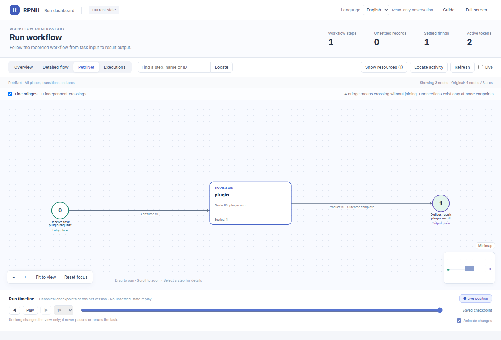

# RPNH Harness

English | [中文](README_ZH.md)

RPNH is a provider-neutral agent execution framework for combining language
models, native tools and reusable workflows.

A durable **Registry** records execution and resource history. A typed
**PetriNet** controls when work can run: declared inputs and settled outputs
enable later steps, including parallel branches and joins. Frontends and the
read-only Viewer inspect the same runtime state rather than owning separate
execution or recovery logic.

## What you can do

- Combine agents and existing code in explicit workflows.
- Create independent child tasks, each with its own Registry and result.
- Track versioned workspace inputs and outputs; inspect runs in the PetriNet Viewer.
- Resume owner-stopped work or reopen a selected committed checkpoint while
  preserving prior history. This does not undo external effects.

## One-command installation

Requires **Linux/WSL2, Python 3.11+ with venv, Git, curl and Bash**.
[Review the installer](scripts/install.sh), then run:

```bash
bash -c 'set -e; installer=$(mktemp); curl -fsSL https://raw.githubusercontent.com/Deng-0119/RPNH/main/scripts/install.sh -o "$installer"; bash "$installer"; rm -- "$installer"'
```

This installs current public source and the demo plugin into
`~/.local/share/rpnh/{source,venv}`. It refuses an existing destination, uses no
sudo, and changes neither system Python nor shell startup files. Network access
is needed; no model is called. [Custom directory, pinned commit and manual installation](docs/guides/installation.md).

## Example: add two numbers and inspect the run

After the default installation, run this zero-model example. Local subprocess
and Unix-socket permissions are required:

```bash
cd "$HOME/.local/share/rpnh/source"
. ../venv/bin/activate
RUN_DIR="$(mktemp -d)/add-run"
rpnh plugins --config examples/native_plugin/plugins.json run demo/add \
  --input examples/native_plugin/input.json --run-dir "$RUN_DIR"
rpnh net --run "$RUN_DIR" --view --no-open
```

The input is `2 + 3`; expected output contains `output.value: 5` and a terminal-evidence
reference. The last command prints the local read-only Viewer URL. Keep the run
directory for later inspection.



Existing capture of a completed native-tool run, not a model run or a new test
of this revision. [Example details](examples/native_plugin/README.md) ·
[More workflows](examples/workflow_patterns/README.md).

For conversation, configure your provider and exact model with the
[model guide](docs/guides/models.md), then run `rpnh --frontend basic`.
No provider is preselected.

## Compatibility and releases

Current source retains version `0.1.0rc3`, but the October 30
[v0.1.0rc3 wheel and DSH plugin](https://github.com/Deng-0119/RPNH/releases/tag/v0.1.0rc3)
do **not** include the November 1 source fixes; see the
[source/release boundary](docs/guides/compatibility.md).

- **Codex:** default 0.163.0; 0.166.0 is an explicitly selected candidate.
- **OpenCode:** default 1.19.4; 2.2.5 is only an opt-in REST/authentication/non-durable events
  subset, not a complete native frontend.
- **Stock DSH plugin:** manual pairing with DSH 0.2.2-alpha.2; not a qualified
  managed upgrade. Follow the [operator guide](integrations/dsh/operator/README.md).

These integrations have bounded compatibility, not blanket support across versions.

## Learn more

[Documentation](docs/index.md) · [Examples](examples/README.md) ·
[Architecture](docs/architecture/design.md) · [Contributing](CONTRIBUTING.md)

## License

[MIT](LICENSE). Third-party components retain their own licenses; see
[third-party notices](THIRD_PARTY_NOTICES.md).
