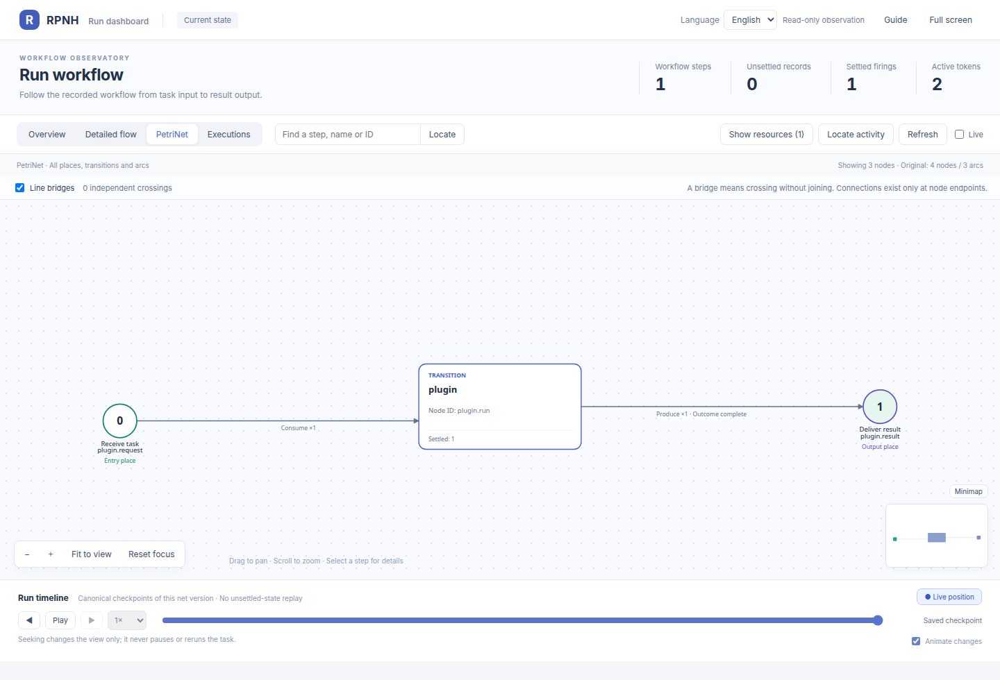
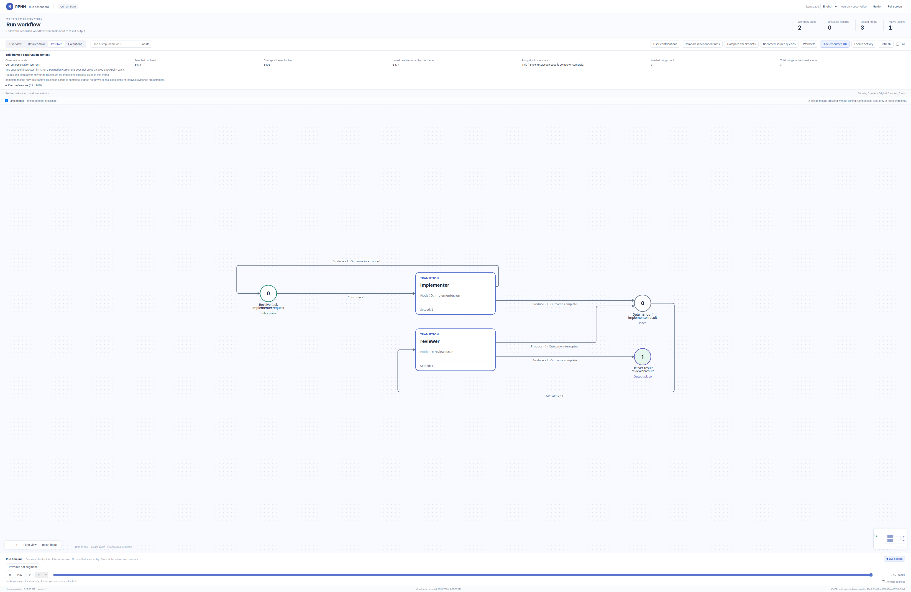

> 发行状态：[v0.1.0rc6](https://github.com/Deng-0119/RPNH/releases/tag/v0.1.0rc6) 是最新 GitHub 预发布，范围为 Linux x86_64 Basic。正式 rc6 npm 格式 tgz 已在 WSL2／CPython 3.13.12 Basic 通过 A4 安装与激活验收。npm registry 尚未发布；RC8 是独立本地候选。[范围与证据](docs/guides/linux-npm-candidate_ZH.md)。

# RPNH Harness

[English](README.md) | 中文

RPNH 是不绑定特定模型服务商的 Agent 执行框架，用于**构建、运行和复用由语言模型与原生工具组成的工作流**。

类型化的 **PetriNet** 将任务依赖与资源要求转化为执行规则：步骤只有在声明的
前提满足后才可能执行，完成结算的输出再供后续工作使用。持久化的 **Registry**
连接工作流定义、资源版本、执行记录与检查点。

[第一次运行](docs/guides/getting-started_ZH.md) ·
[技术报告](docs/technical-report_ZH.md) · [案例](examples/README_ZH.md) ·
[文档导航](docs/index_ZH.md) ·
[仓库目录图](docs/guides/repository-layout_ZH.md)

## 可以做什么

- **组合 Agent、工具与工作流模块。** 直接定义受支持的工作流，或使用内置 Designer；
  通过类型化依赖、并行分支和全输入汇合连接已注册操作，再通过显式接口组合可复用模块。
- **通过版本化资源协调独立任务。** 任务拥有自己的 Registry 和结果，Agent 显式获得
  每次交接所需材料与资源版本的访问权限。
- **审阅和合并工作流定义。** 提出并比较受支持的定义修订、解决冲突，再将选定版本
  显式采用到运行中。
- **打包并复用工作方法。** 分享受支持的定义、输入与环境要求，让另一个项目使用自己的
  Registry、本地配置和授权完成准备与独立运行。

[技术报告](docs/technical-report_ZH.md)进一步说明组合方式、各类定义的合并契约，
以及修订如何进入实际执行。

**检查与续接真实运行。** [只读 Viewer](docs/guides/viewer_ZH.md)展示结构、已记录输入、
输出与工作区版本。[续接 owner 主动停止的工作](docs/guides/checkpoint-recovery_ZH.md)
从最新已提交检查点继续，也可显式重开当前 net lineage 中的检查点。
先前历史会保留；重开不会撤销外部效果。

## 一键安装

需要 **Linux/WSL2、Python 3.11+（含 venv）、Git、curl 和 Bash**。
先[查看安装脚本](scripts/install.sh)，然后执行一条命令：

```bash
bash -c 'set -e; installer=$(mktemp); curl -fsSL https://raw.githubusercontent.com/Deng-0119/RPNH/main/scripts/install.sh -o "$installer"; bash "$installer"; rm -- "$installer"'
```

安装当前公开源码及演示插件到 `~/.local/share/rpnh/{source,venv}`。
目标目录已存在时拒绝安装；不用 sudo，不改系统 Python 或 shell 启动文件。
需要联网，不调用模型。[自定义目录、固定提交与手动安装](docs/guides/installation_ZH.md)。

## 使用案例：两数相加并查看运行

完成默认安装后，执行这个零模型案例；需要本地子进程与 Unix socket 权限：

```bash
cd "$HOME/.local/share/rpnh/source"
. ../venv/bin/activate
RUN_DIR="$(mktemp -d)/add-run"
rpnh plugins --config examples/native_plugin/plugins.json run demo/add \
  --input examples/native_plugin/input.json --run-dir "$RUN_DIR"
rpnh net --run "$RUN_DIR" --view --no-open
```

输入为 `2 + 3`，预期输出包含 `output.value: 5` 和终态证据引用。
最后一条命令打印本地只读 Viewer 地址；保留运行目录即可再次查看。



这是已有的原生工具完成运行截图，不是模型运行，也不是对本次版本的新测试。
[案例说明](examples/native_plugin/README_ZH.md) · [更多工作流](examples/workflow_patterns/README_ZH.md)。

如需对话，先按[模型指南](docs/guides/models_ZH.md)配置自己的 provider 和精确模型，
再运行 `rpnh --frontend basic`；系统不预选 provider。

## 看一个完整项目

| 目标 | 案例 | 可以看到什么 |
|---|---|---|
| 将 Agent 与已有代码组合 | [混合汇总](examples/hybrid_summary/README_ZH.md) | Agent → 原生计算 → Agent；默认脚本化，真实模型路线需显式选择 |
| 协作修改并复用项目 | [项目协作](examples/project_collaboration/README_ZH.md) | 受控贡献者解决定义冲突；Implementer／Reviewer Agent 执行业务，包含独立接收端运行 |
| 让独立角色围绕共享资源协作 | [多用户发布交接](examples/multiuser_release_handoff/README_ZH.md) | 四个任务 Registry 与独立资源 Source，已记录的角色交接及资源版本 |

[](examples/project_collaboration/figures/source-petri.png)

**已记录的项目运行：**官方只读 Viewer 展示 Implementer 向 Reviewer 交接工作。
案例说明将这次执行与定义修订、显式采用和独立接收端复用联系起来。
这是历史截图；[完整案例](examples/project_collaboration/README_ZH.md)保留其来源与验收范围。

## 兼容与发布边界

本地候选目标为 `0.1.0rc8`（npm `0.1.0-rc.8`），尚未发布；见[发行范围](docs/guides/releases_ZH.md)。公开基线的源码版本元数据仍为 `0.1.0rc5`；rc6 构建请使用对应发行标签。10 月 30 日发布的
[v0.1.0rc3 wheel 与 DSH 插件](https://github.com/Deng-0119/RPNH/releases/tag/v0.1.0rc3)
**不包含** 11 月 1 日的源码修复；详见[源码与发布包边界](docs/guides/compatibility_ZH.md)。

- **Codex：**默认 0.163.0；0.166.0 和 0.171.0 是需要显式选择的候选版本。
  0.171.0 已通过 WSL2 真实 `batch-summary-v1` 任务及同根非空重开；
  见[精确模型与验收范围](docs/guides/compatibility_ZH.md)。
- **OpenCode：**默认 1.19.4；2.2.5 仅为显式启用的 REST／认证／非持久化事件子集，不是完整原生前端。
  既有 2.2.6 opt-in 支持绑定单一普通文本会话，不授予原生工具执行能力或完整客户端认证。
- **DSH Web 前端：**默认 0.2.2-alpha.2 官方 Web UI，绑定一个 RPNH MainSession；
  0.2.2-rc.1 是既有 opt-in；0.2.2-rc.5 候选已通过限定 WSL2 零模型检查，
  另行授权的新输入集真实任务及同根只读重开已通过；此前被驱动关闭、结果未知的首次提交单独保留。
  见 [Web 指南](docs/guides/dsh_ZH.md)。
- **Stock DSH operator 插件：**与 DSH 0.2.2-alpha.2 手动配对，查看既有 RPNH 任务并
  可选启用控制；不代表通过托管升级验收。见 [operator 指南](integrations/dsh/operator/README_ZH.md)。

这些集成只覆盖限定的兼容范围，不代表支持任意版本。

## 显式配置受控工具调度

[受控工具指南](docs/controlled-managed-tools.zh.md)说明如何按选定策略与效果／冲突约束，
为显式绑定的 managed 操作启用并行执行。混合 builtin/managed 的工具轮次仍按顺序执行。
共享容量仅限同一个 run，不是跨 run 锁；选用策略不会增加业务权限。

## 更多资料

[文档](docs/index_ZH.md) · [案例](examples/README_ZH.md) ·
[Registry 资料与控件图解](docs/guides/viewer-materials_ZH.md) ·
[技术报告](docs/technical-report_ZH.md) ·
[架构](docs/architecture/design_ZH.md) · [参与贡献](CONTRIBUTING_ZH.md)

## 许可证

[MIT](LICENSE)。第三方组件保留各自许可证，见[第三方声明](THIRD_PARTY_NOTICES.md)。

