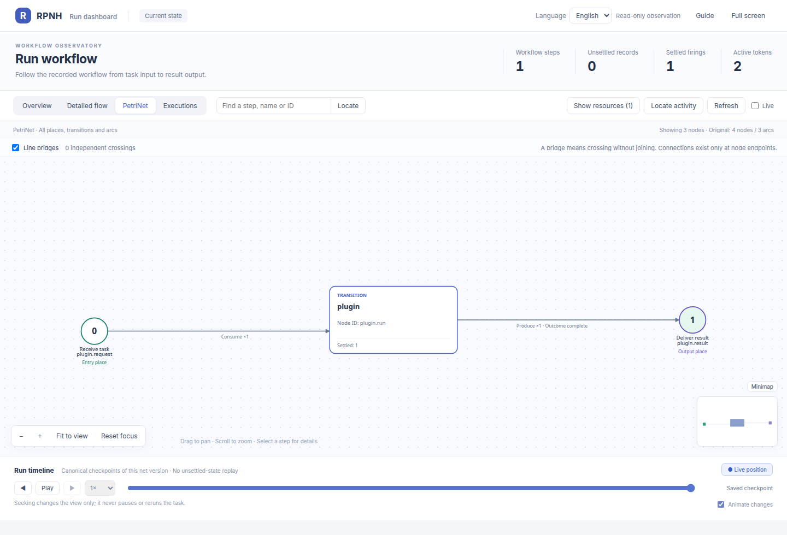

# RPNH Harness

[English](README.md) | 中文

RPNH 是不绑定特定模型服务商的 Agent 执行框架，用于组合语言模型、原生工具与可复用工作流。

持久化的 **Registry** 记录执行与资源历史；类型化的 **PetriNet** 决定工作何时可执行：
已声明的输入与完成结算的输出使后续步骤具备执行条件，也支持并行分支与汇合。
前端和只读 Viewer 查看同一份运行状态，不另建执行或恢复逻辑。

## 可以做什么

- 将 Agent 与已有代码组合成显式工作流。
- 创建独立子任务，各自保留 Registry 和结果。
- 跟踪工作区输入、输出的版本，通过 PetriNet Viewer 查看运行。
- 续接 owner 主动停止的工作，或从指定的已提交 checkpoint 重开，并保留先前历史；
  这不会撤销外部效果。

## 一键安装

需要 **Linux/WSL2、Python 3.11+（含 venv）、Git、curl 和 Bash**。
先[查看安装脚本](scripts/install.sh)，然后执行一条命令：

```bash
bash -c 'set -e; installer=$(mktemp); curl -fsSL https://raw.githubusercontent.com/Deng-0119/RPNH/main/scripts/install.sh -o "$installer"; bash "$installer"; rm -- "$installer"'
```

安装当前公开源码及演示插件到 `~/.local/share/rpnh/{source,venv}`。
目标目录已存在时拒绝安装；不用 sudo，不改系统 Python 或 shell 启动文件。
需要联网，不调用模型。[自定义目录、固定提交与手动安装](docs/guides/installation_ZH.md)。

## 使用案例：两数相加并查看运行

完成默认安装后，执行这个零模型案例；需要本地子进程与 Unix socket 权限：

```bash
cd "$HOME/.local/share/rpnh/source"
. ../venv/bin/activate
RUN_DIR="$(mktemp -d)/add-run"
rpnh plugins --config examples/native_plugin/plugins.json run demo/add \
  --input examples/native_plugin/input.json --run-dir "$RUN_DIR"
rpnh net --run "$RUN_DIR" --view --no-open
```

输入为 `2 + 3`，预期输出包含 `output.value: 5` 和终态证据引用。
最后一条命令打印本地只读 Viewer 地址；保留运行目录即可再次查看。



这是已有的原生工具完成运行截图，不是模型运行，也不是对本次版本的新测试。
[案例说明](examples/native_plugin/README_ZH.md) · [更多工作流](examples/workflow_patterns/README_ZH.md)。

如需对话，先按[模型指南](docs/guides/models_ZH.md)配置自己的 provider 和精确模型，
再运行 `rpnh --frontend basic`；系统不预选 provider。

## 兼容与发布边界

当前源码仍标为 `0.1.0rc3`，但 10 月 30 日发布的
[v0.1.0rc3 wheel 与 DSH 插件](https://github.com/Deng-0119/RPNH/releases/tag/v0.1.0rc3)
**不包含** 11 月 1 日的源码修复；详见[源码与发布包边界](docs/guides/compatibility_ZH.md)。

- **Codex：**默认 0.163.0；0.166.0 是需要显式选择的候选版本。
- **OpenCode：**默认 1.19.4；2.2.5 仅为显式启用的 REST／认证／非持久化事件子集，不是完整原生前端。
- **Stock DSH 插件：**与 DSH 0.2.2-alpha.2 手动配对，不代表通过托管升级验收；
  使用方式见[operator 指南](integrations/dsh/operator/README_ZH.md)。

这些集成只覆盖限定的兼容范围，不代表支持任意版本。

## 更多资料

[文档](docs/index_ZH.md) · [案例](examples/README_ZH.md) ·
[架构](docs/architecture/design_ZH.md) · [参与贡献](CONTRIBUTING_ZH.md)

## 许可证

[MIT](LICENSE)。第三方组件保留各自许可证，见[第三方声明](THIRD_PARTY_NOTICES.md)。
