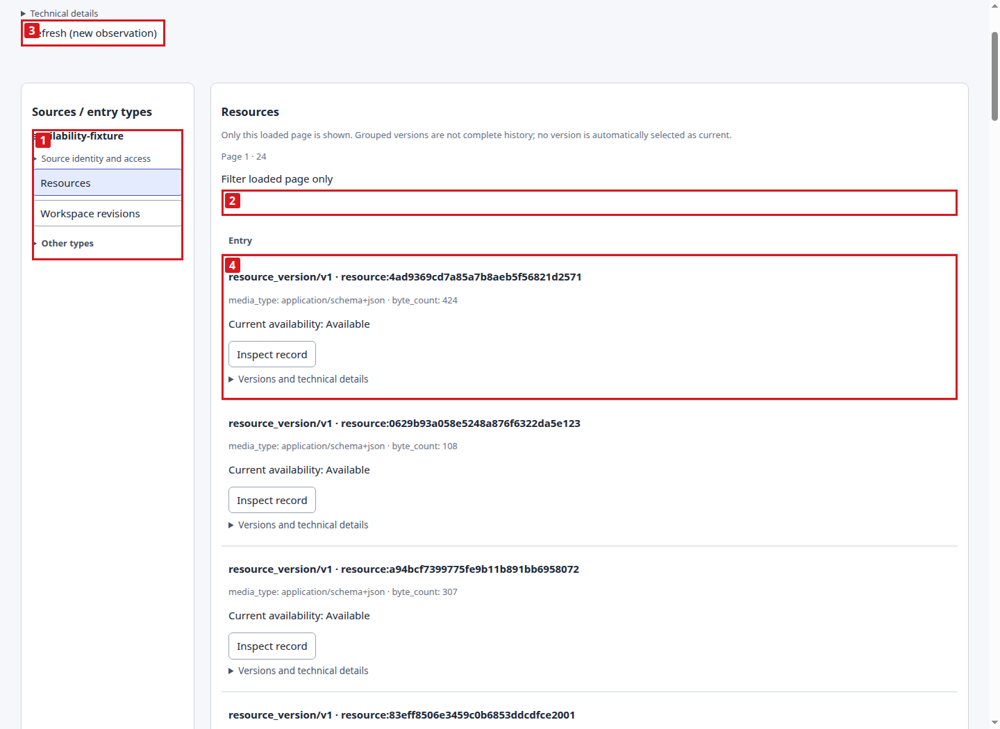
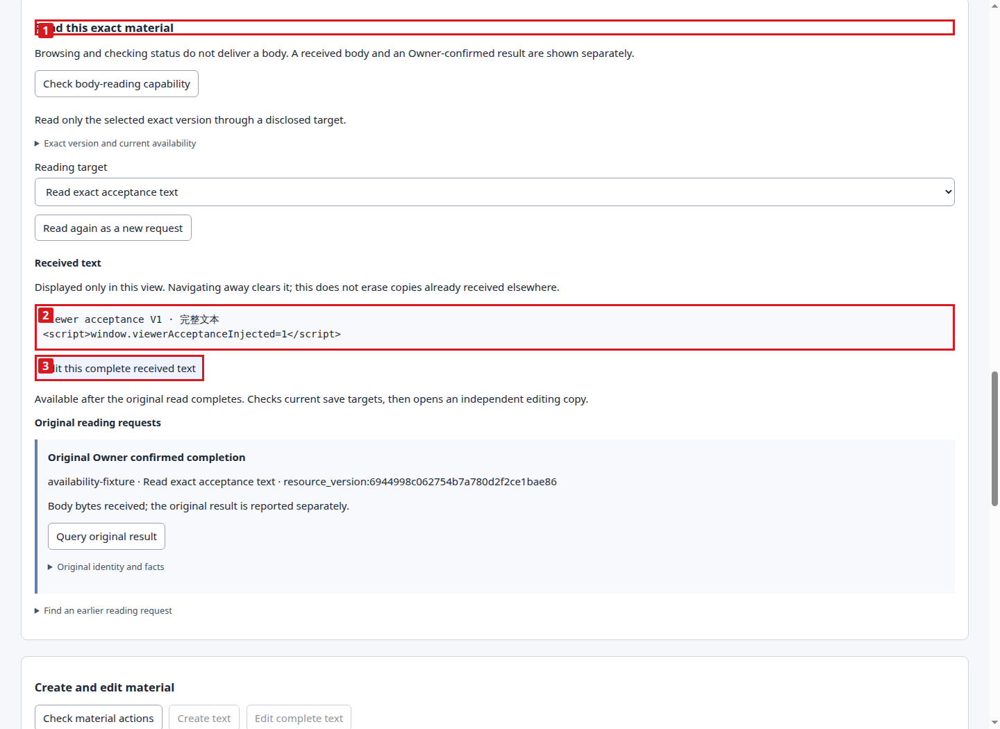
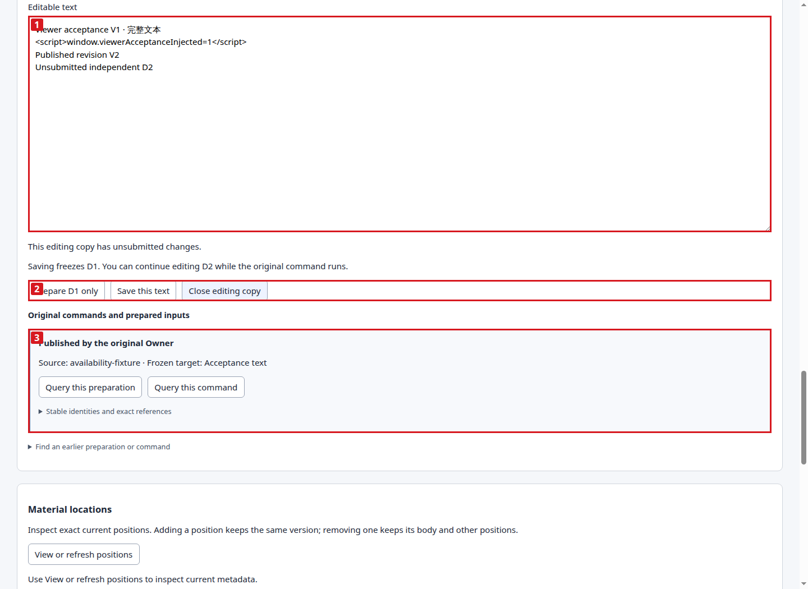
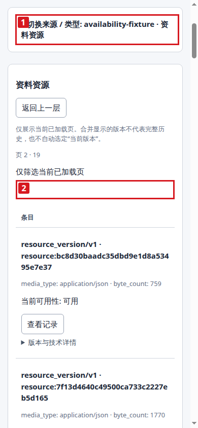

[English](viewer-materials.md) | [中文](viewer-materials_ZH.md)

# Browse and manage Registry materials

Use **Registry** in the Viewer toolbar to find resources, inspect an exact version
and read the actions available for that source. A configured application HOST can
also offer text creation and revision, position changes, version disablement and
limited carrier cleanup. Those actions use the original Owner and Registry/PN
execution path; the browser does not create a second permission or execution system.

## 1. Open the right entry

For an existing local run, open the ordinary Viewer:

```bash
rpnh net --run /absolute/path/to/run --view --no-open
```

Open the printed local address and select **Registry**. The browser is at
`/registry` on the same local listener. An independently authorized read session
can also be opened through [the read-HOST entry](independent-registry-reader.md).

These ordinary entries provide observation. To use managed actions, open the
Viewer URL supplied by the application HOST that has configured them for your
identity and source. A read configuration or a visible button does not grant
management permission. **Material management is not enabled for this source**
means that this entry has not supplied the required capability. Check the chosen
source and ask its operator for the appropriate configured entry.

The screenshots below were captured in a real local Chromium session on
2026-11-17 with synthetic demonstration data. Their source is **851b721**;
red frames and numbers are the original capture annotations. The subsequent
terminal-location checks used **3354e410**. These are separate evidence windows,
not a complete journey rerun on one final package. See
[capture scope and original images](../assets/viewer-materials/20261117/README.md).

## 2. Find a resource and choose its exact version

1. Choose a source and **Resources** in the left navigation. Final-result pointers,
   workspace revisions and other types have separate groups.
2. Use **Filter loaded page only** to narrow the page already on screen. Use
   **Previous page** and **Next page** for other pages.
3. Open **Versions and technical details** or **Browse object versions** when
   you need another version of the same logical object. A version group on one
   page is not the complete history and does not select a current version.
4. Choose **Inspect record** for the exact entry you need. Its declared related
   records can lead to the owning task, producer or result. **Back to previous
   view** returns to the prior observed location; **Refresh (new observation)**
   starts a new read of the source.

[](../assets/viewer-materials/20261117/S01-resources.raw.png)

**1** selects source/type; **2** filters only the loaded page; **3** starts a new
observation; **4** identifies one resource or its on-page version group.

[Exact-record controls](../assets/viewer-materials/20261117/S02-exact-record.annotated.png)
show **1** the selected record, **2** the expandable original fields, and **3**
the close-details button. Seeing an index entry does not establish body access.

## 3. Read the body

An ordinary source may disclose **Preview text**. A source that requires managed
delivery instead uses **Read this exact material**:

1. Select the exact resource, then choose **Check body-reading capability**.
2. Select an offered **Reading target** and choose **Read this exact version**.
3. Read the returned text and its original request card. **Body bytes received**
   and **Original Owner confirmed completion** describe separate facts.
4. If the result is unresolved, choose **Query original result**. Use
   **Continue this read** only when the original request explicitly permits it.
   **Read again as a new request** starts another reading request.

[](../assets/viewer-materials/20261117/S04-complete-read.raw.png)

**1** is the explicit reading panel; **2** is the text actually received;
**3** opens an editing copy after a supported complete read has been confirmed.
The script-shaped demonstration string is displayed as text.

Leaving this view clears its displayed body. It does not erase copies already
received elsewhere. Disabled or unconfirmed availability keeps body access
closed while permitted structural history may remain visible.

## 4. Create text or save a revision

In **Create and edit material**, choose **Check material actions**. Use
**Create text** for a disclosed new-text target. To revise supported text, choose
**Edit complete text**, or **Edit this complete received text** after the managed
read has completed. The current editor supports the declared RPNH agent-text
document type; arbitrary binary files and partial previews are not editable here.

Select the **Save target**, edit the text, and choose **Save this text**. This
freezes the submitted input as D1. You can continue editing a separate D2 while
the original request proceeds. A receipt for D1 does not overwrite D2.

[](../assets/viewer-materials/20261117/S05-draft-and-result.raw.png)

**1** is the current independent editing copy; **2** contains prepare, save and
close controls; **3** is the original input/command card. Here the original
request was published, while D2 still contains an unsubmitted change.

| What the card says | What to do |
|---|---|
| **Input prepared, not submitted** | **Prepare D1 only** retained an input; choose **Submit prepared D1** to request publication. |
| **Registered**, **Admitted** or **Products prepared** | The original request exists, but publication has not been confirmed. Query that command. |
| **Published by the original Owner** | Publication is confirmed for the exact original request. Refresh the resource/position observation to inspect the saved version. |
| **Preparation unknown** or **Result unknown** | Query the same original preparation or command ID. An uncertain response is not evidence of failure or completion. |
| **Original Owner recovery required** | Keep the original identity and use the application's existing recovery procedure. |
| **Not published; original rejection recorded** | Read the recorded reason before forming a new edit intention. |

**Close editing copy** can discard unsubmitted local changes after confirmation.
It does not cancel a submitted command. If the HOST offers **Abandon this prepared
input**, that separate confirmed action closes future submission of that exact
prepared input while retaining its history. Earlier requests can be found under
**Find an earlier preparation or command** using their original IDs.

## 5. Inspect and change positions

A position is a named Registry reference to a resource version, not a filesystem
folder. [The position-history capture](../assets/viewer-materials/20261117/S03-position-history.annotated.png)
marks **1** one exact position's history, **2** return to observed positions,
**3** refresh, and **4** an original binding and its availability. Position history
and an object's version history are different views.

In **Material locations**, choose **View or refresh positions**. If your HOST
offers an action:

- **Add to this position** adds the selected exact version to a disclosed empty
  destination. Review the confirmation; the body is not copied.
- **Remove this position** removes only that exact binding after confirmation.
  The resource body and other positions remain.

Read **Original position requests** for the result, then refresh positions for
a new observation. An already displayed list can still reflect the pre-submit
state. If a request is unresolved, query its original ID before another action.
Management of a terminal task requires the HOST's separate terminal opt-in;
completion of the business task does not enable it automatically.

The retained **3354e410** terminal check completed bind and unbind through the
original Owner and real HTTP/browser flow. A refreshed catalog and Registry
established the removed binding; the earlier screenshot list alone did not.

## 6. Disable a version or clean one carrier

Choose the action according to the intended effect:

| Action | Effect after the original result confirms it | What remains |
|---|---|---|
| Remove a position | Removes one exact binding. | Body, other positions and history. |
| Disable exact versions | Closes future body access under the original availability policy for the confirmed versions. | Positions, structural history and retained physical carriers. |
| Clean up one exact carrier | Removes one authorized immutable carrier, or confirms that it was already absent. | Other carriers, versions, positions and out-of-scope archives/paths. |

For disablement, choose **Check disable actions**, **Prepare disable plan**,
review the exact versions and displayed conditions, then **Confirm this disable
plan**. Preparation alone does not disable anything. Current use or a changed
target can prevent the original command from publishing.

**Material carriers** offers **View carrier relationships** and **Observe carrier
states** when supported. Their coverage is the disclosed original producer and
workspace lineage, not an inventory of every copy. Inspection does not deliver
the body or authorize cleanup.

Before authorizing cleanup, confirm that the selected exact version is disabled
and that the HOST discloses an allowed one-carrier target. Disablement itself
does not authorize cleanup.

For cleanup, choose **Check cleanup actions** and review its one-carrier scope.
Confirm **Authorize this carrier** first. Once that original authorization is
published and an execution target is available, separately confirm **Execute
this authorized cleanup**. Read the original execution result for `removed` or
`already_absent`. A rejected or uncertain final receipt does not by itself prove
the physical state, because physical work can precede final publication.

The retained screenshots show
[disablement not configured](../assets/viewer-materials/20261117/S06-disable.annotated.png),
[carrier inspection unavailable](../assets/viewer-materials/20261117/S07-carriers.annotated.png),
and [cleanup unavailable](../assets/viewer-materials/20261117/S08-cleanup.annotated.png).
They illustrate those closed states; they do not demonstrate successful deletion
or all disable/cleanup paths.

## 7. Narrow screens and common messages

[](../assets/viewer-materials/20261117/S09-narrow-navigation.raw.png)

On a narrow screen, **1** opens source/type navigation and **2** filters the loaded
page. The language selector changes labels without changing the selected identity.

| Message or symptom | Next action |
|---|---|
| No permitted target / management not configured | Check the exact source and the capabilities supplied by its application HOST. |
| Access changed or session expired | Refresh the catalog; if needed, reopen an authorized read session. The page cannot renew authority. |
| Source changed / stale observation | Refresh before selecting a new target. Preserve unresolved command IDs. |
| Body is disabled, unknown, unsupported or not UTF-8 | Follow the displayed capability/reason; use a suitable authorized reader for supported content. |
| A result is unknown or a request is still active | Query that original ID. Closing a panel or refreshing is not cancellation. |

For graph navigation and checkpoints, return to the [Viewer guide](viewer.md).
For this guide's image versions, observed outcomes and raw captures, see
[capture scope](../assets/viewer-materials/20261117/README.md).
