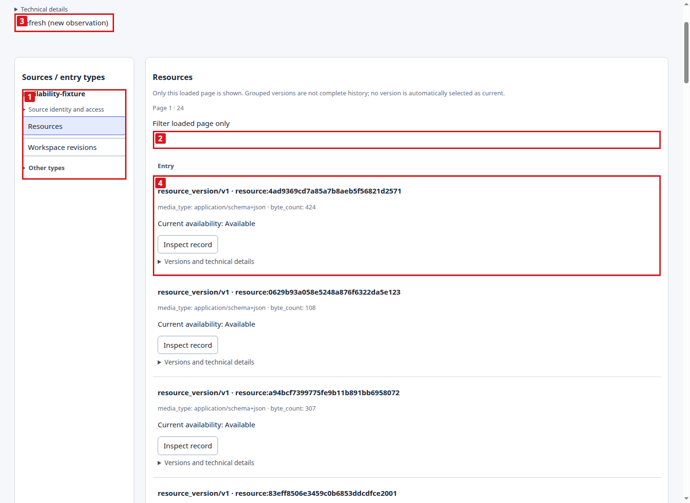
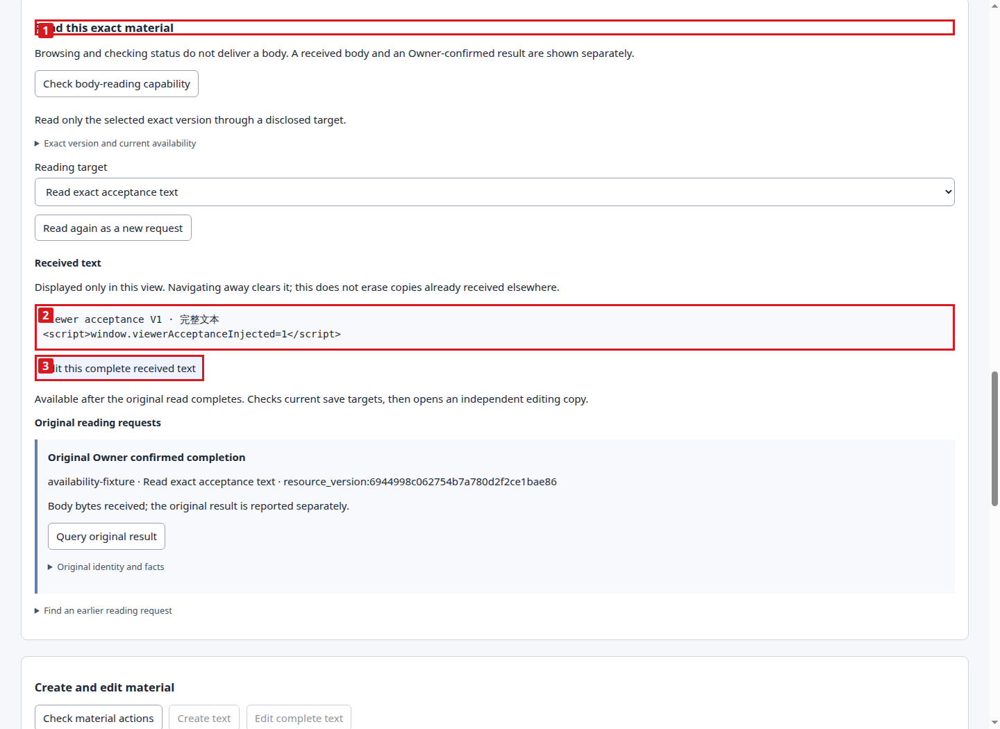
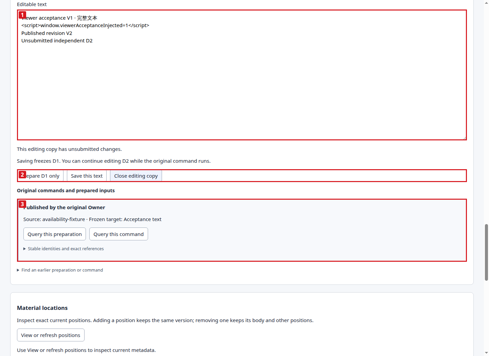
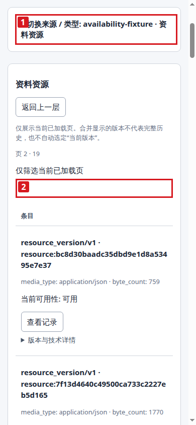

[English](viewer-materials.md) | [中文](viewer-materials_ZH.md)

# 浏览与管理 Registry 资料

在 Viewer 工具栏选择 **Registry**，可以查找资料、查看精确版本，以及查询该来源开放的操作。
经过配置的应用 HOST 还可提供文本创建与修订、位置变更、版本停用和有限载体清理。
这些操作沿用原 Owner 与 Registry/PN 执行路径；浏览器不会另建权限或执行系统。

## 1. 打开相应入口

已有本地 run 时，可打开普通 Viewer：

```bash
rpnh net --run /absolute/path/to/run --view --no-open
```

打开命令输出的本机地址，选择 **Registry**。资料浏览器位于同一本机监听地址的
`/registry`。独立授权的读取会话也可通过[read-HOST 入口](independent-registry-reader_ZH.md)打开。

这些普通入口提供观察能力。使用管理操作时，应打开应用 HOST 为当前身份和来源配置后提供的
Viewer 地址。读取配置或一个可见按钮不会授予管理权限。**此来源未开放资料管理** 表示该入口
没有提供所需能力；请先核对所选来源，再向其操作者取得相应的已配置入口。

下图来自 2026-11-17 的真实本机 Chromium 会话，使用合成演示资料，源码版本为 **851b721**；
红框和编号均为原捕获时的标注。后续终态位置检查使用 **3354e410**，两者是不同证据窗口，
不能合称在同一最终包上重跑的完整旅程。具体范围与原图见
[截图来源说明](../assets/viewer-materials/20261117/README_ZH.md)。

## 2. 找到资料并选择精确版本

1. 在左侧选择来源和 **资料资源**。最终成果指针、工作区修订和其它类型分别分组。
2. 用 **仅筛选当前已加载页** 缩小当前页范围；需要其它页时使用 **上一页**、**下一页**。
3. 需要同一逻辑对象的其它版本时，打开 **版本与技术详情** 或 **查看该对象的跨页版本**。
   一页中的版本分组不代表完整历史，也不会自动选定当前版本。
4. 对所需精确条目选择 **查看记录**。其中已声明的相关记录可以指向所属任务、生产者或成果。
   **返回上一层** 回到此前观察的位置；**刷新（新观察）** 重新读取来源。

[](../assets/viewer-materials/20261117/S01-resources.raw.png)

**1** 选择来源与类型；**2** 只筛选已加载页；**3** 开始新观察；**4** 是一份资料或其本页版本分组。

[精确记录截图](../assets/viewer-materials/20261117/S02-exact-record.annotated.png)中的
**1** 是所选记录，**2** 展开原精确字段，**3** 关闭详情。索引可见不代表正文可读。

## 3. 读取正文

普通来源可能披露 **查看正文**。要求受治理交付的来源则使用 **读取此精确版本正文**：

1. 选中精确资料后，点击 **查看正文读取能力**。
2. 选择提供的 **读取目标**，点击 **读取此精确版本**。
3. 分别查看收到的文本和原请求卡。**已收到正文** 与 **原 Owner 已确认完成** 是两个不同事实。
4. 结果未确认时，选择 **回查原结果**。只有原请求明确允许时才使用 **继续本次读取**；
   **发起一次新的正文读取** 会新建一次读取请求。

[](../assets/viewer-materials/20261117/S04-complete-read.raw.png)

**1** 是显式读取面板；**2** 是实际收到的正文；**3** 在受支持的完整读取被确认后打开编辑副本。
图中形似脚本的演示字符串按普通文本展示。

离开该视图会清空其中展示的正文，不会删除其它地方已经收到的副本。版本已停用或当前可用性
无法确认时，正文入口保持关闭；获准披露的结构历史仍可能可见。

## 4. 创建文本或保存修订

在 **创建与编辑资料** 中，点击 **查看资料操作能力**。对披露的新建目标使用 **新建文本**。
修订受支持的文本时，使用 **编辑完整文本**；受治理读取完成后，也可选择 **编辑本次完整文本**。
当前编辑器支持声明的 RPNH agent-text 资料类型，不在这里编辑任意二进制文件或不完整预览。

选择 **保存目标**，编辑文本，再点击 **保存当前文本**。这会将提交输入冻结为 D1。
原请求执行期间，可以继续编辑独立的 D2；D1 的回执不会覆盖 D2。

[](../assets/viewer-materials/20261117/S05-draft-and-result.raw.png)

**1** 是当前独立编辑副本；**2** 为准备、保存和关闭控件；**3** 为原输入／命令卡。
图中原请求已经发布，D2 仍有尚未提交的修改。

| 卡片状态 | 接下来做什么 |
|---|---|
| **输入已准备，尚未提交** | **仅准备 D1** 只保留输入；需要请求发布时，选择 **提交已准备的 D1**。 |
| **已登记**、**已准入** 或 **产物已准备** | 原请求已存在，正式发布尚未确认；回查这条原命令。 |
| **原 Owner 已正式发布** | 该精确原请求的发布已经确认；刷新资料／位置观察，查看保存的版本。 |
| **准备结果未知** 或 **结果未知** | 用原输入准备或命令 ID 回查；响应不确定不代表失败，也不代表完成。 |
| **需要原 Owner 恢复** | 保留原标识，按应用已有恢复流程处理。 |
| **未发布，原拒绝结果已登记** | 先读取登记的原因，再决定新的编辑意图。 |

**关闭编辑副本** 可在确认后放弃尚未提交的本地修改，但不会取消已提交的命令。
如果 HOST 提供 **放弃这份已准备输入**，这是另一项需要确认的操作：它关闭该精确输入的
后续提交，仍保留历史。离开面板后，可在 **查找此前的输入准备或命令** 中用原 ID 回查。

## 5. 查看和变更位置

位置是 Registry 中指向资料版本的命名引用，不是文件系统文件夹。
[位置历史截图](../assets/viewer-materials/20261117/S03-position-history.annotated.png)标出
**1** 一个精确位置的历史、**2** 返回原位置观察、**3** 刷新、**4** 原绑定及其可用性。
位置历史与某个对象的版本历史是两种视图。

在 **资料位置** 中选择 **查看或刷新位置**。HOST 披露对应操作时：

- **添加到此位置** 将选中的精确版本添加到披露的空位置，需复核确认；不会复制正文。
- **移除此位置** 在确认后仅移除该精确绑定；资料正文及其它位置仍保留。

在 **原位置请求** 中读取结果，然后刷新位置取得新观察。此前显示的列表仍可能是提交前的状态。
请求结果未确认时，先用其原 ID 回查，再进行其它操作。终态任务的资料管理需要 HOST 单独开启
对应能力；业务任务完成不会自动开启管理。

保留的 **3354e410** 终态检查通过原 Owner 与真实 HTTP／浏览器流程完成了绑定及解绑。
解绑结果由刷新后的目录与 Registry 确认，不能只凭此前截图中的列表判定。

## 6. 停用版本或清理单个载体

按希望产生的效果选择操作：

| 操作 | 原结果确认后的效果 | 仍保留什么 |
|---|---|---|
| 移除一个位置 | 移除一个精确绑定。 | 正文、其它位置和历史。 |
| 停用精确版本 | 按原可用性规则关闭确认版本的后续正文访问。 | 位置、结构历史和保留的物理载体。 |
| 清理一个精确载体 | 删除一个获准的不可变载体，或确认它此前已不存在。 | 其它载体、版本、位置，以及范围外的归档和路径。 |

停用时，依次选择 **查看停用操作**、**准备停用计划**，复核精确版本和显示条件后，再
**确认此停用计划**。准备计划本身不会停用版本；仍有交付在使用或目标变化等情况可能使原命令无法发布。

**资料载体** 在支持时提供 **查看载体关系** 和 **观察载体状态**。其覆盖范围是披露的原生产者
与工作区来源链，不代表所有副本的完整清单。查看不会交付正文，也不授权清理。

清理授权前，先确认所选精确版本已停用，并由 HOST 披露允许的单载体目标。
停用本身不授予清理权限。

清理时，先选择 **查看清理操作** 并复核单载体范围。第一次确认 **授权此载体**。
原授权正式发布且提供执行目标后，才单独再次确认 **执行此原授权清理**。
用原执行结果中的 `removed` 或 `already_absent` 判断该载体的结果。最终回执被拒绝或未确认，
本身不能证明物理状态，因为物理操作可能早于最终发布。

保留的截图分别展示
[停用管理未配置](../assets/viewer-materials/20261117/S06-disable.annotated.png)、
[载体查看不可用](../assets/viewer-materials/20261117/S07-carriers.annotated.png)、
[清理不可用](../assets/viewer-materials/20261117/S08-cleanup.annotated.png)。
这些图说明的是关闭状态，不能作为删除成功或全部停用／清理路径通过的证据。

## 7. 窄屏和常见提示

[](../assets/viewer-materials/20261117/S09-narrow-navigation.raw.png)

窄屏下，**1** 展开来源／类型导航，**2** 筛选已加载页。语言选择器切换标签，不改变所选身份。

| 提示或现象 | 接下来做什么 |
|---|---|
| 没有允许目标／未配置管理 | 核对精确来源，以及应用 HOST 为该来源提供的能力。 |
| 访问变化或读取会话过期 | 刷新来源目录；必要时重新打开已授权读取会话。页面不能续订权限。 |
| 来源变化／旧观察已过期 | 选择新目标前刷新；保留未决命令 ID。 |
| 正文已停用、可用性未知、不支持或非 UTF-8 | 按显示的能力与原因处理；需要时使用适合该内容的已授权 reader。 |
| 结果未知或原请求仍在执行 | 回查原 ID。关闭面板或刷新不等于取消命令。 |

图导航和 checkpoint 使用见 [Viewer 指南](viewer_ZH.md)。图像版本、实际观察到的结果和
原始截图见[截图来源说明](../assets/viewer-materials/20261117/README_ZH.md)。
