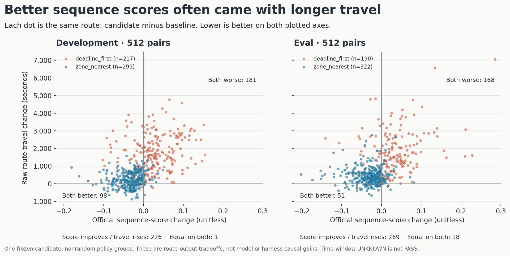
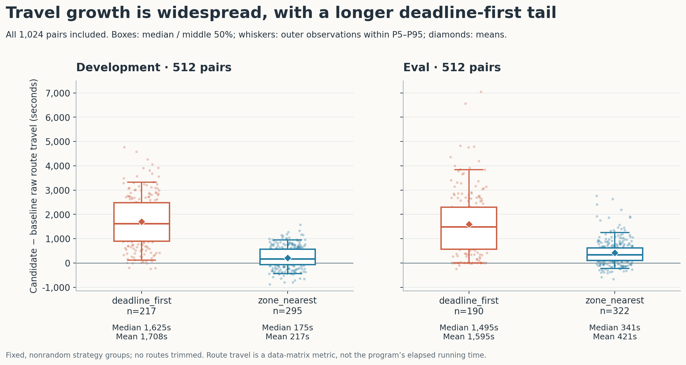
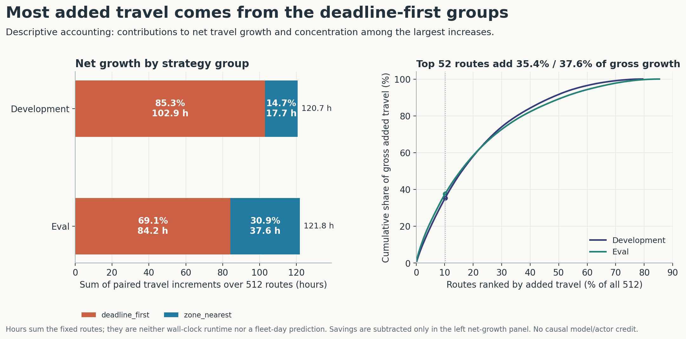

English | [中文](README_ZH.md) | [Results index](../README.md)

# Controlled multi-user collaboration: 12 October 2026

Three independent controlled **simulated Registry identities/sessions**, two real model conditions, and a same-user model switch completed a native proposal → review → explicit coordination → protected-branch merge → adoption → business execution → independent evaluation chain. The official sequence score improved on both fixed 512-route sets; mean travel time increased. This is one measured end-to-end capability case, not a comparison of models or a causal estimate of collaboration benefit.

[Collaboration diagrams, business panoramas and local structure Viewer](../../../examples/user_collaboration/README.md) · [Exact aggregate values](results.json) · [Source and figure identities](SOURCES.json) · [Collaboration API](../../guides/user-collaboration.md)

## Conditions and actual work

A, B and C were separate controlled Registry identities, not three human participants or external accounts. A and C used `gpt-5.6-terra` (medium); B first used `deepseek-v4-pro` (effort undeclared), then Terra in the **same B session and cumulative budget**. Terra used native Codex app-server 0.162.0; DeepSeek used the existing external-provider input port. These are recorded conditions, not required versions for readers.

The retained runtime was source `c26cf943eb9d32d14646fe411da6332ace9a3c24`, installed wheel SHA-256 `66e55af8ff6e7a8156441e8a6f622628002d62cba7bb28d2259015ab501fbad4`, plus the eight runtime overlays identified in [SOURCES.json](SOURCES.json). It was not an unmodified wheel run. A single trusted HOST coordinator preserved original identity, access and Registry accounting. Authoring had bounded inputs; scorer labels were reserved for the separate evaluators.

There were **22 logical calls and 22 provider-attempt specifications**: A 15, B 4, C 3; no post-limit excess. They include failed authoring attempts. Upstream HTTP-attempt counts are unknown. The configured ceilings were 72 overall, 24 per actor across profiles and 12 per node, with tighter task limits retained.

| Stage | Recorded outcome |
|---|---|
| A1–A4 | Tool-order, history-size or invalid-PN failures retained; A1 made no model call |
| A5 | Valid proposal: batches 0–10 use existing `deadline_first` |
| B1 | Independent proposal: batches 11–17 use existing `zone_nearest` |
| C1 | Independent proposal: batches 12–23 use `zone_nearest` |
| B2 | Same B switched models; withdrawn batch 11 failed review and was not adopted |
| C2 | Explicit peer coordination retained B's batch 11 and C's batches 18–23 |
| M2 | Original two-parent merge of B1/C2; owner selected the already assembled incoming C2; protected branch advanced and result was actually adopted |

B1/C1 overlapped on six batches. The common 74-operation business budget produced a coupled-contract merge conflict. C2 assembled the strategy union before the merge; owner selection resolved it. This was **explicit coordination followed by native merge/adoption**, not automatic conflict-free fusion. Copying B's change into C2 does not create a second independent contribution. A's 11 changes remained. Only existing strategy configurations changed; graph topology and available algorithms did not.

## Measured results

Each of development and eval had a fixed 512-route population, baseline and adopted candidate. Four native business arms completed, each with 74 firings, 98 products and 25 entry resources. Two separate native evaluator runs used the same pinned original scorer, not two independently implemented scoring algorithms. All four arms had 512 finite scores, 512 structurally valid sequences, capacity PASS for 512 routes, and zero recorded scorer errors.

| Metric | Development baseline → candidate | Eval baseline → candidate |
|---|---:|---:|
| Official sequence score, lower is better | 0.109175 → 0.100959 (−7.525%) | 0.103382 → 0.094723 (−8.376%) |
| Mean travel, seconds | 10,998.19 → 11,846.74 (+7.715%) | 10,173.91 → 11,030.64 (+8.421%) |
| Time-window FAIL / UNKNOWN | 182 / 330 → 75 / 437 | 161 / 351 → 79 / 433 |
| Routes with lower / equal / higher score | 324 / 1 / 187 | 320 / 18 / 174 |

`VALID` means permutation/structural validity. Time-window UNKNOWN is not PASS. In the paired records, 126 development and 99 eval routes moved FAIL→UNKNOWN, while 19 and 17 moved UNKNOWN→FAIL. Checked/unknown package counts were unchanged within each pair. Thus fewer observed violations did not establish full constraint satisfaction. Travel increased on 407/512 development and 437/512 eval routes.

The nonrandom `deadline_first` groups worsened sequence score on average (+0.027285 development / +0.030937 eval); `zone_nearest` groups improved it (−0.034330 / −0.032023). Both groups increased mean travel. This descriptive stratification, overlapping edits and different prompts/transports/attempt counts cannot assign independent causal credit to an actor, model or model switch.

## What the harness evidence establishes

The business comparison is **deterministic nearest-neighbor versus a model-authored configuration of other existing deterministic planners**. Neither business arm calls an LLM per route. Model usage belongs to proposal authoring, revision and failed attempts. There is no matched experiment holding the model, task, input, tool capabilities and resources fixed while comparing RPNH with a mature alternative harness.

| Capability observed in this case | Concrete evidence |
|---|---|
| Identity and budget continuity | B1/B2 use the same actor/session; profile switching does not reset the 3 + 1 calls; failed attempts remain counted |
| Separate tool completion from valid work | A3/A4 complete tool/TEXT handling but fail proposal validation |
| Check actual actions against a model's description | B2 says it retains its contribution; its actual edit removes batch 11, and the proposal is not adopted |
| Identify adopted content and its origin | M2 links B1/C2, the common A5 ancestor, owner selection and the actual adoption receipt; matching values in unadopted B2 do not establish adoption |

These records support specific failure diagnosis and source checks. They have not measured whether another agent investigates more accurately or quickly, uses fewer tokens, or repeats less work than with an alternative harness. Observed traceability is a concrete capability; comparative engineering benefit remains untested.

## Where the route tradeoffs occur

The following figures use all **1,024 original route pairs**, with no rescoring, trimming or new samples. `raw_travel_seconds` sums route travel-matrix costs; it is not program walltime, service time or a fleet-day forecast. [Machine-readable secondary analysis](ANALYSIS.json) preserves denominators, exact values and missing-field coverage.

**Paired outcomes.** Candidate improves both score and travel on 98/512 development routes and 51/512 eval routes; baseline is better on both axes on 181 and 168. Score improves while travel grows on 226 and 269. The remaining cases are six per domain with worse score but shorter travel, and 1/18 exact ties. Across domain means, score improves and travel worsens, so neither configuration dominates on these two axes. These route points are not alternative system operating points or evidence of a global Pareto optimum; time-window UNKNOWN remains an additional constraint limitation.

**Spread and tail.** Median paired travel growth is +574.45 seconds (development) and +524.15 (eval); P95 is +2,994.39 / +2,855.34 seconds. Travel grows on 407/512 and 437/512 routes, across 23/24 and 24/24 batches. It is widespread, with a longer `deadline_first` tail. The boxes show the middle 50% and median; whiskers reach the most extreme observations within the P5–P95 thresholds. Exact tabulated quantiles use linear interpolation at `(n−1)p`. Paired-delta medians differ from subtracting the two arm medians.

**Accounting by group.** `deadline_first` accounts for 85.29% of development and 69.10% of eval **net** travel growth, although it covers only 217/512 and 190/512 routes. The 52 largest increases account for 35.37% / 37.62% of **gross positive** growth (development / eval); savings are excluded from that denominator. The left panel subtracts savings; the right does not. Summed hours describe the fixed routes, not computer runtime. Strategy groups were not randomized, so these are descriptive contributions, not actor/model credit or a policy causal estimate.

## Registered model usage

All 22 registered response envelopes have input/output fields. They cover the retained authoring responses, including failed attempts; they do not establish complete HTTP retry or billing coverage.

| Recorded transport / model / effort | Responses | Input tokens | Output tokens | Other recorded fields |
|---|---:|---:|---:|---|
| Native app-server / gpt-5.6-terra / medium | 19 | 661,047 | 7,682 | Cached field present in 19/19, all 0; provider total absent |
| ExternalProviderInputPort / deepseek-v4-pro / undeclared | 3 | 63,694 | 3,836 | Provider total 67,530 in 3/3; cached field absent |

Terra's input-plus-output arithmetic sum is 668,729, not a retained provider-total field. Reasoning-token detail and cost fields are absent for both models; absence is UNKNOWN, not zero. Tokenizers, provider accounting and inclusion of cache/reasoning were not established as equivalent, so no cross-model total or currency estimate is offered. Repeated input context is counted each turn. The 13 Terra responses in failed stages A2/A3/A4 account for input 528,958 and output 5,250; this disposition is not a measured avoidable-waste estimate. B2 is also retained rather than silently excluded.

The 22 envelopes contain no usable request durations. The safe evidence has only selected coarse HOST-command walltimes, without a complete successful timeline, CPU measurements or additive phase spans. Registry timestamps, logical order and timing fields declared in a schema are not measured operation durations. Shares for model waiting, tool IO, publication/settlement, scheduling and scoring remain unknown. Different owner histories and adaptations also prevent a fair speed comparison. The closing wheel-plus-overlay identity does not independently certify identical full-stack bytes in every earlier execution window.

## Scope, reuse and limitations

- The fixed evaluation population was retained. Its largest original same-station batch was split deterministically into adjacent halves to use 24 batches without changing route membership, order or the 512 denominator.
- The available evaluation corpus had 3,052 routes, versus 3,072 in the dataset description. The 20-route discrepancy remains unresolved; no missing data were fabricated.
- Model attempts were not all clean successes. B2's conflicting guidance and C2's later coordination are observed conditions, not a controlled prompt or model comparison. No generic superiority, new routing algorithm or arbitrary-scale collaboration claim follows.
- The published artifacts support offline result reading and interactive inspection of **static declaration structure**. The two PNGs are original runtime captures. The full experiment depended on an existing local installation, admitted dataset, private model profiles and retained Registry state. This folder is not a standalone fresh-trial experiment or a public interactive replay of that state.
- No model, business experiment or scoring run was repeated to publish this report. Later product changes do not retroactively change the tested source identities.

## References and data terms

The [Amazon Last Mile Routing Research Challenge dataset record](https://registry.opendata.aws/amazon-last-mile-challenges/) describes the data and its **CC BY-NC 4.0** terms; the RPNH software license does not replace those data terms. Raw routes, package labels, travel matrices, credentials and private Registry/transcript material are not bundled here. Dataset methodology: [Merchán et al., Transportation Science, DOI 10.1287/trsc.2022.1173](https://pubsonline.informs.org/doi/10.1287/trsc.2022.1173).

Scoring used [MIT-CAVE/rc-cli `scoring/score.py` at `fdafa50e8b8a18d4cbff112ec432011952b92c7d`](https://github.com/MIT-CAVE/rc-cli/blob/fdafa50e8b8a18d4cbff112ec432011952b92c7d/scoring/score.py), SHA-256 `4ab51620391b3b5d131720518d2ce4c346f0eedb3d68afcf1ae9174b9e6b1540`. Its [scoring guide](https://github.com/MIT-CAVE/rc-cli/blob/fdafa50e8b8a18d4cbff112ec432011952b92c7d/scoring/README.md) defines the route score and mean; its [MIT license](https://github.com/MIT-CAVE/rc-cli/blob/fdafa50e8b8a18d4cbff112ec432011952b92c7d/license) is separate from the dataset license.
