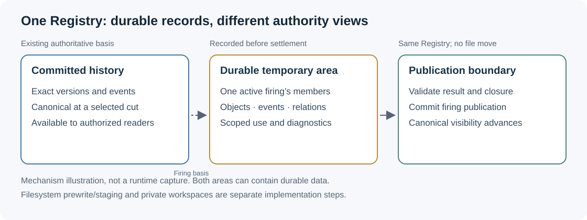
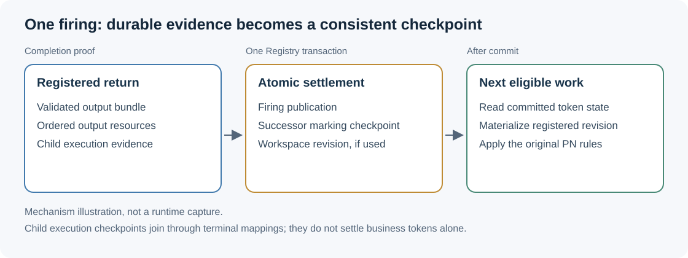
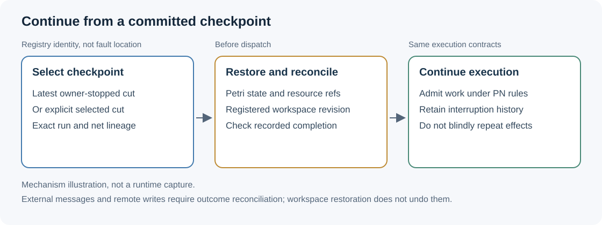

English | [中文](technical-report_ZH.md) | [Documentation](index.md)

# RPNH Technical Report

## Executable processes for Agents and programs

**Updated:** 2026-10-16. **Implementation snapshot:**
[`6cec63ff5b7a0039611713961d00941767edaaf8`][snapshot].
Historical tests retain their own source identities in [§10](#10-historical-results-and-their-limits).
The dated native examples below retain their own execution windows; the earlier report snapshot and historical model/benchmark results remain separate.

## Abstract

Agent applications need to coordinate work, retain the products of each step and
recover without confusing a plausible answer with a completed process. RPNH
makes those responsibilities explicit: typed Petri nets govern eligibility,
trusted HOST bindings supply execution, and a durable Registry records products,
settlement and checkpoints. This report follows a small runnable example, then
explains the execution and observation contracts it exercises. The evidence
combines scripted demonstrations, deterministic tools and separately identified
historical model-backed evaluations. It supports a concrete execution design;
it does not establish comparative quality, speed or cost gains.

## A worked example before the contracts

Consider a review that needs both a facts check and a risk check before a final
answer. In the checked-in `parallel` scenario, `prepare` registers a shared brief,
`facts` and `risks` consume their declared inputs, and `join` requires both branch
products. The declared maximum is two parallel nodes. These dependencies are
part of the [scenario definition][parallel-scenario], rather than a request for
an Agent to remember the order.

**Example figure A.** The official Viewer's existing Overview of the completed
scripted example. The four readable Agent nodes show the review structure;
Overview omits Petri-net places and arcs. The [paired PetriNet view and reproduction
instructions](../examples/workflow_patterns/README.md#parallel-fan-out-and-join)
show the lower-level representation. This retained image is not a new execution
of the report snapshot, and its topology alone does not prove completion or
simultaneous wall-clock execution.

The [runner][parallel-runner] accepts the example only when the stop reason is
terminal, a terminal-evidence reference exists, and the registered output equals
`Parallel workflow complete.` The fixture supplies prescribed text. It tests the
handoff and settlement protocol, not whether a language model can perform a
useful facts or risk review. The [dated public validation record][parallel-validation]
reports four transitions, nine places, 26 arcs and zero provider calls for this
scenario; it does not pin an exact tested commit, so it is historical example
evidence rather than validation of the current source.

After [installing the selected source](guides/installation.md), follow the
[workflow gallery](../examples/workflow_patterns/README.md) to create a fresh run
and open its read-only Viewer. No live profile is selected by default; supported
local process and IPC permissions are still required. A real model route must
be supplied separately and explicitly.

Two companion examples show why the same structure is useful beyond canned
review text. The [hybrid summary](../examples/hybrid_summary/README.md) places a
native calculation between two Agent nodes. The
[atomic-tool pipeline](../examples/tool_pipeline/README.md) separates usage and
tariff preparation, billing and independent validation into ten tool transitions.
Its [historical native result](results/tool-pipeline-20261008/README.md) preserves
the input, source and scorer for the reported 2.000 kWh / 1.70 CNY result. That
specific fixture establishes a calculation and evidence path, not a general
business-task success rate.

## Agent task networks and read-only projections

Choose by modeled object: agent workflows describe task responsibilities and handoffs; domain algorithms and business systems are tools or external environments. ERP, 3-DOF, JB, HarnessAudit, AutomationBench, SlopCodeBench and RRSI remain genuine agent/role workflows. RRSI custom registered-host role PNs can have genuine agent bindings without using stock AgentLoop. Pure-tool pipelines, native-input gates, author principals and annotations do not become agents merely through Registry lineage.

The current collaboration entry is [copy, co-create and reuse one agent project](../examples/project_collaboration/README.md). A complete project includes definitions, inputs, environment requirements, the original task, verifier, provenance and licenses. Two controlled contributors resolve real conflicts into a two-parent revision M. Before business execution, the source adopts M → a new successor with base content → a new successor with M content, then downloads exact original M for an independently authorized receiver with fresh identities. Source and receiver each run the original multi-source merge task through two provider-backed stock implementer/reviewer AgentLoop roles; the receiver package contains no source business answers. The [operator guide](guides/project-entry.md) covers import, review, acceptance, adoption, download and execution.

The bounded **2026-10-13** result is **43 registered requests / 42 responses within a limit of 48**: source 23/22, retaining one original `NOT_SUBMITTED` failure and two completed business firings; receiver 20/20 and two completed business firings. Both path-adapted original assertion sets are **3/3 PASS**, and independent full-instruction review is **ACCEPT_BOTH**. Original `test.sh` is **NOT_RUN** and the grader was **VISIBLE**; these are not blind official-container scores. Independent checks cover all four rows/20 cells and three complete field conflicts; optional status normalization remains a disclosed instruction ambiguity.

The business PN models the two agents' responsibilities and handoff: each Overview has two nodes/one edge, and each full business PN has five nodes/six arcs. Actual file-materialization and workspace-finalization child execution PNs belong to exact business invocations/firings in the same Registry, with separate tokens, firings and checkpoints; AgentLoop logs do not substitute for execution PNs. Supported scope is controlled principals under one trusted OS user, ordinary Module contributions, explicit scoped reads and owner adoption. Pre-business content restoration does not resurrect consumed or terminal tokens or roll back external effects. It does not establish real-human authentication, live-token hot migration or broad graph/open-region/selected-change/assembly exchange.

The actual official Viewer windows are source-05 (101 PNGs) and receiver-04 (28 PNGs), each reporting zero gaps. Inspect the [full source business PN](../examples/project_collaboration/figures/source-petri.png), [source file-materialization execution PN](../examples/project_collaboration/figures/source-execution-materialization.png), [source workspace-finalization execution PN](../examples/project_collaboration/figures/source-execution-finalization.png) and [independent receiver Overview](../examples/project_collaboration/figures/receiver-overview.png). Native Previous Net Segment navigation verified two historical segments, original M's two parents and all three adoption references; the project example provides the full figure set, with [capture provenance](../examples/project_collaboration/figures/provenance.json) identifying the exact source windows. Curated PNGs retain their original captured bytes.

The historical zero-provider protocol entry is [agent-network co-building](../examples/user_collaboration/agent_cobuild/README.md). Two native task-agent roles, `curator.run` and `auditor.run`, use stock `AgentStage`/default `AgentLoop` in an ordinary Module assembled from two stock single-agent declarations, with `curator.result → auditor.request`. Deterministic source programs from two controlled original principals strengthen the curator input-lineage contract and auditor reconciliation contract. The original HOST reviews exact revisions, advances a protected Branch sequentially and enables owner adoption before target execution.

The 12 October UTC fresh03 protocol run retained both contracts in the exact adopted declaration and each role’s two real request recipes. Two main-task firings and two native AgentLoops completed four scripted turns and six tool actions; the independent original-input check verified four source records and 24 minutes (planning 17, review 7). The [actual main-task PN](../examples/user_collaboration/agent_cobuild/figures/petri-panorama.png) has five nodes and six arcs. Registered file-I/O child nets remain separate. All three official Viewer capture windows preserved head/event count 1099 and writer epoch 2; [capture provenance](../examples/user_collaboration/agent_cobuild/figures/provenance.json) identifies their source windows. No external provider or cognitive-quality claim is involved.

In that historical window, source programs, external control actions and target agents remain separate; its single-parent chain does not imply automatic same-base merging. A `local_process` scripted driver computes from actual inputs and tool returns. This demonstrates structure and protocol using registered task agents. It makes no live-model or cognition claim; execution results, artifacts and Viewer evidence are reported on the example page.

That historical example assembles two stock single-agent declarations into an ordinary Module, preserving the existing plain-proposal constraints, Registry gates, adapter and scheduler.

Overview is a read-only agent projection, not a reduced executable PN. `registered_agent_binding` traces to the exact executable binding and agent reference; `declared_llm_executor` establishes a declaration only, not execution; `explicit_host_annotation` is an unconfirmed display annotation and cannot establish agent identity. Roles are grouped through explicit scoped identity, not equal names, model names or user accounts. An edge retains original path provenance and denotes a structural path to the next agent, not observed firing order or proof that a guard passes or an all-input join is satisfied. The full PetriNet and owning Registry retain authority, guards and joins, together with the associated loop/turn/action records and tool/product references. Those runtime records do not automatically add PN nodes. Managed children/actions are not additional PN transitions; independent child Registries remain independent.

Static declarations and runtime records are identified separately. An empty overview alone does not disprove a genuine agent workflow in source; declared or registered identity does not prove execution of this task.

The ERP / AutomationBench / HarnessAudit Office / SlopCodeBench static exports contain 1 / 1 / 4 / 1 declared roles. Identity export corrections preserve the original frames and images; they do not rerun or recertify those benchmarks.

## Research context and reading route

Petri nets provide a long-established language for concurrency, synchronization
and state-based analysis; Murata's review also explains the trade-off between
model expressiveness and analysis complexity [1]. RPNH applies typed net and
Registry contracts around Agent and program execution. The ReAct work studies
interleaving language-model reasoning and actions [2]. Such Agent behavior and
RPNH's execution accounting address different levels of an application; neither
citation is evidence of a head-to-head comparison.

Read [§2](#2-eligibility-comes-from-actual-tokens-and-claims) and
[§3](#3-settlement-connects-computation-to-durable-state) for the worked example's
eligibility and result rules, [§4](#4-revise-definitions-before-explicitly-adopting-them)
for controlled changes, and [§10](#10-historical-results-and-their-limits) for
measured outcomes and failures. The numbered figures in the contract
sections are conceptual sketches, not run screenshots or complete schemas.
The linked references define the full contracts. RPNH is useful where persistent
outputs, explicit coordination or controlled process changes matter; it also
adds declaration and state-management work.

## 1. Separate the method from its execution

**Figure 1.** Four related assets: definition, trusted binding, execution evidence
and observation. The arrows show the relationship, not a separate execution engine.

- **Definition:** `ModuleDeclaration`, Agent graph source and immutable author revisions.
- **Binding:** `Registration` resolves declared keys to trusted host implementations.
  A declaration cannot invent executable Python locators; reading compiled data
  does not register callables.
- **Execution:** one `RunOwner`/`Harness` path admits and settles work. `Orchestrator`
  uses the host's existing owner, event loop, workers and dispatch services.
- **Observation:** selected Registry projections and read sessions remain read-only.

The two PN layers retain different scopes: the **business PN** models agent task
responsibilities, work actions and handoffs; "business" refers to those agent
operations, not the task domain's algorithms or processes. The **execution PN**
models subordinate harness mechanics under an exact admitted business
invocation/firing in the same Registry. Domain processes do not replace agent
operations as the PN's subject; domain materials are Registry-indexed PN resources. See the
[two-layer architecture](ARCHITECTURE.md#workflow-graph-and-petrinet-lowering).

Basic, Codex and OpenCode are presentations of the same direct main-session root;
its shared lease prevents competing writable presentations. DSH is a registered
host integration. Independent child tasks own separate Registries, nets and owners;
subordinate execution nets share the business Registry for mechanics such as
workspace finalization. Authored assembly membership is a definition relationship.
The independent child-task entry does not establish a complete native parent-bound
launch-to-parent-completion chain. Its production transport boundary is not wired
at this snapshot. See the [parent–child boundary][parent-child].

Details: [architecture](architecture/design.md), [runtime contracts](reference/runtime-registry.md).
Code: [declarations][module], [registration][registration], [compiler][compiler],
[Orchestrator][orchestrator].

## 2. Eligibility comes from actual tokens and claims

**Figure 2.** A fragment of `prepare -> (facts || risks) -> join`, after both
branches have settled. Their separate input occurrences have been consumed;
both output occurrences enable the join. The final output place is omitted.

Typed places, weighted arcs, outcomes and resource claims determine which firings
are valid. Consume, read, borrow, guard, produce and return modes have different
contracts. Place fusion shares a place; it does not copy a product for broadcast.

`Harness.schedule_ready` rehydrates the current net and marking, installs active
claims and respects in-flight capacity. An injected selector may choose only a
distinct subset of the enabled transitions. Start is recorded before a worker is
submitted. Scheduling preference cannot make an invalid firing eligible.

`AgentWorkflowGraph` is the convenient dependency-graph interface; general
`ModuleDeclaration` supports richer typed contracts. Agent artifact labels route
text products, without proving business-data validity. At the graph boundary,
native-plugin nodes have one input and one output and exclude graph feedback.

Details: [declarations](reference/declarations.md), [workflow example](../examples/workflow_patterns/README.md).
Code: [Petri contracts][petri], [Harness][harness], [Agent graph][graph].

## 3. Settlement connects computation to durable state

**Figure 3.** The successful result path. Waiting, interruption, blocked execution
and terminal handoff have separate dispositions; not every settled firing ends a run.

A returned future is insufficient. The owner checks the exact firing, Start and
execution lease; registered products then support settlement of the outcome,
successor marking/checkpoint, applicable workspace publication and subordinate
execution mappings. The batch contract permits at most one firing
settlement/publication per transaction. Durable completed products win a racing
stop, avoiding replay of the completed semantic action.

`TaskControl.result` follows the current execution generation, terminal evidence
and selected registered resource. Status and result reads use the same guarded
`RunReadCut` and recheck it before returning. A filename, process exit or last
assistant message cannot select a result.

Workspace changes retain exact before/after resources and revision lineage.
Concurrent changes preserve conflicts. `resume` continues the latest owner-stopped
cut; explicit `reopen` creates a new execution generation while retaining later
history. Workspace recovery does not undo external messages or transactions.
Unknown provider submissions and managed outcomes must not be treated as safe
retries. The ERP adapter's unknown-outcome receipts are script-level replay
controls, not an exactly-once ERP transaction guarantee.

Details: [checkpoint recovery](guides/checkpoint-recovery.md), [ERP lifecycle](../examples/erp_bench/README.md#action-boundary-and-lifecycle).
Code: [owner][owner], [publication gate][commit], [run reader][run-reader], [TaskControl][task-control].

### 3.1 Permanent history and durable temporary records

The storage and checkpoint explanations in §§3.1–3.3 are checked against public source `3b3c9d63f3bcb74c241847f4147c4146491ecae5`; the other source links and historical results retain their stated versions.

RPNH separates **what has been stored** from **what may govern execution**. Its permanent history retains versioned payloads and exact events; each active firing also has a **durable temporary area**. Temporary means awaiting the firing's publication boundary, not an in-memory cache. The implementation tracks that area through `firing_publications` and `firing_temporary_members` in the same Registry. An object can therefore be durable without being an authoritative completed product. Here, permanent history names committed historical authority; it is not a separate promise of unlimited physical retention.

**Figure 9.** Storage and authority are separate dimensions. This mechanism diagram is not a Viewer capture. A firing-scoped view combines its permitted canonical basis with its own temporary members; a diagnostic observation grants no execution authority. Ordinary canonical reads apply the publication rules at an exact history cut. Narrow control-evidence exceptions remain governed by those same rules.

A private firing workspace is a materialized working view. Its mutable files, file-write staging paths and immutable archive candidates serve different steps of execution; none alone establishes a settled shared workspace revision. Immutable object prewrites likewise preserve exact version bytes before the Registry transaction acknowledges them. Promotion changes authoritative visibility through the publication record; it does not mean moving a disposable temporary directory into another store. Published and superseded history retain their exact identities for inspection.

Implementation: [storage tables][storage-tables], [authority views][storage-views], [immutable prewrites][storage-objects]. Operational detail: [workspace and resource architecture](ARCHITECTURE.md#agent-execution-workspace-resources-and-delegation).

### 3.2 A checkpoint closes a consistent execution boundary

A business marking checkpoint identifies the exact net, live token references, marking epoch, token-allocation state and attempt counters, with the corresponding workspace revisions and predecessor/settlement references. It is a registered state boundary, not a line number or a last log message. Subordinate execution PNs have their own checkpoints; their progress becomes business evidence only through the existing terminal-mapping and settlement contract.

**Figure 10.** Successful settlement checks the exact result and subordinate evidence, then closes firing publication, the successor business checkpoint and the applicable workspace revision together. The owner advances the workspace head with compare-and-swap. A durable operation-completion record can precede this transaction; it proves the registered executor return, not business settlement by itself.

This boundary lets later work rely on one consistent registered result instead of mixing new files with an older marking. Within the supported recovery contract, an exact registered completion and, when required, a validated immutable workspace candidate at `map_ready` let recovery finish settlement without repeating the physical operation; outcomes with declared HOST effects remain excluded.

Implementation: [publication transaction][storage-commit], [checkpoint state and reentry][storage-reentry]. Full contract: [durable completion and bounded recovery](reference/runtime-registry.md#durable-completion-and-bounded-recovery).

### 3.3 Continue from a checkpoint

RPNH continuation reconstructs execution from committed Registry checkpoint state. An owner-stopped task resumes its latest committed cut in the same run. Explicit checkpoint reopen selects a committed cut in the active net lineage and appends a new execution generation: fresh token occurrences represent the selected state, corresponding workspace revisions restore the registered workspace, and attempt high-water marks prevent reuse of physical attempt identities. Later history remains available for audit.

Owner-selected reopen also covers process exit that leaves unfinished provisional firings without a declared interruption outcome. The reentry transaction supersedes their temporary publication roots together with the new generation; it does not promote their products or resume the failed process. The selected checkpoint remains the source of business state. The current lifecycle and legacy-Registry migration contract is described in [durable completion and bounded recovery](reference/runtime-registry.md#durable-completion-and-bounded-recovery).

**Figure 11.** The restart point is the checkpoint. The failed process location and its unsettled working files do not select the restored state. Registry evidence is reconciled under the recovery contract before dispatch; exact completed work is not blindly replayed. External services remain outside workspace restoration.

The useful consistency criterion is the same valid continuation state and execution rules from the chosen checkpoint. A clean reference execution with the same inputs and controlled operation outcomes can test that criterion. Fresh identity allocation and retained interruption history need not be byte-identical, and new model calls need not reproduce identical text. Messages, remote writes and other external effects require their own recorded outcome/idempotency contract; restoring the local workspace does not reverse them.

Operators can list committed checkpoints and select the appropriate continuation through the [checkpoint recovery guide](guides/checkpoint-recovery.md). See [checkpoint comparison](guides/checkpoint-comparison.md) to inspect exact cuts and [runtime recovery](reference/runtime-registry.md#durable-completion-and-bounded-recovery) for completion evidence and unknown submissions.

[storage-tables]: https://github.com/Deng-0119/RPNH/blob/3b3c9d63f3bcb74c241847f4147c4146491ecae5/cpn/rpnh/registry/_event_store/backend.py#L74-L124
[storage-views]: https://github.com/Deng-0119/RPNH/blob/3b3c9d63f3bcb74c241847f4147c4146491ecae5/cpn/rpnh/registry/_event_store/views.py#L386-L553
[storage-objects]: https://github.com/Deng-0119/RPNH/blob/3b3c9d63f3bcb74c241847f4147c4146491ecae5/cpn/rpnh/registry/object_store.py#L43-L60
[storage-commit]: https://github.com/Deng-0119/RPNH/blob/3b3c9d63f3bcb74c241847f4147c4146491ecae5/cpn/rpnh/registry/_event_store/commit.py#L1404-L1812
[storage-reentry]: https://github.com/Deng-0119/RPNH/blob/3b3c9d63f3bcb74c241847f4147c4146491ecae5/cpn/rpnh/registry/checkpoint_reentry.py#L282-L428

## 4. Revise definitions before explicitly adopting them

**Figure 4.** Definition history and running state advance through separate operations.
The adoption sketch shows owner-driven replacement.

Extract, Compose, Instantiate and Branch can produce registered
`rpnh/module_declaration/v1` resources. Author APIs add stable element identities,
expected-head checks, source mappings, merge analysis and selected-change history.
Assemblies pin exact member revisions and lowering mappings. Equal labels alone
do not establish shared identity.

Runtime change has two explicit paths:

1. **Owner replacement:** prepare against the current net, pause admission, drain
   active firings, check occurrence mappings/retirements and adopt the successor
   with existing budgets and workspace lineage.
2. **Declared operation revision:** a registered Module product and
   `DeclaredModuleRevision` supply a checked structural delta and finite
   activations. Revision witness, successor checkpoint and adoption close with
   settlement; a whole-net switch requires the firing to be the sole unresolved
   provisional firing.

Neither path clones in-flight model calls or performs an unrestricted semantic
merge of live execution. The finite policy in [§8](#8-finite-pn-analysis-has-an-explicit-policy-boundary)
applies to its documented owner-adoption boundary.

Details: [net operations](guides/net-operations.md), [graph authoring](reference/graph-authoring.md),
[identity transforms](reference/author-identity-transform-contract.md), [assemblies](reference/assembly-full-history-merge.md).
Code: [author APIs][authors], [operation revision][revision].

## 5. Compose tools at the declared execution boundary

**Figure 5.** Managed-call concurrency inside Agent execution. These calls are not
automatically separate business-net transitions.

A native plugin can be a formal workflow node or an explicitly bound managed tool
inside an Agent. The [atomic-tool pipeline](../examples/tool_pipeline/README.md)
uses the first kind of boundary: each of its ten transitions binds one trusted
HOST tool to a one-step executor. Its checks, normalization and AND-join are
workflow structure, with separate admitted firings and registered products.

Managed scheduling is opt-in. The pure policy allows bounded pure calls;
conflict-domain policy serializes conflicting reads/writes and allows unrelated
domains to overlap. Missing or unknown conflict declarations form an exclusive
barrier. Capacity is run-shared. Mixed builtin/managed turns remain ordered;
stop prevents new starts while admitted siblings drain. An unknown outcome blocks
new calls to that operation pending authorized reconciliation. Genuine receipts and
whole-turn settlement preserve identities regardless of completion order.

The optional Linux isolated program API composes explicitly selected managed
calls through a HOST broker. Its SDK is synchronous (`tools.call`,
`tools.parallel`, `tools.read_result`, `result`); unsupported isolation has no
unrestricted fallback. It receives no host files, credentials, network or Registry
writer. Native plugin code itself is trusted host code.

Exact output readers page already registered results without re-execution.
Returned output, later submitted-request inclusion, observed business state and
model semantic use remain different claims. Missing policies preserve ordinary
serial/toolkit behavior.

Managed children are call evidence within the parent operation, not extra PN transitions. A returned parent, enclosing completion and business success require separate checks; none establishes execution of a child blocked by an isolation prerequisite.

Details: [controlled managed tools](controlled-managed-tools.md), [customization](guides/customization.md).
Code: [scheduler][scheduler], [program broker][broker], [isolated runtime][isolation],
[pipeline declaration][pipeline-module].

## 6. Observe independently at per-source cuts

**Figure 6.** Per-source consistency does not create a global atomic snapshot.
Unavailable or unauthorized sources retain explicit gaps, not zero counts.

An independent read host opens existing Registries without starting a task,
acquiring a writer fence or recording an Observation. The owner must already have
issued the selected observer profile and grant. Access to a directory, SourceSet
membership or a HOST label does not grant authority. Index, record, material and
export scopes are separate.

Typed queries return source-qualified references and permitted fields. Opaque
session-local cursors bind the full query, source cuts, authority, binding and
reader/schema catalog; ordinary append does not move an existing cut. Delivery
rechecks current access. Revocation, changed binding/catalog or expiry invalidates
affected data and cursors. A comparison clears its required pair if either side
becomes invalid. Material reads are separate bounded operations.

The local viewer projects selected Registry facts and checkpoint history without
becoming a writer. SourceSet's older explicit query/record API can persist selected
observations through its original publication contract; ordinary read-session
pagination writes none, and `capture_observation` is unsupported there. These
local owner-controlled interfaces do not establish remote trust or isolation
between hostile processes of the same OS user.

Details: [independent reader](guides/independent-registry-reader.md), [read-session contract](reference/registry-read-sessions.md),
[SourceSet observations](guides/source-queries.md), [comparison](guides/comparison-context.md).
Code: [read session][read-session], [read-host configuration][read-host].

## 7. Ask a bounded product-origin question

**Figure 7.** `product_origin_v1` returns finite metadata evidence, not recursive
lineage or evidence that a model read or used content.

At this snapshot, `query_product_origin_v1` is a public Python session method and
convenience function in `cpn.rpnh.collaboration`. This snapshot has no installed
origin-query CLI; the comparison viewer's HTTP endpoints do not expose it either. Supply one exact source-qualified canonical
`petri_output`/`workspace_write` resource produced by an Invocation, or an exact
`operation_result/v1`, plus an unchanged same-source `SourceCut` issued by the
session. Names, paths, `latest` and cross-source search are not accepted roots.

The query always verifies `producer_execution`; optional relations are
`start_inputs` and `claims`. Required record/index fields are preauthorized, and
the producing closure and all requested relation candidates/endpoints are
validated before the first successful page. A later invalid item cannot hide
behind a successful prefix. Current access is checked again after serialization.

- `root_role` separates formal `registered_output` membership from an
  `invocation_produced_resource` and an `operation_result` root. A shared producer
  link alone is insufficient.
- Start rows retain actual input versions, order and repeated resources. Claims
  distinguish consumed from non-consuming claims; their referenced resource may
  differ from a substituted Start input. Bodies are not read.
- `complete` covers only this authorized root, cut and selected relations.
  Recursive ancestry, observed reads, tool-call causality and content influence
  remain outside the profile. Changed-net settlement is unsupported.

Continuation repeats the unchanged full request and uses the returned cursor.
The page default is 20, bounded by session limits; the maximum is 100 or the
session's smaller limit. Validation work, retained state and response bytes are
bounded separately. The profile's content schema is inert validation data.

Details: [origin contract](reference/registry-read-sessions.md#fixed-product-origin-query).
Code: [query/paging][origin-query], [producer proof][origin-core], [relations][origin-includes].

## 8. Finite PN analysis has an explicit policy boundary

**Figure 8.** An opt-in, input-bound analysis. Neither a report nor a policy grants
execution, settlement or terminal authority.

`cpn.rpnh.pn_validation` explores a fixed compiled declaration and exact marking
with finite modeled outcomes, using production reservation/deposit semantics
without executing tools or models. It returns `HOLDS`, `VIOLATED`, `UNKNOWN` or
`NOT_APPLICABLE` for distinct properties. Safety, proper completion, possible
success, allowed completion from every state and inevitable completion without
fairness are not interchangeable. Allowed failure is separate from success.

`start_run(..., pn_validation=...)` registers explicit models, contracts and
policy after real owner inputs exist and before first admission. Advisory retains
the Registry gates while recording conclusions. Strict requires all named
mandatory properties to be `HOLDS`; absent models, unsupported requirements or
cutoffs that leave a required property unresolved block it. The policy persists across reopen and the documented owner
adoption path; adoption checks the exact input, mapping and bounded report within
the commit boundary.

Support is finite: contentless control outputs, declared outcomes and the
supported consume/read/lease/guard forms. Unmodeled data, dynamic nets, external
replies/timeouts, fairness and local Agent progress obligations remain `UNKNOWN`.
HOST fidelity to the model is an assumption. Exact state identities are retained;
exploration cutoffs are not invented cycles. A finite success path or counterexample
can establish its specific conclusion before cutoff; global `HOLDS` needs complete
supported exploration. The scheduler model is
`any-exact-binding`, not certification of arbitrary scheduling callbacks.

Details: [finite PN validation](reference/pn-validation.md).
Code: [analysis contracts][pn-contracts], [owner policy][pn-policy], [adoption gate][pn-adoption].

## 9. Reuse and choose an example

Portable packages carry supported definitions, schemas, resources and provenance;
receiver-local credentials, interpreter paths, bindings and private run evidence
stay separate. Preview/resolve inspect and lock declarative material. Environment
planning and explicitly approved preparation precede a separately approved run.
V1/V2 packages support one closed-module entry; wider author/assembly APIs are
not automatically portable formats. Supplied native wheels are installed through
the bounded no-index/no-deps receiver path. Public metadata does not sanitize
package contents.

Closed-author imports create local identities with `copied_from` provenance and
expected-head protection, without starting execution. Worksets track contribution,
delivery and acceptance; first acceptance requires actual registered operation
outputs. See [Workset contracts](reference/worksets.md).

The installed entry is `rpnh`; the user-owned provider/exact-model catalog starts
empty. Start with [installation](guides/installation.md) and [models](guides/models.md).
Choose an example by the boundary you want to inspect:

- [Project collaboration](../examples/project_collaboration/README.md): complete-project co-creation, a true two-parent M, pre-business M/base/M adoptions and independent receiver execution of the original task.
- [Historical agent-network co-building](../examples/user_collaboration/agent_cobuild/README.md): two stock AgentLoop roles with sequential original-principal contract contributions and owner adoption; scripted structure/protocol evidence.
- [Workflow patterns](../examples/workflow_patterns/README.md): serial/parallel
  dependencies with scripted local responses by default.
- [Native plugin](../examples/native_plugin/README.md): editable schemas and an
  explicitly installed deterministic program.
- [Hybrid summary](../examples/hybrid_summary/README.md): Agent → program → Agent;
  scripted by default, live execution selected separately.
- [Atomic-tool pipeline](../examples/tool_pipeline/README.md): offline usage/tariff
  branches, amount calculation, independent validation and final publication.
- [SQL query validation](../examples/query_validation/README.md): fixed-candidate,
  read-only SQLite execution, exact ordered comparison and a final SQL resource.
- [Multi-source data merge](../examples/tool_pipeline/multi_source/README.md):
  original JSON/CSV/Parquet inputs, a three-input join and two terminal artifacts.
  Both source examples link actual Viewer captures and navigation instructions;
  their dated native results and adapted-verifier limits are documented separately.
- [Package reuse](../examples/package_reuse/README.md): receiver binding of a
  closed process; preparation and execution remain separate.

At the snapshot, the installed export catalog contains `adapter_task`,
`native_plugin`, `hybrid_summary`, `compose_serial` and `package_reuse`.
`compose_serial` creates a definition only. Exporting never installs or runs it.
Scripted/native examples still require their documented process/IPC environment.
The source is the `0.1.0rc2` development candidate; older `v0.1.0rc1` binaries
have an earlier feature set. See [example catalog](guides/examples.md) and
[package guide](guides/portable-packages.md).

## 10. Historical results and their limits

These are separate historical windows, not validation of `6cec63f` or this rewrite.
The [curated results](results/README.md) preserve complete score/status projections,
inputs, source identities, commands and limitations. Publication commits are not
reruns. Runtime completion does not replace original business acceptance.

### Controlled multi-user collaboration

This historical tool-pipeline PN is 24 ingest → plan → validate batches plus aggregate/publication: 74 business-tool operations. Models authored configurations outside the net. These are not 74 agents or execution evidence for the current co-building net. This retained domain/tool workflow does not define the subordinate execution-PN layer described in §1.

The [12 October 2026 study](results/user-collaboration-20261012/README.md) completed native proposals, review, explicit peer coordination, protected-branch merge/adoption, business execution and independent evaluation with three controlled simulated Registry identities and two real models. B switched models within its existing identity and cumulative budget. A total of 22 logical calls / provider-attempt specifications included failed attempts; HTTP-attempt counts remain unknown.

On fixed development/eval sets of 512 routes each, sequence score fell by 7.525% / 8.376%, while mean travel increased 7.715% / 8.421%; time-window FAIL and UNKNOWN remained. C2 explicitly assembled the strategy union, then the owner selected incoming C2 through the original merge. This demonstrates a controlled execution chain, not automatic conflict-free fusion, new routing algorithms or causal collaboration gains. [Original runtime panoramas and static declaration Viewer](../examples/user_collaboration/README.md) keep execution evidence separate from offline structure inspection.

### ERP-Bench

A04 and H01 tested clean tracked RPNH `6f8ee2e406f3c70edb73206f861e56a0202b9f15`,
using `gpt-5.6-terra` through `local_process`, with ERP-Bench task/scorer
`ceba3880af555129b5278e056a0c20f2fb5a0ba9`. First publication was `74fad32d…`.
The adapted environment used Harbor 0.24.0, Odoo 19.0.20260926, Python 3.12.3 and
PostgreSQL 18.6; solver access was local Odoo with no external network.

| Individual run | Original business result | Applicable checks | Real calls |
|---|---|---|---|
| A04, `2000_easy_01_buy_only_baseline` | 100/100 PASS | 37/37; 1 NA | 9 |
| H01, `2299_hard_repair_plan_hard` | 21/100 FAIL | 86/95 | 13 |

H01's nine failed checks include four constraints and five purchase-origin checks.
The original scoring gate turns 63/75 constraint points into 21/100 overall;
86/95 is a check count. Checker exceptions prevent a single-cause conclusion.
Earlier A01 was blocked, A02 lacked an evaluable quiescent world, and A03 scored
0/100 with 11 real calls. Unknown counts are not zero. These different tasks are
not a matched comparison or task-set success estimate. The request-dependent
input-reader diagnosis and an offline coverage claim without an exact standalone
source lock remain withdrawn. [Full ERP record](results/erp-first-wave-20261008/README.md).

### SlopCodeBench

The adapted development-prefix `code_search` run tested installed RPNH matching
`74fad32d369876841686d10d33361c016e3d3648`, runner/evaluator
`31ceea3add480edb33431e70475c4c70597e6b31`, problem source
`9cd9ca3a51c3d3e2a99d2488a25baf73a2204451` and `codex/gpt-5.6-terra`.
Publication was `dbad0045…`. Public tasks were inspected; this was not held-out.

| Checkpoint | Original evaluator | Runtime | Real calls |
|---|---|---|---|
| 1 | 13/13; exit 0 | complete | 5 |
| 2 | 25/25; exit 0 | complete | 5 |
| 3 | 40/47; exit 1 | complete | 14 |
| 4 and 5 | Not run | Not run | Not run |

Checkpoint 3 had seven failures, including two Core and five Functionality cases,
with all 25 regression cases passing and `infrastructure_failure=false`.
Totals include regression and cannot be summed as unique tasks. The run used
24 calls, no post-limit excess, and 998.82 seconds; each checkpoint allowed
48 calls and a 7,200-second owner wait. Upstream cost/net-cost/step caps were
disabled. Normalized task tokens and USD cost were unavailable.

The solver had no network and used fresh containers with source snapshots carried
forward by the outer controller (`native_workspace_reuse=false`). Build/evaluation
used host networking and a same-version download adaptation. Original evaluation
ran; official `AgentRunner`, full five-checkpoint execution and quality judging
did not. There was no grader-feedback repair, retry or resume. `any-case` allowed
outer exit 0 despite checkpoint 3 failing. Earlier synthetic failures and blocked
native attempts remain in the [full SCB record](results/scb-prefix3-20261008/README.md).

### Deterministic pipeline and focused runtime windows

- **Atomic-tool pipeline:** `00f2d29c…` plus 16 example files, unchanged core,
  later published at `80a17c3c…`. Real AF_UNIX owner; 32 unique pytest IDs in
  33 executions, including unit checks. The standard fixture produced complete,
  **2.000 kWh / 1.70 CNY**, ten firings, 12 tool products and two source resources;
  the rounding fixture produced **0.02 CNY**. The independent integer-input
  validator is an example scorer, not a benchmark grader. Fresh-process readback
  preserved event ordinal/count 1001 and ten dispatch/Start counts, with zero
  model calls. Earlier AF_UNIX-blocked attempts remain separate.
  [Exact sources, inputs and results](results/tool-pipeline-20261008/README.md).
- **ERP runtime:** `dbad004…` plus the overlay published at `e92b05c…`.
  65 unique offline cases plus four subtests; installed-owner complete/stop/timeout
  paths and six direct-owner receipt scenarios. Nine synthetic backend invocations
  and 18 subsequent unknown-outcome probes retained the intended no-replay boundary.
  No real provider, Odoo world or original grader; reconstruction reused the same
  owner, so this does not certify OS-owner crash recovery.
  [Full window](results/erp-runtime-20261008/README.md).
- **Shared entry and exact reader:** H1 tested `674252f…` plus seven files and
  passed 39 unique native cases. H1+H2a tested `715468d…` plus five reader files,
  later published at `d92ff37…`: 166 unique cases/executions across eight windows,
  including 12 independent package checks. Real AF_UNIX/SIGINT/resume used scripted
  Agents, with no real provider. All 11 stable pipeline/readback fields matched;
  live-only transport/stop fields were absent. Earlier blocked and baseline-failure
  windows remain historical. These are focused checks, not whole-product acceptance.
  [Full source and status record](results/entry-reader-20261009/README.md).

The dated [AutomationBench record](../examples/automationbench/PUBLIC_RESULTS_20261006.md)
retains freeze04 first18 at **5 PASS / 9 FAIL / 4 BLOCKED**, and separate repair4
at **1 PASS / 3 FAIL**; the older 14 scored tasks were not rerun.
The [product-combination record](results/product-validation-20261009/README.md)
retains its separate source identity, split windows and original failures,
including the deferred parity case and incomplete native/stock-client scope.
It is not certification of later PN or origin-query commits. This update reran
none of those windows. [Release-validation history](guides/release-validation.md)
provides the remaining version-specific checks.

## Historical native-input and contribution evidence

The historical [mock approval](../examples/approval_workflow/README.md), [external-result quote intake](../examples/a2a_quote/README.md) and [native billing contribution](../examples/user_collaboration/native_billing/README.md) examples retain their original source windows, Viewer images, results and authority limits. They demonstrate exact native-input admission or sequential definition contribution, protected-Branch advance and owner adoption around synthetic business/tool fixtures. Their business operations and controlled principals are not task agents; these records do not validate the current agent co-building run, real A2A/OID4VP interoperability, external identity authentication or automatic multi-parent merging.

## References

1. Tadao Murata. “Petri nets: Properties, analysis and applications.”
   *Proceedings of the IEEE* 77(4), 541–580, 1989.
   [DOI](https://doi.org/10.1109/5.24143) ·
   [Paper](https://docenti.ing.unipi.it/~a009435/issw/extra/murata.pdf).
2. Shunyu Yao, Jeffrey Zhao, Dian Yu, Nan Du, Izhak Shafran, Karthik Narasimhan
   and Yuan Cao. “ReAct: Synergizing Reasoning and Acting in Language Models.”
   ICLR 2023. [Paper](https://arxiv.org/abs/2210.03629v3).

These references supply research context. RPNH implementation and result claims
are supported by the versioned source and dated evidence linked in each section.

## Multi-user release handoff: independent agents and shared resources

The [complete example](../examples/multiuser_release_handoff/README.md) follows four controlled participants with independent Tasks, Registries and private agent PNs, plus a separate fifth Source Registry for resource control. Native checkpoint restoration completed v2, SQL, the QA checklist, incident and final handoffs; the final read-only audit passed 98/98 required checks. Source is not an agent. Original failures and two optional UNKNOWN history-coverage checks remain explicit.

[Actual role PNs and Source details](../examples/multiuser_release_handoff/figures/README.md) · [Original task and run prerequisites](../examples/multiuser_release_handoff/RUNNING.md) · [Exact historical results and limits](../examples/multiuser_release_handoff/RESULTS.md). New model runs require authorization; this is not an official benchmark score, deployment or executed rollback validation.

## Source map

The implementation links below are pinned to the report snapshot. Historical
result pages identify their different tested and publication revisions.
For API detail, follow the topic links alongside each figure.

[snapshot]: https://github.com/Deng-0119/RPNH/tree/6cec63ff5b7a0039611713961d00941767edaaf8
[module]: https://github.com/Deng-0119/RPNH/blob/6cec63ff5b7a0039611713961d00941767edaaf8/cpn/rpnh/module.py
[registration]: https://github.com/Deng-0119/RPNH/blob/6cec63ff5b7a0039611713961d00941767edaaf8/cpn/rpnh/registration.py
[compiler]: https://github.com/Deng-0119/RPNH/blob/6cec63ff5b7a0039611713961d00941767edaaf8/cpn/rpnh/compiler.py
[orchestrator]: https://github.com/Deng-0119/RPNH/blob/6cec63ff5b7a0039611713961d00941767edaaf8/cpn/orchestrator/runner.py
[petri]: https://github.com/Deng-0119/RPNH/blob/6cec63ff5b7a0039611713961d00941767edaaf8/cpn/rpnh/petri_contracts.py
[harness]: https://github.com/Deng-0119/RPNH/blob/6cec63ff5b7a0039611713961d00941767edaaf8/cpn/rpnh/harness.py
[graph]: https://github.com/Deng-0119/RPNH/blob/6cec63ff5b7a0039611713961d00941767edaaf8/cpn/rpnh/agent_workflows.py
[owner]: https://github.com/Deng-0119/RPNH/blob/6cec63ff5b7a0039611713961d00941767edaaf8/cpn/rpnh/run.py
[commit]: https://github.com/Deng-0119/RPNH/blob/6cec63ff5b7a0039611713961d00941767edaaf8/cpn/rpnh/registry/_event_store/commit.py
[run-reader]: https://github.com/Deng-0119/RPNH/blob/6cec63ff5b7a0039611713961d00941767edaaf8/cpn/rpnh/registry/run_authority.py
[task-control]: https://github.com/Deng-0119/RPNH/blob/6cec63ff5b7a0039611713961d00941767edaaf8/cpn/rpnh/task_control.py
[authors]: https://github.com/Deng-0119/RPNH/blob/6cec63ff5b7a0039611713961d00941767edaaf8/cpn/rpnh/collaboration/__init__.py
[revision]: https://github.com/Deng-0119/RPNH/blob/6cec63ff5b7a0039611713961d00941767edaaf8/cpn/rpnh/registry/module_revision.py
[scheduler]: https://github.com/Deng-0119/RPNH/blob/6cec63ff5b7a0039611713961d00941767edaaf8/cpn/plugins/managed_scheduler.py
[broker]: https://github.com/Deng-0119/RPNH/blob/6cec63ff5b7a0039611713961d00941767edaaf8/cpn/components/agent_loop/program_execution.py
[isolation]: https://github.com/Deng-0119/RPNH/blob/6cec63ff5b7a0039611713961d00941767edaaf8/cpn/plugins/controlled_script.py
[pipeline-module]: https://github.com/Deng-0119/RPNH/blob/6cec63ff5b7a0039611713961d00941767edaaf8/examples/tool_pipeline/module.json
[read-session]: https://github.com/Deng-0119/RPNH/blob/6cec63ff5b7a0039611713961d00941767edaaf8/cpn/rpnh/collaboration/registry_read_session.py
[read-host]: https://github.com/Deng-0119/RPNH/blob/6cec63ff5b7a0039611713961d00941767edaaf8/cpn/rpnh/collaboration/read_host_config.py
[origin-query]: https://github.com/Deng-0119/RPNH/blob/6cec63ff5b7a0039611713961d00941767edaaf8/cpn/rpnh/collaboration/_product_origin_query.py
[origin-core]: https://github.com/Deng-0119/RPNH/blob/6cec63ff5b7a0039611713961d00941767edaaf8/cpn/rpnh/collaboration/_product_origin_core.py
[origin-includes]: https://github.com/Deng-0119/RPNH/blob/6cec63ff5b7a0039611713961d00941767edaaf8/cpn/rpnh/collaboration/_product_origin_includes.py
[pn-contracts]: https://github.com/Deng-0119/RPNH/blob/6cec63ff5b7a0039611713961d00941767edaaf8/cpn/rpnh/pn_validation/contracts.py
[pn-policy]: https://github.com/Deng-0119/RPNH/blob/6cec63ff5b7a0039611713961d00941767edaaf8/cpn/rpnh/pn_validation/runtime_gate.py
[pn-adoption]: https://github.com/Deng-0119/RPNH/blob/6cec63ff5b7a0039611713961d00941767edaaf8/cpn/rpnh/registry/pn_validation.py
[parent-child]: https://github.com/Deng-0119/RPNH/blob/6cec63ff5b7a0039611713961d00941767edaaf8/cpn/rpnh/registry/parent_child.py

[parallel-scenario]: https://github.com/Deng-0119/RPNH/blob/6cec63ff5b7a0039611713961d00941767edaaf8/examples/workflow_patterns/scenarios/parallel.json
[parallel-runner]: https://github.com/Deng-0119/RPNH/blob/6cec63ff5b7a0039611713961d00941767edaaf8/examples/workflow_patterns/run.py
[parallel-validation]: https://github.com/Deng-0119/RPNH/blob/6cec63ff5b7a0039611713961d00941767edaaf8/examples/workflow_patterns/validation.json

