[English](technical-report.md) | 中文 | [文档导航](index_ZH.md)

# RPNH 技术报告

## 面向 Agent 与程序的可执行流程

**更新日期：** 2026-10-16。**实现快照：**
[`6cec63ff5b7a0039611713961d00941767edaaf8`][snapshot]。
历史测试分别保留自己的源码身份，见[第 10 节](#10-历史结果及其限制)。
下方原生案例分别保留自己的执行窗口；报告原快照和历史模型／benchmark 结果仍单独标识。

## 摘要

Agent 应用需要协调工作、保留各步产物，并在恢复时区分可信的回答与真正完成的流程。
RPNH 将这些职责显式化：类型化 PetriNet 约束执行资格，可信 HOST 绑定提供执行实现，
持久 Registry 记录产物、结算与 checkpoint。本报告先讲解一个可运行的小案例，
再说明它所涉及的执行与观察契约。证据分别来自脚本化演示、确定性工具，以及单独标明的
历史真实模型评估。它们支持一套具体的执行设计，尚未建立相对其他系统的质量、速度或成本优势。

## 先看一个可运行的案例

设想一项必须先完成事实检查与风险检查、再给出最终答复的任务。仓库中的 `parallel` 案例
由 `prepare` 登记共同简报，`facts` 与 `risks` 使用各自声明的输入，`join` 必须取得两条分支
的产物。声明允许最多两个节点并行。这些依赖写在[案例定义][parallel-scenario]中，
而不是要求某个 Agent 自行记住执行顺序。

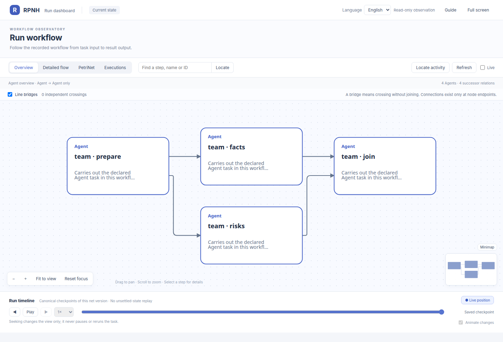

**案例图 A。** 官方 Viewer 已有的脚本化完成案例 Overview。四个清晰可读的 Agent 节点
展示审核结构；Overview 省略 PetriNet 的 place 与 arc。
[同一案例的 PetriNet 视图和复现方法](../examples/workflow_patterns/README_ZH.md)
给出底层表示。这是保留的历史图片，不是对本报告源码快照的新运行；拓扑本身也不能证明完成，
或证明两条分支在实际时间上同时执行。

[运行器][parallel-runner]只有在 stop reason 为 terminal、存在 terminal-evidence 引用、
且已登记输出等于 `Parallel workflow complete.` 时才接受该案例。Fixture 提供预设文本，
检查的是交接与结算协议，不是语言模型开展有效事实或风险审核的能力。
[公开的带日期验证记录][parallel-validation]记载该场景有 4 个 transition、9 个 place、
26 条 arc，provider 调用为零；它没有锁定实际测试 commit，因此只能作为历史案例证据，
不能作为当前源码的验收结论。

[安装所选源码](guides/installation_ZH.md)后，按[工作流案例库](../examples/workflow_patterns/README_ZH.md)
创建新 run 并打开只读 Viewer。默认不选择真实模型 profile，但仍需要受支持的本地进程与
IPC 权限。真实模型 route 必须单独、显式传入。

两个相关案例把相同结构应用到预设审核文本以外的任务。[混合汇总](../examples/hybrid_summary/README_ZH.md)
在两个 Agent 节点之间插入原生计算；[原子工具流水线](../examples/tool_pipeline/README_ZH.md)
则把用量与电价准备、计费和独立验证分为十个工具 transition。
其[历史原生运行结果](results/tool-pipeline-20261008/README_ZH.md)保留了产生
2.000 kWh / 1.70 CNY 结果的输入、源码和 scorer。该特定 fixture 证明一条计算及证据路径，
不能推广为一般业务任务的成功率。

## Agent 任务网与只读投影

按建模对象选择：agent 工作流描述任务职责与交接，领域算法和业务系统是工具或外部环境。ERP、3-DOF、JB、HarnessAudit、AutomationBench、SlopCodeBench 与 RRSI 保留为真实 agent／角色工作流。RRSI 自定义 registered-host role PN 也可具有真实 agent 绑定，不要求一律使用 stock AgentLoop。纯工具流水线、原生输入 gate、作者 principal 和显示注释不会仅因 Registry 来源链而变成 agent。

当前协作入口是[复制、共创并复用同一 Agent 项目](../examples/project_collaboration/README_ZH.md)。完整项目包含定义、输入、环境、原任务、验收器、来源与许可证；两个受控贡献者解决真实冲突并形成双 parent 修订 M。业务执行前依次采用 M → base 内容新后继 → M 内容新后继，再下载精确原 M，由新身份、独立授权的 receiver 导入。source 与 receiver 均由 implementer／reviewer 两个调用真实模型的 stock AgentLoop 职责执行同一原始多源合并任务；receiver 包不含 source 的业务答案。[操作指南](guides/project-entry_ZH.md)给出导入、审核、接纳、采用、下载和运行步骤。

2026-10-13 的有界结果为 **43 次登记／42 次响应，上限 48**：source 23／22（保留 1 次 `NOT_SUBMITTED` 原失败、2 个完成业务 firing），receiver 20／20、2 个完成业务 firing。两端路径适配原断言均 **3/3 PASS**，独立完整 instruction 审阅为 **ACCEPT_BOTH**；原 `test.sh` **NOT_RUN**，grader **VISIBLE**，不称盲评官方容器成绩。全部四行／20 单元格和三项完整字段冲突经独立核对；可选 status 归一化歧义仍披露。

业务 PN 建模两个 agent 的职责与交接；两端 Overview 均为 2 节点／1 边，完整业务 PN 为 5 节点／6 弧。文件物化与 workspace finalization 的真实下级执行 PN 在同一 Registry 内归属于精确业务 invocation/firing，具有分开的 token、firing 和 checkpoint；AgentLoop 日志不替代执行 PN。受支持范围是单一可信 OS 用户下的受控主体、普通 Module 贡献与显式 scoped 读取／owner 采用。业务前内容恢复不复活已消费或终态 token，也不回滚外部效果；不证明真人身份认证、活跃 token 热迁移或 graph／open-region／selected-change／assembly 的广泛交换。

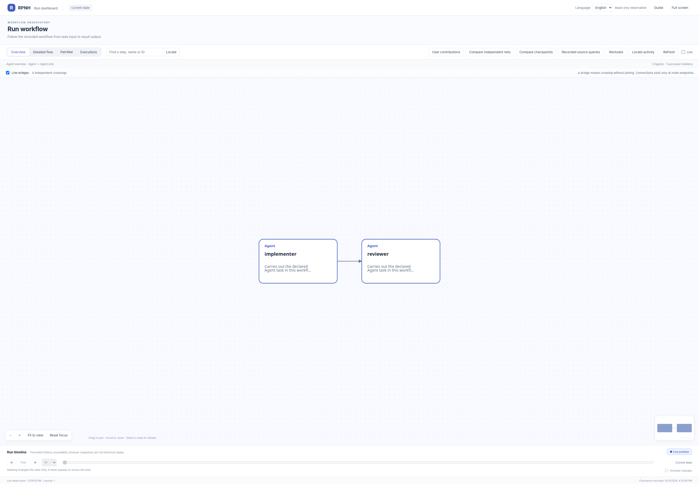

两端实际官方 Viewer 窗口为 source-05（101 张 PNG）与 receiver-04（28 张 PNG），均报告缺项 0。查看[完整 source 业务 PN](../examples/project_collaboration/figures/source-petri.png)、[source 文件物化执行 PN](../examples/project_collaboration/figures/source-execution-materialization.png)、[source workspace-finalization 执行 PN](../examples/project_collaboration/figures/source-execution-finalization.png)和[独立 receiver Overview](../examples/project_collaboration/figures/receiver-overview.png)。原生 Previous Net Segment 导航验证两段历史、原 M 的两个 parents 与三次采用引用；完整图见项目示例，[捕获来源](../examples/project_collaboration/figures/provenance.json)标明精确源码窗口。精选 PNG 保持捕获原字节。

历史零 provider 协议入口是[Agent 任务网共建](../examples/user_collaboration/agent_cobuild/README_ZH.md)。`curator.run` 与 `auditor.run` 两个原生任务 agent 使用 stock `AgentStage`／default `AgentLoop`，由两份 stock 单 agent 声明组成同一普通 Module，连接为 `curator.result → auditor.request`。两个受控原 principal 的确定性 source 程序分别加强 curator 输入来源合同和 auditor 对账合同。原 HOST 审阅精确 revision、连续推进受保护 Branch，再由 owner 在 target 执行前采用。

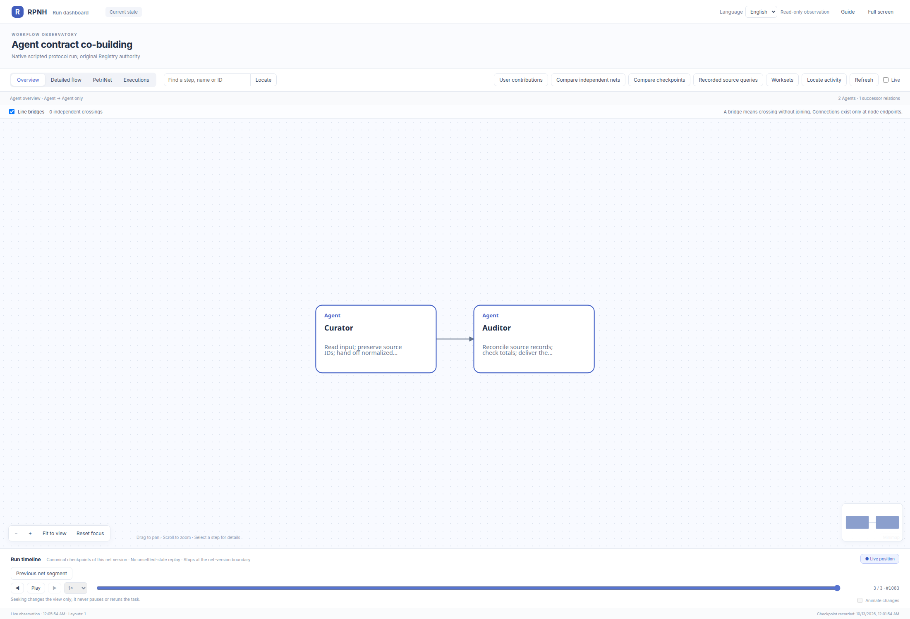

10月12日 UTC 的 fresh03 协议运行将两项合同保留在精确采用声明和每角色两次真实请求中。两次主任务 firing、两个原生 AgentLoop 完成四次脚本 turn、六个工具 action；独立原输入检查核对四条来源、24分钟（planning17、review7）。[实际主任务 PN](../examples/user_collaboration/agent_cobuild/figures/petri-panorama.png)为五节点六弧，原登记的文件 I/O 子网保持分开。三个官方 Viewer 捕获窗口前后 head／事件数均为 1099、writer epoch 均为 2，[捕获来源](../examples/user_collaboration/agent_cobuild/figures/provenance.json)标明各自源码窗口；不包含外部 provider 调用或认知质量主张。

该历史窗口的 source 程序、网外控制动作与 target agent 分层记录；其单 parent 链不表示同 base 自动合并。`local_process` 脚本驱动从实际输入与工具返回计算，以已登记任务 agent 展示结构／协议，不声称真实模型调用或认知能力；运行结果、产物与 Viewer 证据以示例页记录为准。

该历史示例使用两份 stock 单 agent 声明组装普通 Module，保留既有 plain-proposal 约束、Registry 门、adapter 与调度器。

Overview 是只读 agent 投影，不是简化后可执行 PN。`registered_agent_binding` 可追到精确 executable binding 与 agent 引用；`declared_llm_executor` 仅确认声明，不证明执行；`explicit_host_annotation` 是未确认显示注释，不建立 agent 身份。角色按显式 scoped identity 分组，不能凭同名、模型名或用户账号合并。边保留原路径依据，表示通往下一 agent 的结构路径，不证明已发生顺序、guard 通过或全输入 join 满足。完整 PetriNet 与所属 Registry 保留权限、guard、join 及关联的 loop／turn／action 记录、工具和产物引用。这些运行记录不会自动新增 PN 节点。managed child／action 不计为新增 PN transition，独立 child Registry 保持独立。

静态声明与运行分别标识；空概览本身不否定源码中的真实 agent 工作流，声明或已登记身份也不证明本次任务已执行。

ERP／AutomationBench／HarnessAudit Office／SlopCodeBench 的静态导出分别含 1／1／4／1 个声明角色。身份导出修正保留原 frame 与图像，不重跑或重新认证这些 benchmark。

## 研究背景与阅读路径

PetriNet 是描述并发、同步和状态分析的成熟方法；Murata 的综述也讨论了模型表达能力与分析
复杂度之间的权衡 [1]。RPNH 在 Agent 与程序执行周围应用类型化网图和 Registry 契约。
ReAct 研究交替进行语言模型推理与动作的方法 [2]。此类 Agent 行为与 RPNH 的执行记录
分别关注应用中的不同层次；引用这些工作不代表已经进行直接对比实验。

案例涉及的执行资格和结果规则见[第 2 节](#2-执行资格来自真实-token-与-claim)与
[第 3 节](#3-settlement-将计算连接到持久状态)，受控变更见
[第 4 节](#4-先创作修订再显式采用)，测得结果及失败见[第 10 节](#10-历史结果及其限制)。
契约章节中的编号图是概念示意，不是运行截图或完整 schema；完整契约以链接中的专题为准。
RPNH 适用于重视持久化输出、显式协作或受控流程变更的应用，也会增加声明和状态管理工作。

## 1. 将方法与实际执行分开

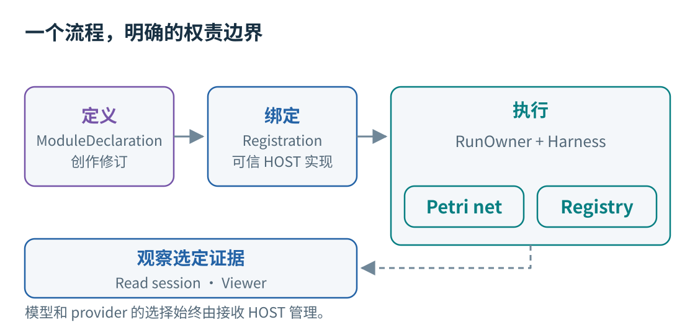

**图 1。** 定义、可信绑定、执行证据和观察是四类相互关联的资产。箭头表示关系，不代表另一套执行引擎。

- **定义：**`ModuleDeclaration`、Agent graph source 与不可变 author revision。
- **绑定：**`Registration` 将声明的 key 解析为可信 HOST 实现。声明不能自行引入可执行 Python locator；
  读取编译数据也不会注册 callable。
- **执行：** 同一 `RunOwner`/`Harness` 路径负责准入与结算。`Orchestrator` 使用 HOST 已有的 owner、
  event loop、worker 与 dispatch service。
- **观察：** 选定的 Registry 投影和 read session 保持只读。

两层 PN 各有范围：**业务 PN** 建模 agent 的任务职责、工作动作和交接，“业务”指这些
agent 操作，不是任务领域算法或流程。**执行 PN** 在同一个 Registry 内，归属于精确、
已准入的业务 invocation/firing，建模下级 harness 执行机制。领域流程不能替代 agent 操作成为
PN 主体；领域资料作为被 Registry 收录的 PN 资源。详见[两层架构](ARCHITECTURE_ZH.md#workflow-graph-与-petrinet-lowering)。

Basic、Codex 与 OpenCode 是同一直接主会话根的不同呈现，共享 lease 防止多个可写呈现竞争。
DSH 是受注册管理的 HOST 接入。独立子任务各自拥有 Registry、net 和 owner；从属 execution net
则与业务网共享 Registry，用于 workspace finalization 等执行机制。Author assembly 成员关系属于定义层。
已有独立子任务入口不等于完整的原生父子启动至父完成链；此快照尚未接通该父子 transport 的生产边界。
见[父子执行边界][parent-child]。

详见：[架构](architecture/design_ZH.md)、[runtime 契约](reference/runtime-registry_ZH.md)。
代码：[声明][module]、[注册][registration]、[编译器][compiler]、[Orchestrator][orchestrator]。

## 2. 执行资格来自真实 token 与 claim

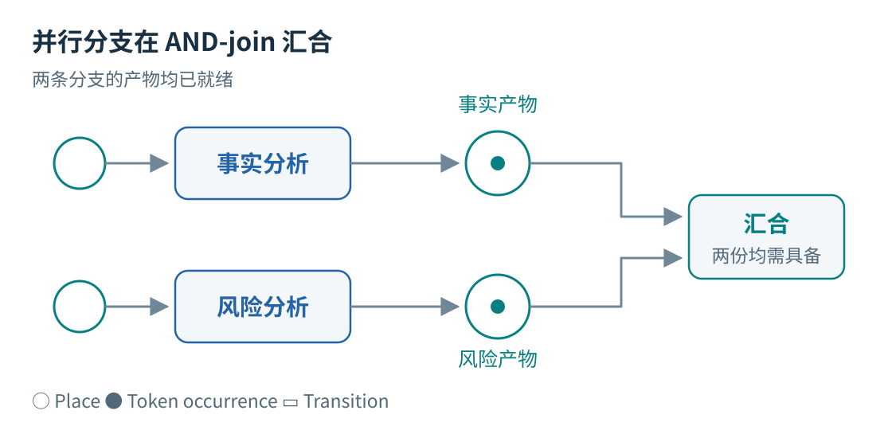

**图 2。** `prepare -> (facts || risks) -> join` 的局部结构；两条分支均已结算，各自的输入
occurrence 已消费，两份输出 occurrence 使 join 获得执行资格。图中省略最终输出 place。

类型化 place、带权 arc、outcome 与资源 claim 决定 firing 是否有效。Consume、read、borrow、guard、
produce 和 return 模式各有契约。Place fusion 共享一个 place，不会为广播复制产物。

`Harness.schedule_ready` 重建当前 net 和 marking、安装活动 claim，并遵守 in-flight 容量。
外部 selector 只能选择 enabled transition 的无重复子集。Worker 提交前先记录 Start；
调度偏好不能使原本无效的 firing 获得执行资格。

`AgentWorkflowGraph` 是便捷的依赖图接口；通用 `ModuleDeclaration` 支持更丰富的类型化契约。
Agent artifact label 用于路由文本产物，不证明业务数据有效。在当前 graph 边界，
native-plugin 节点只有一个输入和一个输出，且含此类节点的 graph 不支持 feedback。

详见：[声明](reference/declarations_ZH.md)、[工作流示例](../examples/workflow_patterns/README_ZH.md)。
代码：[Petri 契约][petri]、[Harness][harness]、[Agent graph][graph]。

## 3. Settlement 将计算连接到持久状态

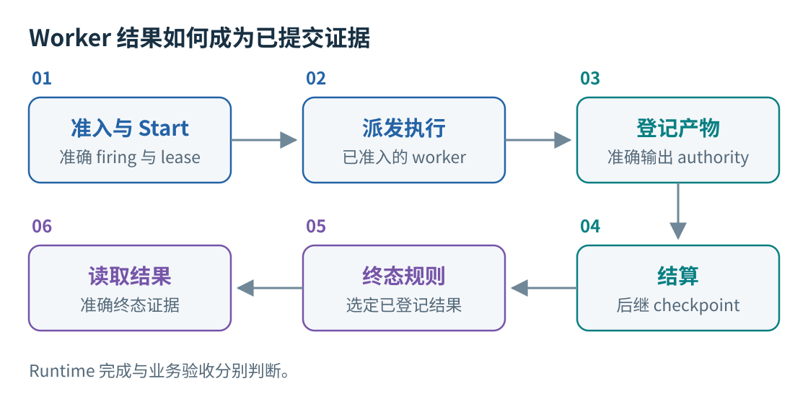

**图 3。** 成功结果路径。等待、中断、执行阻塞和终态移交各有独立 disposition；并非每次 firing
结算都结束整个 run。

Future 返回本身不够。Owner 核对准确的 firing、Start 和 execution lease，再以已登记产物支持
outcome、后继 marking/checkpoint、适用的 workspace 发布及从属 execution 映射的结算。
当前 batch 契约每个事务至多包含一次 firing settlement/publication。持久化的已完成产物优先于竞态中的
stop，避免重放已经完成的语义操作。

`TaskControl.result` 沿当前 execution generation、终态证据与选定登记资源读取结果。
Status 和 result 使用同一个受保护的 `RunReadCut`，返回前再次核对。文件名、进程退出或最后一条
assistant 消息都不能替代结果选择依据。

Workspace 变化保留准确的 before/after 资源和版本血缘，并发变更保留冲突。
`resume` 继续最近一次 owner-stopped 切面；显式 `reopen` 创建新的 execution generation，保留后续历史。
Workspace recovery 不会撤销外部消息或交易。未知 provider submission 和 managed outcome 不能被当作
可以安全重试。ERP adapter 的未知结果回执提供脚本级防重放控制，不保证 ERP transaction 恰好执行一次。

详见：[checkpoint recovery](guides/checkpoint-recovery_ZH.md)、[ERP 生命周期](../examples/erp_bench/README_ZH.md#动作边界与生命周期)。
代码：[owner][owner]、[发布关口][commit]、[run reader][run-reader]、[TaskControl][task-control]。

### 3.1 永久保存的历史与持久化暂存区

§§3.1–3.3 的保存区与 checkpoint 说明按公开源码 `3b3c9d63f3bcb74c241847f4147c4146491ecae5` 核对；其它源码链接与历史结果保留各自原有版本。

RPNH 区分“已经保存的内容”与“能够支配执行的事实”。永久历史保留版本化 payload 和准确事件；每个活跃 firing 还有自己的**持久化暂存区**。“暂存”表示尚待该 firing 的发布边界，不表示只在内存中的缓存。实现通过同一 Registry 中的 `firing_publications` 和 `firing_temporary_members` 管理这一区分。因此，某个对象已经落盘，并不代表它已经成为权威的已完成产物。这里的永久历史指已提交的历史权威，并非另行承诺无限期的物理保留。

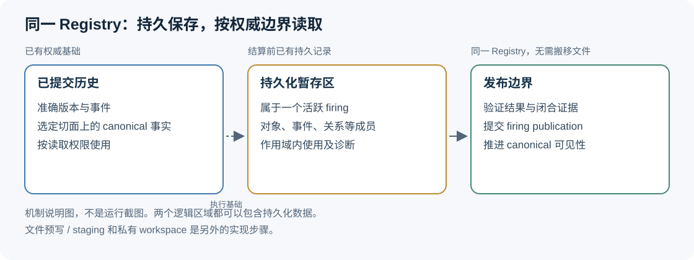

**图 9。** 保存状态与权威可见性是两个维度。这是机制说明图，不是 Viewer 运行截图。Firing 作用域视图组合其获准使用的 canonical 基础和自己的暂存成员；诊断 observation 不授予执行权威。普通 canonical 读取在准确历史切面上应用发布规则；少数控制证据的例外也由同一规则限定。

Firing 的私有 workspace 是物化的工作视图。可变文件、文件写入的 staging 路径、不可变归档候选分别服务于不同执行步骤，任何一项单独存在都不能确立已结算的共享 workspace revision。不可变对象预写也会先保存准确版本字节，再由 Registry 事务确认。Promotion 通过发布记录改变权威可见性，并非把一个可丢弃的临时目录搬入另一套存储。已发布与被后继执行取代的历史仍保留准确身份，可供检查。

实现依据：[存储表][storage-tables]、[权威视图][storage-views]、[不可变预写][storage-objects]。操作细节见 [workspace 与资源架构](ARCHITECTURE_ZH.md#agent-执行workspace资源与委派)。

### 3.2 Checkpoint 闭合一致的执行边界

业务 marking checkpoint 标识准确的 net、活跃 token 引用、marking epoch、token 分配状态及 attempt 计数，同时关联对应的 workspace revisions、前驱和 settlement 引用。它是已注册的状态边界，不是程序行号或最后一条日志。从属 execution PN 拥有各自的 checkpoint；它们的进度通过原有 terminal mapping 与 settlement 契约进入业务执行证据。

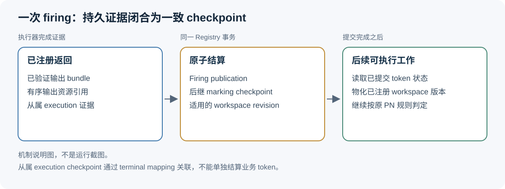

**图 10。** 成功结算核对准确结果及从属执行证据，再共同闭合 firing publication、后继业务 checkpoint 与适用的 workspace revision。Owner 通过 compare-and-swap 推进 workspace head。持久化 operation-completion 记录可以早于这一事务，它证明执行器已经注册返回，单独不代表业务结算完成。

这一边界使后续工作依赖一致的已注册结果，避免把新文件和旧 marking 混合使用。在已支持的恢复契约内，准确的已注册完成证据，以及需要时经过验证、处于 `map_ready` 的不可变 workspace 候选，可以支持恢复完成结算而不重复物理操作；声明了 HOST effects 的 outcome 不适用这一路径。

实现依据：[发布事务][storage-commit]、[checkpoint 状态与重新进入][storage-reentry]。完整契约见 [持久完成与恢复参考](reference/runtime-registry_ZH.md#持久完成记录与有界恢复)。

### 3.3 从 checkpoint 续跑

RPNH 的续跑从已提交的 Registry checkpoint 状态重建执行。Owner 停止的任务在同一 run 中从最新已提交切面恢复；显式 checkpoint reopen 则在当前 net lineage 中选择一个已提交切面，并追加新的 execution generation：以新的 token occurrences 表示选定状态，以对应 workspace revisions 恢复已注册工作区，同时保留 attempt 高水位，避免复用物理尝试身份。后续历史仍保留供审查。

Owner 选择的 reopen 也覆盖进程退出后遗留 provisional firing、且操作未声明中断 outcome 的情况。reentry 事务将其暂存 publication 根的取代与新代次一起提交，不提升暂存产物，也不恢复失败进程；业务状态仍来自所选 checkpoint。当前生命周期及旧 Registry 迁移合同见[持久完成与有界恢复](reference/runtime-registry_ZH.md#持久完成记录与有界恢复)。

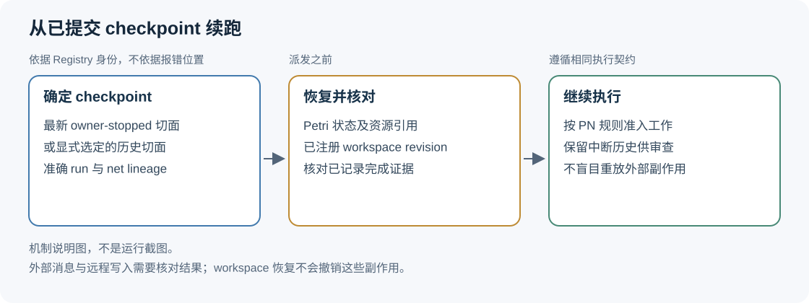

**图 11。** 重启基点是 checkpoint。失败进程的位置和未结算的工作文件不决定恢复状态。派发前，Registry 证据按恢复契约完成核对；准确完成的工作不会被盲目重放。外部服务位于 workspace 恢复边界之外。

一致性的关键是：从选定 checkpoint 获得相同的有效续跑状态，并遵循相同执行规则。使用相同输入、受控操作结果的干净参照执行，可以检验这一点。新的身份分配与保留的中断历史无需逐字节相同；新发起的模型调用也无需生成完全相同的文字。消息、远程写入等外部副作用需要各自的结果记录或幂等契约，恢复本地工作区不会撤销它们。

操作方可依据 [checkpoint 恢复指南](guides/checkpoint-recovery_ZH.md) 列出已提交 checkpoint 并选择对应续跑方式。准确切面的检查见 [checkpoint 比较](guides/checkpoint-comparison_ZH.md)；完成证据与未知提交状态见 [runtime 恢复参考](reference/runtime-registry_ZH.md#持久完成记录与有界恢复)。

[storage-tables]: https://github.com/Deng-0119/RPNH/blob/3b3c9d63f3bcb74c241847f4147c4146491ecae5/cpn/rpnh/registry/_event_store/backend.py#L74-L124
[storage-views]: https://github.com/Deng-0119/RPNH/blob/3b3c9d63f3bcb74c241847f4147c4146491ecae5/cpn/rpnh/registry/_event_store/views.py#L386-L553
[storage-objects]: https://github.com/Deng-0119/RPNH/blob/3b3c9d63f3bcb74c241847f4147c4146491ecae5/cpn/rpnh/registry/object_store.py#L43-L60
[storage-commit]: https://github.com/Deng-0119/RPNH/blob/3b3c9d63f3bcb74c241847f4147c4146491ecae5/cpn/rpnh/registry/_event_store/commit.py#L1404-L1812
[storage-reentry]: https://github.com/Deng-0119/RPNH/blob/3b3c9d63f3bcb74c241847f4147c4146491ecae5/cpn/rpnh/registry/checkpoint_reentry.py#L282-L428

## 4. 先创作修订，再显式采用

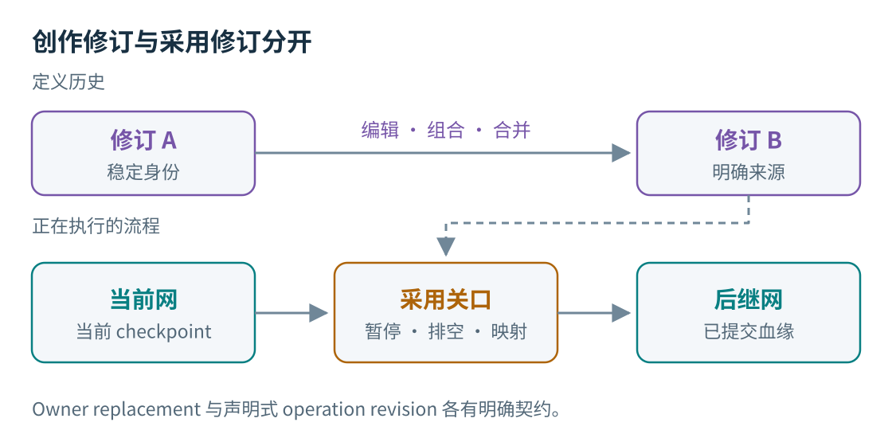

**图 4。** 定义历史与运行状态通过不同操作推进。图中采用流程表示 owner-driven replacement。

Extract、Compose、Instantiate 和 Branch 可以产生已登记的 `rpnh/module_declaration/v1` 资源。
Author API 提供稳定元素身份、expected-head 检查、来源映射、merge analysis 与 selected-change 历史。
Assembly 固定准确的成员修订与 lowering 映射；名称相同不足以证明身份相同。

运行时变更有两条显式路径：

1. **Owner replacement：** 针对当前 net 准备候选，暂停准入、排空活动 firing，检查 occurrence
   mapping/retirement，再沿用已有预算与 workspace 血缘采用后继网。
2. **声明式 operation revision：** 登记的 Module 产物与 `DeclaredModuleRevision` 提供经检查的
   structural delta 和有限 activation。Revision witness、后继 checkpoint 与 adoption 随 settlement
   闭合；切换整张网要求当前 firing 是唯一尚未解决的 provisional firing。

两条路径都不克隆 in-flight 模型调用，也不对正在执行的流程进行无限制语义合并。
[第 8 节](#8-有限-pn-分析具有显式-policy-边界)的 finite policy 适用于其文档规定的 owner-adoption 边界。

详见：[net operations](guides/net-operations_ZH.md)、[graph authoring](reference/graph-authoring_ZH.md)、
[身份变换](reference/author-identity-transform-contract_ZH.md)、[assembly](reference/assembly-full-history-merge_ZH.md)。
代码：[author API][authors]、[operation revision][revision]。

## 5. 在已声明的执行边界组合工具

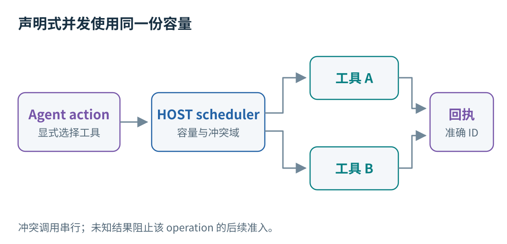

**图 5。** Agent 执行内部的 managed-call 并发。这些调用不会自动成为独立的业务网 transition。

Native plugin 可以作为正式工作流节点，也可以作为 Agent 内部显式绑定的 managed tool。
[原子工具 pipeline](../examples/tool_pipeline/README_ZH.md)使用前一种边界：十个 transition
各自为 one-step executor 绑定一个可信 HOST 工具。检查、归一化和 AND-join 属于工作流结构，
各自拥有独立的准入 firing 与登记产物。

Managed scheduling 需显式选择。Pure policy 支持有界 pure call；conflict-domain policy
将冲突读写串行化，允许不相关 domain 并发。缺失或未知的冲突声明形成独占屏障。容量由整个 run 共享。
混合 builtin/managed turn 仍按原顺序执行；stop 阻止新启动并排空已准入的并行调用。
未知结果阻止该 operation 的新调用，等待经授权的 reconciliation。
真实回执与 whole-turn settlement 保留准确身份，不因完成先后而改变。

可选 Linux isolated program API 通过 HOST broker 组合显式选定的 managed call。
SDK 为同步接口（`tools.call`、`tools.parallel`、`tools.read_result`、`result`）；不支持隔离时
不会回退为不受限执行。程序不获得 HOST 文件、凭据、网络或 Registry writer。
Native plugin 自身则是可信 HOST 代码。

准确的输出 reader 对已登记结果分页，不会重新执行。返回结果、进入后续已提交请求、观测到业务状态变化
和模型在语义上使用结果是不同结论。没有显式 policy 时保留原有串行与 toolkit 行为。

Managed child 是父 operation 内的调用证据，不是新增 PN transition。父程序返回、外层 complete 与业务成功须分别检查，均不能证明受隔离前置阻塞的 child 已执行。

详见：[受控 managed tools](controlled-managed-tools.zh.md)、[定制](guides/customization_ZH.md)。
代码：[scheduler][scheduler]、[program broker][broker]、[隔离 runtime][isolation]、[pipeline 声明][pipeline-module]。

## 6. 在各来源的独立切面只读观察

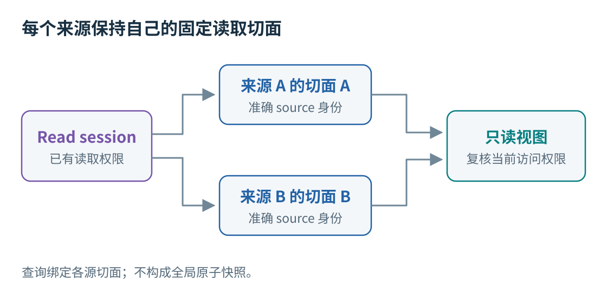

**图 6。** 每个来源内部的一致性不构成全局原子快照。离线或未获授权的来源保留明确缺口，不能当作零计数。

独立 read HOST 打开已有 Registry，不启动 task、不获取 writer fence，也不记录 Observation。
Owner 必须已经签发选定的 observer profile 与 grant。能访问目录、属于 SourceSet 或拥有 HOST 标签都不等于授权。
Index、record、material 与 export scope 分别控制。

类型化查询返回 source-qualified 引用和获准字段。Opaque session-local cursor 绑定完整查询、
source cut、权限、binding 与 reader/schema catalog；普通 append 不会移动已有切面。
交付前复核当前权限；撤销、binding/catalog 变化或过期会使相关数据和 cursor 失效。
比较所需的任一方失效时，清除整个比较对。Material 读取是单独的有界操作。

本地 Viewer 只投影选定 Registry 事实与 checkpoint 历史，不成为 writer。
SourceSet 原有的显式 query/record API 可以沿原发布契约持久化选定 observation；
普通 read-session 分页不写入，其 `capture_observation` 不受支持。
这些由本地 owner 控制的接口不建立远程信任，也不隔离同一 OS 用户下相互敌对的进程。

详见：[独立 reader](guides/independent-registry-reader_ZH.md)、[read-session 契约](reference/registry-read-sessions_ZH.md)、
[SourceSet observation](guides/source-queries_ZH.md)、[跨网比较](guides/comparison-context_ZH.md)。
代码：[read session][read-session]、[read-host 配置][read-host]。

## 7. 提出一个有界的产物来源问题

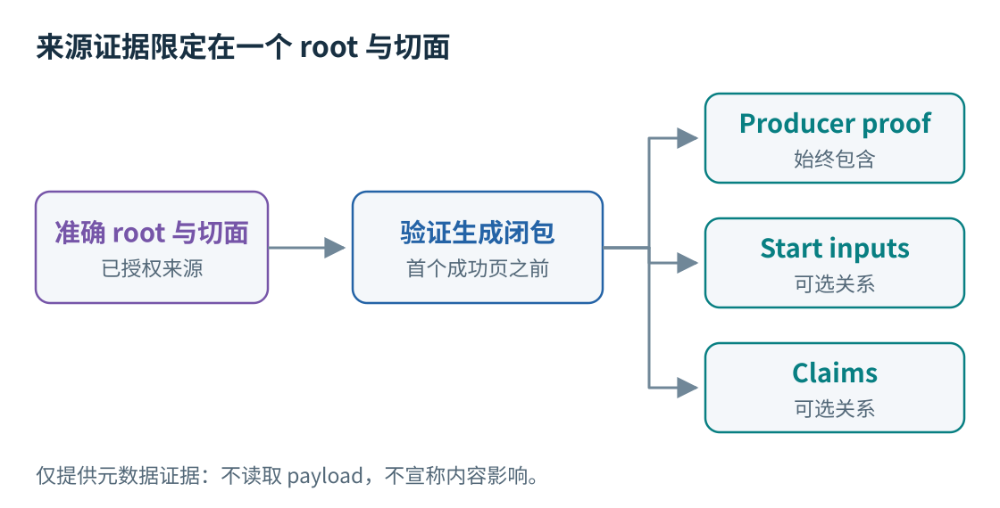

**图 7。** `product_origin_v1` 返回有限的元数据证据，不提供递归血缘，也不证明模型读取或使用了内容。

此快照中的 `query_product_origin_v1` 是 `cpn.rpnh.collaboration` 的公开 Python session method
及 convenience function。此快照没有安装态 origin-query CLI；comparison viewer 的 HTTP endpoint 也未提供此查询。
输入必须是由 Invocation 产生、准确 source-qualified 的 canonical `petri_output`/`workspace_write`
资源，或准确的 `operation_result/v1`，并提供同一 session 签发、同来源且未修改的 `SourceCut`。
名称、路径、`latest` 和跨来源搜索都不是受支持的 root。

查询始终验证 `producer_execution`，可选关系为 `start_inputs` 和 `claims`。
所需 record/index field 先经过预授权；首个成功页之前，验证生成闭包与全部所选关系的候选项和端点。
后续无效项不能藏在已经返回的成功前缀之后。序列化后再次核对当前访问权限。

- `root_role` 区分正式的 `registered_output` 成员、`invocation_produced_resource` 和
  `operation_result` root。仅有相同 producer 链接不足以成立。
- Start 行保留实际输入版本、次序与重复资源。Claim 区分 consumed 与 non-consuming；
  其资源引用可能不同于经替换后的 Start input。不读取正文。
- `complete` 只覆盖该授权 root、切面和所选关系。递归祖先、实际读取、工具调用因果和内容影响
  均不在此 profile 内；changed-net settlement 不受支持。

继续分页时重传不变的完整请求和返回的 cursor。默认每页 20，受 session 限制；
上限为 100 或 session 更小的限制。验证工作、保留状态和响应字节分别有界。
该 profile 的 content schema 是惰性验证数据。

详见：[产物来源契约](reference/registry-read-sessions_ZH.md)。
代码：[查询与分页][origin-query]、[producer proof][origin-core]、[关系验证][origin-includes]。

## 8. 有限 PN 分析具有显式 policy 边界

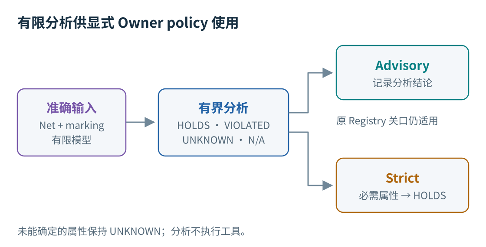

**图 8。** 显式选择且绑定输入的分析。分析报告和 policy 都不授予执行、settlement 或终态 authority。

`cpn.rpnh.pn_validation` 针对固定编译声明、准确 marking 与有限 modeled outcome 探索，
使用 production reservation/deposit 语义，但不执行工具或模型。
不同属性分别返回 `HOLDS`、`VIOLATED`、`UNKNOWN` 或 `NOT_APPLICABLE`。
Safety、proper completion、possible success、每个状态均可到达 allowed completion，
以及无 fairness 假设的 inevitable completion 不可混为一谈；允许的失败终态也不同于成功。

`start_run(..., pn_validation=...)` 在真实 owner 输入建立后、首次准入前登记显式模型、契约与 policy。
Advisory 记录结论并保留 Registry 原关口；strict 要求所有指定必需属性为 `HOLDS`，
缺失模型、不支持的必需属性，或使必需属性仍未确定的探索截断都会阻断。Policy 在 reopen 与文档规定的 owner adoption
路径中保留；adoption 在 commit 边界核对准确输入、映射与有界报告。

支持范围是有限的：不含内容的控制输出、声明的 outcome 及支持的 consume/read/lease/guard 形式。
未建模数据、动态网、外部回复/timeout、fairness 和本地 Agent progress obligation 保持 `UNKNOWN`。
HOST 忠实执行模型是假设。分析保留准确状态身份，探索截断不会被伪造为循环。
有限成功路径或反例可以在截断前建立其对应结论；全局 `HOLDS` 需要完整且受支持的探索。
Scheduler 模型是 `any-exact-binding`，不认证任意 scheduling callback。

详见：[有限 PN 验证](reference/pn-validation_ZH.md)。
代码：[分析契约][pn-contracts]、[owner policy][pn-policy]、[adoption gate][pn-adoption]。

## 9. 复用流程与选择示例

Portable package 携带受支持的定义、schema、资源与来源；接收方本地凭据、interpreter 路径、binding
和私有 run 证据独立保存。Preview/resolve 检查并锁定声明材料；environment planning 与明确批准的准备
先于单独批准的运行。V1/V2 package 支持单个 closed-module entry，更广的 author/assembly API
不会自动变成可移植格式。提供的 native wheel 通过有界 no-index/no-deps 接收路径安装。
Public metadata 不会自动清洗 package 内容。

Closed-author import 以 `copied_from` 来源和 expected-head 保护创建本地身份，不启动执行。
Workset 记录 contribution、delivery 与 acceptance；首次验收要求真实的已登记 operation output。
详见 [Workset 契约](reference/worksets_ZH.md)。

安装入口为 `rpnh`，用户自有的 provider/exact-model catalog 初始为空。
先看[安装指南](guides/installation_ZH.md)与[模型指南](guides/models_ZH.md)，再按需要检查的边界选例子：

- [项目协作](../examples/project_collaboration/README_ZH.md)：完整项目共创、真实双 parent M、业务前 M/base/M 采用及独立 receiver 原任务执行。
- [历史 Agent 任务网共建](../examples/user_collaboration/agent_cobuild/README_ZH.md)：两项原主体合同贡献连续接纳并由 owner 采用，两个 stock AgentLoop 角色提供脚本化结构／协议证据。
- [Workflow patterns](../examples/workflow_patterns/README_ZH.md)：串行与并行依赖，默认使用脚本化本地响应。
- [Native plugin](../examples/native_plugin/README_ZH.md)：可修改的 schema 与显式安装的确定性程序。
- [Hybrid summary](../examples/hybrid_summary/README_ZH.md)：Agent → 程序 → Agent；默认脚本化，真实执行另行选择。
- [原子工具 pipeline](../examples/tool_pipeline/README_ZH.md)：离线用量/电价分支、金额计算、独立验证与最终发布。
- [SQL 查询校验](../examples/query_validation/README_ZH.md)：固定候选的只读 SQLite 执行、保留行序的精确比较与最终 SQL 资源。
- [多源数据合并](../examples/tool_pipeline/multi_source/README_ZH.md)：原 JSON／CSV／Parquet 输入、三输入 join 与两件终态产物。
  两个源码案例均提供实际 Viewer 图片与点击查看说明；带日期的原生结果及适配验收器限制分别记录。
- [Package reuse](../examples/package_reuse/README_ZH.md)：接收方绑定 closed process，准备与运行保持分离。

此快照的安装导出目录包含 `adapter_task`、`native_plugin`、`hybrid_summary`、`compose_serial`
和 `package_reuse`。`compose_serial` 只生成定义；导出不会安装或运行代码。
脚本化与原生示例仍需文档规定的 process/IPC 环境。源码为 `0.1.0rc2` 开发候选，
较早的 `v0.1.0rc1` 二进制具有更早的功能集。
详见[示例目录](guides/examples_ZH.md)与[package 指南](guides/portable-packages_ZH.md)。

## 10. 历史结果及其限制

以下是相互独立的历史窗口，不是对 `6cec63f` 或本次重写的验证。
[整理后的结果](results/README_ZH.md)保留完整 score/status 投影、输入、源码身份、命令和限制。
发布 commit 不等于重跑；runtime 完成不能替代原始业务验收。

### 受控多用户协作

这项历史记录的工具流水线运行 PN 是 24 批次 ingest → plan → validate 加 aggregate／publish，共 74 个业务工具操作。模型在网外创作配置；这不是 74 个 agent，也不是当前共建网的运行证据。保留这项领域／工具 workflow，不意味着以它定义第 1 节的下级执行 PN 层。

[2026 年 10 月 12 日实验](results/user-collaboration-20261012/README_ZH.md)由三个受控模拟 Registry 身份、两个真实模型，完成原生提案、审阅、明确 peer 协调、保护分支合并／采用、业务执行与独立评估。B 在同一身份与累计预算内切换模型。累计 22 次 logical call／provider-attempt spec 包含失败尝试，HTTP 尝试次数仍未知。

开发、评估各固定 512 条路线，序列分数分别降低 7.525%／8.376%，平均行程增加 7.715%／8.421%，时间窗仍有 FAIL 与 UNKNOWN。C2 显式组装策略联合，随后 owner 在原合并中选择 incoming C2。本例证明受控执行链闭合，不证明自动无冲突融合、新路线算法或协作的因果收益。[原 runtime 全景与静态声明 Viewer](../examples/user_collaboration/README_ZH.md)区分执行证据与离线结构查看。

### ERP-Bench

A04 与 H01 测试 clean tracked RPNH `6f8ee2e406f3c70edb73206f861e56a0202b9f15`，
使用 `local_process` 下的 `gpt-5.6-terra`，ERP-Bench task/scorer 为
`ceba3880af555129b5278e056a0c20f2fb5a0ba9`，首次发布在 `74fad32d…`。
适配环境为 Harbor 0.24.0、Odoo 19.0.20260926、Python 3.12.3 和 PostgreSQL 18.6；
solver 仅访问本地 Odoo，没有外部网络。

| 单次运行 | 原始业务结果 | 适用检查 | 真实调用 |
|---|---|---|---|
| A04，`2000_easy_01_buy_only_baseline` | 100/100 PASS | 37/37；1 NA | 9 |
| H01，`2299_hard_repair_plan_hard` | 21/100 FAIL | 86/95 | 13 |

H01 的九项失败包括四项 constraint 与五项 purchase-origin 检查。
原始计分 gate 将 63/75 constraint points 计为总体 21/100；86/95 是检查数量。
Checker exception 使单一原因归因不成立。更早 A01 被阻塞，A02 没有可评估的 quiescent world，
A03 为 0/100、11 次真实调用。Unknown 计数不是零。这些不同任务不是匹配比较或任务集成功率估计。
依赖请求内容的 input-reader 诊断，以及缺少准确独立源码锁的 offline coverage 声明继续撤回。
[完整 ERP 记录](results/erp-first-wave-20261008/README_ZH.md)。

### SlopCodeBench

Adapted development-prefix `code_search` 运行使用与
`74fad32d369876841686d10d33361c016e3d3648` 匹配的安装 RPNH，runner/evaluator 为
`31ceea3add480edb33431e70475c4c70597e6b31`，problem source 为
`9cd9ca3a51c3d3e2a99d2488a25baf73a2204451`，模型为 `codex/gpt-5.6-terra`。
结果发布在 `dbad0045…`。开发时查看过公开任务，不属于 held-out 评估。

| Checkpoint | 原始 evaluator | Runtime | 真实调用 |
|---|---|---|---|
| 1 | 13/13；exit 0 | complete | 5 |
| 2 | 25/25；exit 0 | complete | 5 |
| 3 | 40/47；exit 1 | complete | 14 |
| 4 与 5 | 未运行 | 未运行 | 未运行 |

Checkpoint 3 有七项失败，包括两项 Core 与五项 Functionality，25 项 regression 全部通过，
`infrastructure_failure=false`。分母包含 regression，不能相加当作独立任务数。
总计 24 次调用，零超限调用，998.82 秒；每个 checkpoint 上限为 48 次调用和 7,200 秒 owner 等待。
Upstream cost/net-cost/step cap 被禁用，标准化 task token 与 USD 成本未提供。

Solver 无网络，每个 checkpoint 使用新容器，由外部 controller 传递源码 snapshot
（`native_workspace_reuse=false`）。Build/evaluation 使用 HOST 网络和同版本下载兼容适配。
原 evaluator 已运行；official `AgentRunner`、完整五 checkpoint 与 quality judging 未运行。
没有 grader-feedback 修复、retry 或 resume。`any-case` 允许 checkpoint 3 失败时 outer exit 仍为 0。
更早的 synthetic 失败和原生阻塞尝试继续保留在[完整 SCB 记录](results/scb-prefix3-20261008/README_ZH.md)。

### 确定性 pipeline 与局部 runtime 窗口

- **原子工具 pipeline：** 测试 `00f2d29c…` 加 16 个 example 文件，core 不变，后发布于 `80a17c3c…`。
  使用真实 AF_UNIX owner；32 个唯一 pytest ID、33 次执行，包含 unit check。
  标准 fixture 为 complete、**2.000 kWh / 1.70 CNY**、十次 firing、12 个工具产物和两个 source resource；
  rounding fixture 为 **0.02 CNY**。独立整数输入 validator 是示例 scorer，不是 benchmark grader。
  新进程 readback 保持 event ordinal/count 1001 与十次 dispatch/Start 不变，模型调用为零。
  更早 AF_UNIX 阻塞尝试单独保留。[准确来源、输入与结果](results/tool-pipeline-20261008/README_ZH.md)。
- **ERP runtime：** 测试 `dbad004…` 加后来发布于 `e92b05c…` 的 overlay。
  65 个唯一 offline case 加四个 subtest，installed-owner complete/stop/timeout 路径与六个 direct-owner
  receipt 场景。九次 synthetic backend invocation 与后续 18 次 unknown-outcome probe 保持规定的防重放边界。
  没有真实 provider、Odoo world 或原 grader；重建复用同一个 owner，不能认证 OS-owner crash recovery。
  [完整窗口](results/erp-runtime-20261008/README_ZH.md)。
- **共享入口与准确 reader：** H1 测试 `674252f…` 加七个文件，通过 39 个唯一 native case。
  H1+H2a 测试 `715468d…` 加五个 reader 文件，后发布于 `d92ff37…`：八个窗口共 166 个唯一 case/执行，
  含 12 个独立 package check。真实 AF_UNIX/SIGINT/resume 使用脚本化 Agent，没有真实 provider。
  Pipeline/readback 的 11 个稳定字段一致，live-only transport/stop 字段缺席。
  更早 blocked 与 baseline-failure 窗口仍作为历史保留。这些是局部检查，不是整体产品验收。
  [完整源码与状态记录](results/entry-reader-20261009/README_ZH.md)。

带日期的 [AutomationBench 记录](../examples/automationbench/PUBLIC_RESULTS_20261006.md)保留
freeze04 first18 的 **5 PASS / 9 FAIL / 4 BLOCKED**，以及单独 repair4 条件的 **1 PASS / 3 FAIL**；
更早 14 个 scored task 没有重跑。[产品组合记录](results/product-validation-20261009/README_ZH.md)
保留独立 source identity、分窗口验证和原始失败，包括延期的 parity case 与不完整的 native/stock-client 范围。
它不认证后来的 PN 或 origin-query commit。本次更新没有重跑以上任何窗口。
其余版本特定检查见[release-validation 历史](guides/release-validation_ZH.md)。

## 历史原生输入与贡献证据

历史[模拟审批](../examples/approval_workflow/README_ZH.md)、[外部结果接入报价](../examples/a2a_quote/README_ZH.md)和[原生电费贡献](../examples/user_collaboration/native_billing/README_ZH.md)分别保留原源码窗口、Viewer 图像、结果及权限边界。它们围绕合成业务／工具 fixture 展示精确原生输入准入，或连续定义贡献、受保护 Branch 推进与 owner 采用。业务操作和受控 principal 不计为任务 agent；这些记录不验证当前 Agent 共建运行、真实 A2A／OID4VP 互操作、外部身份认证或自动多 parent 合并。

## 参考文献

1. Tadao Murata. “Petri nets: Properties, analysis and applications.”
   *Proceedings of the IEEE* 77(4), 541–580, 1989。
   [DOI](https://doi.org/10.1109/5.24143) ·
   [论文](https://docenti.ing.unipi.it/~a009435/issw/extra/murata.pdf)。
2. Shunyu Yao, Jeffrey Zhao, Dian Yu, Nan Du, Izhak Shafran, Karthik Narasimhan
   and Yuan Cao. “ReAct: Synergizing Reasoning and Acting in Language Models.”
   ICLR 2023。[论文](https://arxiv.org/abs/2210.03629v3)。

这些文献提供研究背景。RPNH 的实现与结果主张，以各节链接中的版本化源码和带日期证据为依据。

## 源码索引

以下实现链接固定到本报告快照。历史结果页面分别标明不同的测试与发布版本。
API 细节见各图旁边的专题链接。

[snapshot]: https://github.com/Deng-0119/RPNH/tree/6cec63ff5b7a0039611713961d00941767edaaf8
[module]: https://github.com/Deng-0119/RPNH/blob/6cec63ff5b7a0039611713961d00941767edaaf8/cpn/rpnh/module.py
[registration]: https://github.com/Deng-0119/RPNH/blob/6cec63ff5b7a0039611713961d00941767edaaf8/cpn/rpnh/registration.py
[compiler]: https://github.com/Deng-0119/RPNH/blob/6cec63ff5b7a0039611713961d00941767edaaf8/cpn/rpnh/compiler.py
[orchestrator]: https://github.com/Deng-0119/RPNH/blob/6cec63ff5b7a0039611713961d00941767edaaf8/cpn/orchestrator/runner.py
[petri]: https://github.com/Deng-0119/RPNH/blob/6cec63ff5b7a0039611713961d00941767edaaf8/cpn/rpnh/petri_contracts.py
[harness]: https://github.com/Deng-0119/RPNH/blob/6cec63ff5b7a0039611713961d00941767edaaf8/cpn/rpnh/harness.py
[graph]: https://github.com/Deng-0119/RPNH/blob/6cec63ff5b7a0039611713961d00941767edaaf8/cpn/rpnh/agent_workflows.py
[owner]: https://github.com/Deng-0119/RPNH/blob/6cec63ff5b7a0039611713961d00941767edaaf8/cpn/rpnh/run.py
[commit]: https://github.com/Deng-0119/RPNH/blob/6cec63ff5b7a0039611713961d00941767edaaf8/cpn/rpnh/registry/_event_store/commit.py
[run-reader]: https://github.com/Deng-0119/RPNH/blob/6cec63ff5b7a0039611713961d00941767edaaf8/cpn/rpnh/registry/run_authority.py
[task-control]: https://github.com/Deng-0119/RPNH/blob/6cec63ff5b7a0039611713961d00941767edaaf8/cpn/rpnh/task_control.py
[authors]: https://github.com/Deng-0119/RPNH/blob/6cec63ff5b7a0039611713961d00941767edaaf8/cpn/rpnh/collaboration/__init__.py
[revision]: https://github.com/Deng-0119/RPNH/blob/6cec63ff5b7a0039611713961d00941767edaaf8/cpn/rpnh/registry/module_revision.py
[scheduler]: https://github.com/Deng-0119/RPNH/blob/6cec63ff5b7a0039611713961d00941767edaaf8/cpn/plugins/managed_scheduler.py
[broker]: https://github.com/Deng-0119/RPNH/blob/6cec63ff5b7a0039611713961d00941767edaaf8/cpn/components/agent_loop/program_execution.py
[isolation]: https://github.com/Deng-0119/RPNH/blob/6cec63ff5b7a0039611713961d00941767edaaf8/cpn/plugins/controlled_script.py
[pipeline-module]: https://github.com/Deng-0119/RPNH/blob/6cec63ff5b7a0039611713961d00941767edaaf8/examples/tool_pipeline/module.json
[read-session]: https://github.com/Deng-0119/RPNH/blob/6cec63ff5b7a0039611713961d00941767edaaf8/cpn/rpnh/collaboration/registry_read_session.py
[read-host]: https://github.com/Deng-0119/RPNH/blob/6cec63ff5b7a0039611713961d00941767edaaf8/cpn/rpnh/collaboration/read_host_config.py
[origin-query]: https://github.com/Deng-0119/RPNH/blob/6cec63ff5b7a0039611713961d00941767edaaf8/cpn/rpnh/collaboration/_product_origin_query.py
[origin-core]: https://github.com/Deng-0119/RPNH/blob/6cec63ff5b7a0039611713961d00941767edaaf8/cpn/rpnh/collaboration/_product_origin_core.py
[origin-includes]: https://github.com/Deng-0119/RPNH/blob/6cec63ff5b7a0039611713961d00941767edaaf8/cpn/rpnh/collaboration/_product_origin_includes.py
[pn-contracts]: https://github.com/Deng-0119/RPNH/blob/6cec63ff5b7a0039611713961d00941767edaaf8/cpn/rpnh/pn_validation/contracts.py
[pn-policy]: https://github.com/Deng-0119/RPNH/blob/6cec63ff5b7a0039611713961d00941767edaaf8/cpn/rpnh/pn_validation/runtime_gate.py
[pn-adoption]: https://github.com/Deng-0119/RPNH/blob/6cec63ff5b7a0039611713961d00941767edaaf8/cpn/rpnh/registry/pn_validation.py
[parent-child]: https://github.com/Deng-0119/RPNH/blob/6cec63ff5b7a0039611713961d00941767edaaf8/cpn/rpnh/registry/parent_child.py

[parallel-scenario]: https://github.com/Deng-0119/RPNH/blob/6cec63ff5b7a0039611713961d00941767edaaf8/examples/workflow_patterns/scenarios/parallel.json
[parallel-runner]: https://github.com/Deng-0119/RPNH/blob/6cec63ff5b7a0039611713961d00941767edaaf8/examples/workflow_patterns/run.py
[parallel-validation]: https://github.com/Deng-0119/RPNH/blob/6cec63ff5b7a0039611713961d00941767edaaf8/examples/workflow_patterns/validation.json

