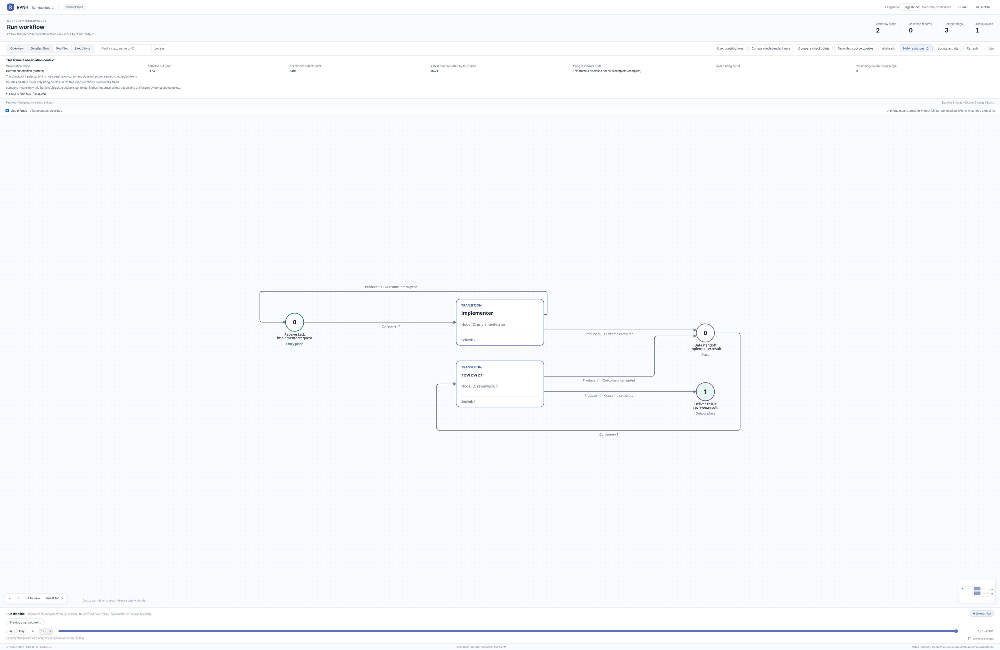

# RPNH 用户案例

[English](README.md) | 中文

[仓库首页](../README_ZH.md) · [入门教程](../docs/guides/getting-started_ZH.md) · [文档中心](../docs/index_ZH.md) · [Viewer 指南](../docs/guides/viewer_ZH.md)

## 选择第一个案例

首次使用先完成[安装与本地运行](../README_ZH.md#快速开始)。按目标选择一项，再按案例自身的 README 执行；源码案例从 checkout 根目录运行，安装包只导出下方列出的命名案例。

| 想先验证什么 | 从哪里开始 | 模型与依赖 |
|---|---|---|
| 安装、工具结果与 Viewer | [原生插件](native_plugin/README_ZH.md) | 不使用模型；安装案例插件 |
| 两个 agent 的并行与 join | [工作流模式](workflow_patterns/README_ZH.md) | 默认脚本替身；可选真实 profile |
| 把项目带到另一个环境 | [分享包复用](package_reuse/README_ZH.md) | 不使用模型；接收端须准备依赖 |
| 两方共建并独立运行原任务 | [项目协作](project_collaboration/README_ZH.md) | 获准真实 profile；受控贡献者 |
| 查看应用任务与已记录成绩 | [Agent／角色工作流](#agent-与角色工作流) | 阅读可离线；执行条件逐例说明 |

[工具与 SDK](#工具sdk-与校验-fixture) · [原生输入与权限](#原生输入与权限-fixture) · [历史机制](#历史贡献与业务证据) · [取用与运行](#取用与运行案例) · [读图与证据](#读图与证据)

按建模对象选择：agent 工作流描述任务职责与交接，领域算法和业务系统是工具或外部环境。ERP、3-DOF、JB、HarnessAudit、AutomationBench、SlopCodeBench 与 RRSI 保留为真实 agent／角色工作流。RRSI 自定义 registered-host role PN 也可具有真实 agent 绑定，不要求一律使用 stock AgentLoop。纯工具流水线、原生输入 gate、作者 principal 和显示注释不会仅因 Registry 来源链而变成 agent。

## 项目预览：复制、共创与复用

完整项目旅程从[复制、共创并复用同一 Agent 项目](project_collaboration/README_ZH.md)开始：
解决两方贡献冲突形成原双 parent M，业务前三次采用内容后，下载精确 M 给独立 receiver。
两端均运行 stock implementer/reviewer agent。注明日期的结果为 43 次登记请求／42 次响应，
两端原路径适配断言均 3/3 PASS；grader 已可见，原 `test.sh` 未运行。
查看[完整业务 PN](project_collaboration/figures/source-petri.png)、真实下级执行网及
[图像来源](project_collaboration/figures/provenance.json)。

[原尺寸 PN](project_collaboration/figures/source-petri.png) · [精确观察与来源](project_collaboration/figures/source-petri.json) · [捕获记录](project_collaboration/figures/provenance.json)

## Agent 与角色工作流

| 目标 | 案例 | 图册或指南 | 默认模型边界 |
|---|---|---|---|
| 完整项目复制、冲突协调与精确 M 独立复用 | [项目共建](project_collaboration/README_ZH.md) | [实际业务与执行 PN](project_collaboration/README_ZH.md#实际-viewer项目与两层-pn) | 既有获准真实 profile；受控贡献者 |
| 两项原主体贡献共建 curator → auditor 合同 | [Agent 任务网共建](user_collaboration/agent_cobuild/README_ZH.md) | 实际运行与证据见示例页 | 原生 AgentLoop；local_process 脚本协议演示 |
| 模型—程序—模型计算 | [混合汇总](hybrid_summary/README_ZH.md) | [Detailed flow](hybrid_summary/README_ZH.md) | 脚本替身；可传入精确真实 profile |
| 串行、并行、文档和长流程结构 | [工作流模式](workflow_patterns/README_ZH.md) | [PN 与简化视图图册](workflow_patterns/README_ZH.md) | 脚本替身；可传入精确真实 profile |
| 两个独立管理的子任务 | [任务工作区](task_workspace/README_ZH.md) | [子任务 PetriNet](task_workspace/README_ZH.md) | 脚本替身 |
| Agent replacement；另含纯声明组合 | [原生网操作](net_operations/README_ZH.md) | [已采用 replacement PetriNet](net_operations/README_ZH.md) | AgentStage replacement；compose_serial 仅声明 |
| 真实临床文档／数据 packet | [JB steering packet](jb_steering_packet/README_ZH.md) | [实际 workflow PetriNet](jb_steering_packet/README_ZH.md) | 用户自有精确真实 profile |
| 真实数值最优控制任务 | [3-DOF 动力下降](three_dof_powered_descent/README_ZH.md) | [实际 workflow PetriNet](three_dof_powered_descent/README_ZH.md) | 用户自有精确真实 profile |
| Office benchmark 接入与评分结果 | [HarnessAudit Office](harnessaudit_office/README_ZH.md) | [运行与 viewer 指南](harnessaudit_office/README_ZH.md) | 离线查看成绩；显式配置后执行／评分 |
| 独立 child run 驱动的两轮 Policy 演化 | [RRSI v0.6](rrsi_v06/README_ZH.md) | [Policy 与角色 PetriNet 声明图](rrsi_v06/README_ZH.md#petrinet-声明) | 用户自有精确真实 profile |
| 业务 workflow benchmark 与宿主扩展 | [AutomationBench](automationbench/README_ZH.md) | [成绩、任务边界与 viewer 指南](automationbench/README_ZH.md) | 离线查看保留结果；新的实时运行需要已授权 profile |
| 使用原验证器的 managed ERP 任务 | [ERP-Bench](erp_bench/README_ZH.md) | [任务与执行指南](erp_bench/README_ZH.md) | 用户自有精确真实 profile 与原 Docker 环境 |
| 编码任务前缀的原生 Session 命令 | [SlopCodeBench pilot](slopcodebench/README_ZH.md) | [pilot 范围与保留结果](slopcodebench/README_ZH.md) | 脚本夹具或显式授权的真实 profile |

## 工具、SDK 与校验 fixture

| 目标 | 案例 | 图册或指南 | 默认模型边界 |
|---|---|---|---|
| 本地计算与登记资源 | [原生插件](native_plugin/README_ZH.md) | [PetriNet 声明图](native_plugin/figures/README_ZH.md) | 不使用模型 |
| 跨环境复用同一个原生加法 v2 包 | [包复用](package_reuse/README_ZH.md) | [包 PetriNet 声明图](package_reuse/figures/README_ZH.md) | 不使用模型 |
| 同一个类型化 Petri 网中的十个登记工具 | [原子工具流水线](tool_pipeline/README_ZH.md) | [PN 变体与节点局部图](tool_pipeline/figures/README_ZH.md) | 确定性 HOST 工具；不使用模型 |
| 只读 SQL 执行与保留行序的精确查询比较 | [SQL 查询校验](query_validation/README_ZH.md) | [原生结果、验收边界与实际 Viewer](query_validation/README_ZH.md) | 固定候选；无模型／provider 调用 |
| 原 JSON、CSV、Parquet 多输入汇合并形成两件产物 | [多源数据合并](tool_pipeline/multi_source/README_ZH.md) | [冲突、适配验收器与实际 Viewer](tool_pipeline/multi_source/README_ZH.md) | 确定性 HOST 工具；不使用模型 |
| 单 Registry 内的有界合成迭代 | [合成迭代](rsi_workflows/README_ZH.md) | [一至四轮与终止绑定声明图](rsi_workflows/figures/README_ZH.md) | 确定性 HOST；不声称模型改进 |
| 验证证据文件与源码身份 | [示例证据约定](example_validation/README_ZH.md) | [只读验证工具](example_validation/README_ZH.md) | 无独立 PN、模型调用或业务执行 |

## 原生输入与权限 fixture

| 目标 | 案例 | 图册或指南 | 默认模型边界 |
|---|---|---|---|
| 不同原生申请者与审批者 | [模拟退款审批](approval_workflow/README_ZH.md) | [实际 PN 与同一运行 Viewer](approval_workflow/README_ZH.md#原运行-petri-net) | 受控本地客户端；无资金或模型调用 |
| 精确的外部结果接入 | [受控报价](a2a_quote/README_ZH.md) | [实际 PN 与同一运行 Viewer](a2a_quote/README_ZH.md#原运行-petri-net) | 自定义 HTTP 状态 fixture；无外部服务或模型 |

## 历史贡献与业务证据

| 目标 | 案例 | 图册或指南 | 默认模型边界 |
|---|---|---|---|
| 历史路线配置贡献与业务评估 | [路线机制与结果](user_collaboration/README_ZH.md#历史路线规划机制证据) | 原 74-operation 工具 PN、版本与失败 | 网外模型配置提案；工具执行业务 |
| 历史十操作电费网的连续修订 | [原生电费机制 fixture](user_collaboration/native_billing/README_ZH.md) | 原业务 PN、提议者与采用证据 | 确定性 source 程序与工具；非 agent 网 |

## 取用与运行案例

若要把案例拿到自己的项目中，先看
[包含完整依赖的导出与修改教程](../docs/guides/examples_ZH.md#导出案例并改成自己的应用)。
命名导出包括 `native_plugin`、`hybrid_summary`、`compose_serial`、`package_reuse` 和默认
`adapter_task`；其余仍是源码案例。[v2 原生加法教程](../docs/guides/package-reuse-example_ZH.md)
会构建可分享包，并完整演示环境准备和真实执行。这些新导出需要本源码候选版构建的 wheel，
旧 rc1 wheel 不包含它们。AutomationBench 另有 Python 3.13+ 与固定上游的准备要求。

安装版附加入口：[适配任务](../docs/guides/examples_ZH.md)通过全部支持宿主运行同一个语义任务，图示为 DSH 宿主下已记录的任务 PN。两层含义见[业务 PN 与执行 PN 定义](../docs/ARCHITECTURE_ZH.md#workflow-graph-与-petrinet-lowering)。

## 读图与证据

图册区分初始声明与运行记录。**PetriNet** 展示完整原网，纯工具网的 agent 概览可为空，工具流程见 **Detailed flow**。节点详情不是简化视图。 Overview 是只读 agent 投影，不是简化后可执行 PN。`registered_agent_binding` 可追到精确 executable binding 与 agent 引用；`declared_llm_executor` 仅确认声明，不证明执行；`explicit_host_annotation` 是未确认显示注释，不建立 agent 身份。角色按显式 scoped identity 分组，不能凭同名、模型名或用户账号合并。边保留原路径依据，表示通往下一 agent 的结构路径，不证明已发生顺序、guard 通过或全输入 join 满足。完整 PetriNet 与所属 Registry 保留权限、guard、join 以及实际 loop／turn／action、工具和产物引用。managed child／action 不计为新增 PN transition，独立 child Registry 保持独立。

ERP、AutomationBench、HarnessAudit Office 与 SlopCodeBench 的静态 frame 现分别导出 **1／1／4／1 个声明角色**。这是声明身份，不是新 benchmark 运行或 runtime binding；原 frame 和图像继续保留。

每个可运行 workflow 都会创建真实 Registry，可用
`rpnh net --run RUN_DIR --view --no-open` 打开。脚本替身经过相同协议与结算边界，但不代表
模型推理能力。运行截图保留其原场景范围；初始声明图的来源与静态编译边界在各图册中说明。常规案例截图省略精确 checkpoint 标识和本地观察时间。注明日期的结果图册可在明确说明后保留原始技术运行标识；这些不是个人身份或访问凭据。

中断／恢复行为请使用独立任务案例和专门的
[checkpoint 恢复指南](../docs/guides/checkpoint-recovery_ZH.md)。Reopen 会在同一 Registry
中追加新的执行代次，不会改写案例的最终成功图片或参考结果。

请从[完整案例指南](../docs/guides/examples_ZH.md)和
[看板指南](../docs/guides/viewer_ZH.md)开始。生成的 profile、Registry 目录和 provider
transcript 均保存在仓库之外。

2026-10-06公开记录：freeze04首轮18题为5 PASS / 9 FAIL / 4 BLOCKED；独立repair四题为1 PASS / 3 FAIL。旧14道已评分题未重跑。 [结果与限制](automationbench/PUBLIC_RESULTS_20261006_ZH.md).

Viewer 可缩放、平移并查看节点／弧细节；简要视图用于查看任务 agent 与交接，见 [Viewer 指南](../docs/guides/viewer_ZH.md)。
