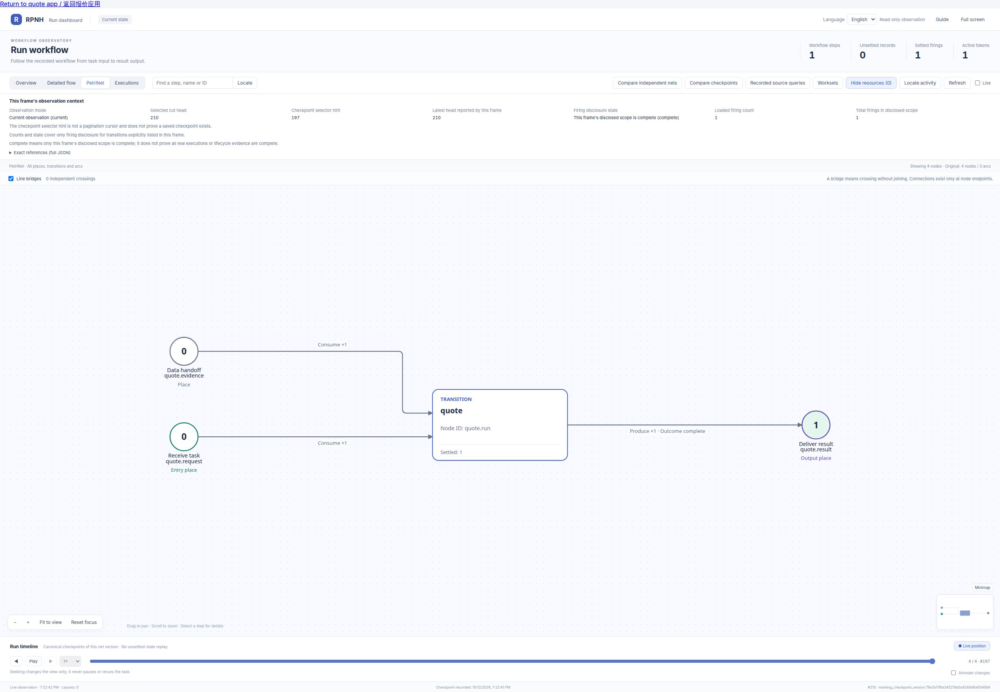
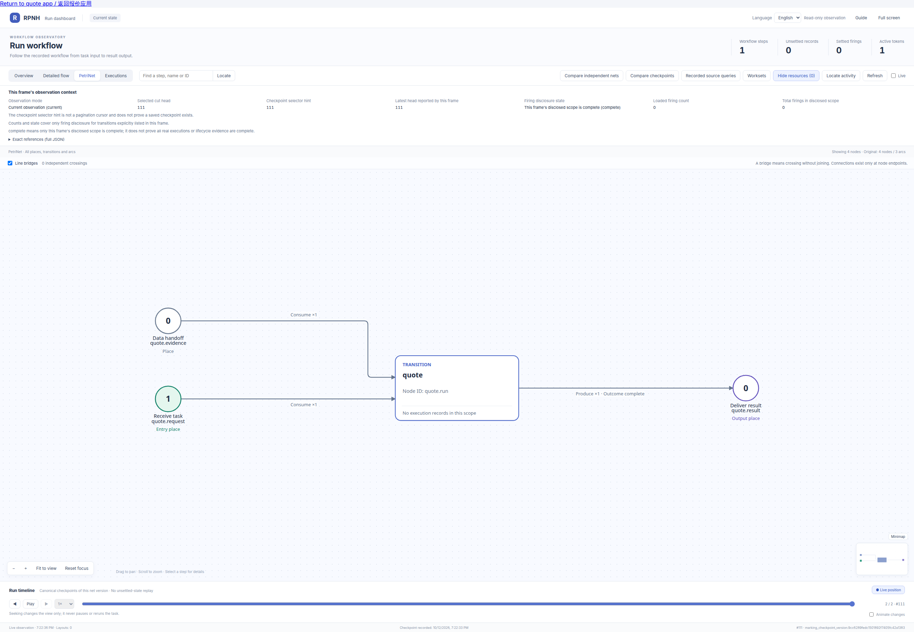

<!-- counterpart: README.md -->

# 受控外部结果接入报价

[English](README.md) · [示例目录](../README_ZH.md) · [Viewer 指南](../../docs/guides/viewer_ZH.md)

这个本地应用把选定的合成外部结果接入一个精确 RPNH 输入等待，再发布登记的模拟酒店报价。
holder 页面和原 Viewer 观察同一 Registry 与 Petri net。自定义 Python HTTP adapter
提供确定性状态 fixture；不调用模型、外部商户、预订或支付服务。

## 原运行 Petri net

[](figures/completed.png)

这张实际 Viewer 截图显示原运行中已结算的一次报价。点击可看原尺寸；
[图片来源](figures/provenance.json)保留精确 net/checkpoint 与历史源码窗口。
它不表示后来源码改动已重新执行或验证。按[同一运行 Viewer 命令](#启动与重开)
可查看此应用创建的运行。

已记录的受控浏览器选择 `trusted25` 后，产生 USD 150.00 报价，1 firing、1 输入回执、
0 模型调用。`trusted25`、`untrusted50` 与 `expired` 是状态 fixture，不是签名凭证。
无折扣报价完成是业务出口，不表示证明验证成功。传输与身份边界见[来源与验证](#来源与验证)。

## 启动与重开

使用已能运行当前 checkout 的既有环境，从产品仓库根目录执行。
在产品树外选择新的本地可写目录，不要指向共享运行目录。
应用会拒绝符号链接穿越和已有的硬链接运行文件。

```bash
# 当前目录为产品仓库；明确选择其父目录作为本次可写工作区。
export A2A_DEMO_WORKSPACE="$(cd .. && pwd -P)"
export A2A_DEMO_RUN="$A2A_DEMO_WORKSPACE/a2a-local-demo-01"
export PYTHONDONTWRITEBYTECODE=1
# TMPDIR 应已指向该工作区内、本任务拥有的临时目录。
python -m examples.a2a_quote.server \
  --workspace "$A2A_DEMO_WORKSPACE" --run-dir "$A2A_DEMO_RUN" \
  --proof-seconds 900 --port 0
```

打开控制台打印的 `http://127.0.0.1:PORT/`。这个受控 loopback 前门把所有浏览器
预绑定到**同一个 holder**；没有角色选择器、密码、凭据端点或外部登录。
holder、本地 fixture adapter 和 owner 对应不同的原 Registry principal/session，
只有 adapter 的 verifier 会话能向原生等待提交证明证据。
这不证明多租户隔离，也不自动把凭证主体等同于本地用户。

1. 核对酒店、不可变 request 引用、等待代际与有效期。原 PN 已处于等待，尚无报价 firing。
2. 选择 **Trusted25**，模拟 25% 折扣令 USD 200.00 变为 USD 150.00。
   **Untrusted50**、**过期 fixture**、**拒绝**各生成一次 USD 200.00 报价，
   同时明确记录相应不满足折扣的 verdict。
3. 选择前可点**替换当前等待的证据请求**。通过原生 wait supersession 登记下一代，
   request/session/challenge 引用全部更新，旧回调被拒绝。
4. **刷新状态**读取原 Registry 并处理已到期的原生等待，超时产生无折扣报价。
   没有独立定时器、调度器或后台业务账本。
5. 点击**打开原 Viewer · 同一运行**查看 Petri／flow 和 firing 记录，再从
   **返回报价应用**回到页面。语言按钮切换中英文。
   网络错误表示完成状态未知，应先刷新原状态再重试。

Ctrl-C 停止后，使用**同一个应用目录**重开：

```bash
python -m examples.a2a_quote.server \
  --workspace "$A2A_DEMO_WORKSPACE" --run-dir "$A2A_DEMO_RUN" --reopen --port 0
```

等待、已接收但尚未准入的状态都走普通 `resume_run`，保留原 run/net/关联，
并隔离旧 writer。输入在准入前到期时，原生层将其原子替换为已声明的超时输入。
终态重开只读投影，不创建写入 gateway、新 checkpoint 或重复报价。
持久关联缺失会阻止继续，宿主不会猜测映射或重发证明。
若启动中断在 wait 发布之前，原生恢复保持阻塞；保留原目录，另用新目录建立明确的新请求。

应用 `--run-dir` 指向应用父目录，**真正的原生 Registry 位于 `$A2A_DEMO_RUN/run`**。
单独打开实际运行 Viewer 时使用这个子目录：

```bash
python -m examples.view_input_declaration a2a_quote \
  --run-dir "$A2A_DEMO_RUN/run"
```

重开需要整个应用目录保持原位，其中包括 run 和原个人 Registries。
这些是本地运行证据，不能作为产品文件提交或公开。

## 精确关联与传输

不可变 `run_input_wait/v1` 的 expiry input 保存完整非秘密关联：原 run/task/net、
私有输入 wait 及代际、精确 anchor request resource、assistant 与 merchant 的
task/context 对、原生 verifier principal 与 HostSession、合成验证 session/request/challenge
引用和有效期。该 payload 同时声明“不折扣”的超时继续输入。
宿主核验**整个关联**，仅 context 相同从不授予准入。
required-one evidence 端口为 private，没有 producer；anchor resource 与
`InputWaitSpec.binding_ref` 精确相同。

浏览器只向 `POST /api/select` 发送 fixture 选择、完整关联和重试 command ID。
宿主计算最小 fixture 证据，用自己的 verifier 会话经 `RunInputHost` 提交。
浏览器的 `approved:true`、actor、session 或 verdict 字段均被拒绝；
没有接受任意 verifier 结果的 HTTP callback 路由。
原生输入 guard 另行检查 principal、binding、deadline、checkpoint 与一次性 wait；
原 Orchestrator 准入并结算一次报价。
UI 状态只是 Registry 投影，没有 pending/completed map、ready queue 或业务账本。

`GET /api/state` 返回状态、关联、结果、checkpoint、证据阶段以及实际 firing／回执／模型计数。
`POST /api/renew` 只接受 `{"association": <完整当前关联>}`。
POST 要求精确本地 Origin；Host 和跨站检查也覆盖 Viewer。
Python 接口为 `A2AQuoteApp(directory, workspace=..., reopen=False)` 和
`A2AQuoteServer(app, port=0)`，后者提供 `server.origin` 与 `serve_forever()`。

只有非秘密引用、判定和 fixture 标签进入 Registry／Viewer；
没有凭证、presentation、nonce 正文、秘密 URI、planner 输入或模型调用。
合成 request 引用不是 bearer credential。

## 来源与验证

传输使用自定义本地 HTTP，不代表已测试 A2A 互操作。此案例没有建立 A2A SDK、Agent Card、
JSON-RPC/SSE 交换、Credo 钱包、OID4VP 流程、签名或信任链验证的通过结论。
`a2a_quote` 模块、类、schema 标识与命令参数保留，以兼容原记录运行；这些名称不代表协议合规。

交互合同参考任务提供的固定
[A2A 样例 6603ba3](https://github.com/a2aproject/a2a-samples/tree/6603ba3f2c31a7ef33e70b9d8b5b5f8be42ac9a3/samples/js/extensions/oid4vp-in-task-auth)。
这是新增的确定性 RPNH adapter，没有移植上游内存 context map、运行其模型意图路径，
也不宣称 Credo 协议已运行。原 RPNH Registry/PN 是唯一持久执行权威。

定向测试位于 [test_a2a_quote.py](../../tests/test_a2a_quote.py)，覆盖四种 fixture、
全部关联字段、共享 context 的两个请求、supersession 后旧 challenge、并发重放、
原生错误 principal、deadline／迟到回调、原运行重开与旧 writer 隔离、
终态 head/epoch 不变、关联缺失、已接收但未准入时超时，以及实际 Viewer 路由的 loopback HTTP。
每次使用 `-p no:cacheprovider` 和**新的任务内** `--basetemp`。
HTTP 测试只对本地测试客户端显式禁用继承的代理。

下方等待图与页首完成图来自同一 Registry/PN，像素保持原样；
[图片来源](figures/provenance.json)记录捕获条件。它们是运行时视图，不是静态声明图，
也没有复用审批截图。历史原生／浏览器检查不能自动认证后来整合的源码候选。

[](figures/waiting.png)
