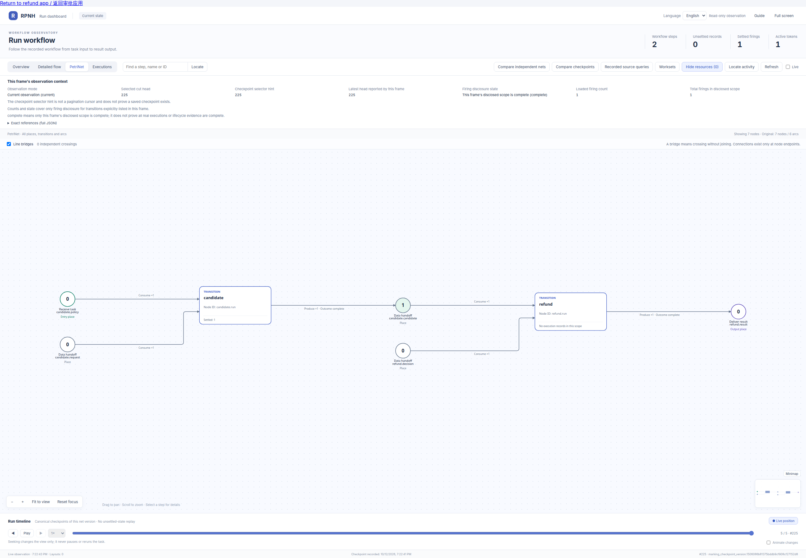

<!-- counterpart: README.md -->
# 双主体受控模拟退款审批

[English](README.md) · [示例](../README_ZH.md)

这是本地确定性退款应用：两个独立受控浏览器客户端分别绑定不同原生 RPNH
主体，另有独立 owner 持有可信前门。不调用模型、支付或真实退款服务，不接生产
登录或公网。金额使用整数最小货币单位：`2500 USD` 表示 25.00 美元。
固定合成案例对应 `synthetic-order-001`；原支付金额与退款政策都是不可变登记输入。

## 原运行 Petri net

[](figures/completed.png)

这张实际 Viewer 截图来自原运行，显示候选与模拟退款两次操作均已结算。点击可看原尺寸；
另见[图片来源](figures/provenance.json)和[Viewer 指南](../../docs/guides/viewer_ZH.md#受控输入示例)。
历史截图不表示后来源码改动已重新执行或验证。

## 启动与重开

在产品仓库目录内，使用**已有**且具备 RPNH 依赖的 Python 环境运行。运行目录必须
是可写工作区内尚不存在的新目录：

```bash
PYTHONDONTWRITEBYTECODE=1 PYTHONPATH=. python -m examples.approval_workflow.server \
  --workspace /absolute/writable/workspace \
  --run-dir /absolute/writable/workspace/refund-demo
```

服务器仅监听 `127.0.0.1`，输出网址和两个临时本地密码。控制台与运行目录应私有
保留。这些密码仅是每次服务器进程的受控演示接入控制，服务器将其映射到持久的
personal Core 会话；它们不是实际外部账号。没有创建凭据或切换角色的 HTTP 端点。
运行目录包含符号链接或硬链接时拒绝打开。

1. 打开**两个独立浏览器配置／上下文**。第一个访问 `/requester`，在浏览器的
   Basic 认证提示中填写控制台提供的 `requester` 用户与密码；提交 `2500`、`USD`
   和合成理由。
2. 第二个访问 `/approver`，使用单独的 `approver` 凭据。刷新后展开不可变候选，
   核对金额、政策／来源引用以及精确 run/task/net/transition/wait，再批准或拒绝。
3. 刷新两个页面。结果从原 Registry 读取。点击“打开原 Viewer · 同一运行”，
   查看实际 PN、checkpoint 与 firing 历史；Viewer 中可返回应用。

导航不会切换身份。申请者不能访问 `/approver`，其状态投影不展示审批候选。
无关第三主体不能读取状态、Viewer 或其 API，也不能提交申请或审批。审批链接
应在已绑定的审批浏览器中打开。界面支持中英文；刷新由用户触发，不自动重送结果
不确定的 POST。相同 command ID 的完整相同请求沿原 Registry replay 返回。

本页记录图展示原运行的等待和完成观察点。精确 run/net/checkpoint、捕获条件和
限制见[图片来源记录](figures/provenance.json)。这些是实际运行 Viewer 视图；
`python -m examples.view_input_declaration approval_workflow --json` 另行导出静态声明 PN。
附加 `--run-dir /absolute/writable/workspace/refund-demo/run` 可查看原 Registry。

[](figures/waiting.png)

默认审批有效期 900 秒，可用 `--decision-seconds 60` 缩短演示等待。刷新状态会
触发可信 owner 的到期处理。等待中或已接收但尚未准入的过期决定走声明的无退款
出口；已 dispatch 的工作仍由原恢复机制处理。应用没有另建业务计时队列或 scheduler。

停止本地服务器后，重开**同一**目录：

```bash
PYTHONDONTWRITEBYTECODE=1 PYTHONPATH=. python -m examples.approval_workflow.server \
  --workspace /absolute/writable/workspace \
  --run-dir /absolute/writable/workspace/refund-demo --reopen
```

在新的浏览器上下文使用本次输出的临时密码。personal 身份、原 task/run/net、等待
与不可变 receipt 均保留于原 Registry。重开需保持相同的已登记实现／schema 清单，
登记内容变化会被拒绝。未完成运行使用原生 `resume_run`；终态只读
打开，不增加 writer epoch。已有 exact registered completion 时走原恢复结算，不
再次调用 executor。缺少完成证据时拒绝自动继续，保留未知并需要检查；不盲重放，
不宣称成功。

`contracts.module()` 构造声明 PN，包含两个普通 registered operation 和两个私有、
required-one 的外部输入口：

```text
政策 anchor + 请求者输入 → candidate.run → 不可变候选 anchor
候选 anchor + 精确审批决定 → refund.run → 登记模拟结果
```

两个外部输入均经 `RunInputHost`，绑定精确 anchor 资源和 Core 派生的获准主体；
同时消费 anchor，没有内部 producer 或初始外部输入 token。候选绑定原请求、政策／
来源资源、申请会话和精确目标；最终 executor 再次比较完整候选。只有 `completed`
对应 `mock_refund: true`；拒绝和过期为 `mock_refund: false`。PN terminal 表示案例
已解决，不等于批准退款。

等待、接收、过期、完成与恢复事实仅在原 Registry/PN 内。Python 锁只串行访问
唯一 owner，不保存业务状态。没有旁路审批账本、completed map、Branch review，
也不把 `TaskControl.resume` 当审批。每个 runtime 支持一个不可变案例；请求改体、
旧决定或跨运行引用会被拒绝。

交互合同参考[固定 Mastra customer-refund 模板](https://github.com/mastra-ai/mastra/tree/4ca41b2135991ac744c3729bbb7d42bf731a8185/templates/template-customer-refund-agent)，提交
`4ca41b2135991ac744c3729bbb7d42bf731a8185`。这里是确定性原生 RPNH 接入，不是运行
上游应用或认证栈。真人、外部账号隔离和金融效果不在受控演示范围内。这些命令不
需要下载源码或安装依赖。

针对性验证（临时文件也放在工作区内）：

```bash
PYTHONDONTWRITEBYTECODE=1 PYTHONPATH=. python -m pytest \
  tests/test_approval_workflow.py -q -p no:cacheprovider \
  --basetemp /absolute/writable/workspace/approval-tests
```

测试实际原生 socket／registered dispatch、不同会话、改体与旧引用、越权读取、
重放／并发、到期、重开及独立 HTTP 客户端。HTTP 测试与真实浏览器证据分开记录。
原始测试 runtime、首轮失败和控制台密码留在产品仓库外，不发布 Registry 数据库
或浏览器凭据。
