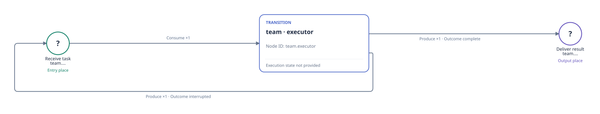

# Native ERP actor declaration

English | [中文](README_ZH.md)

The official Viewer shows the native executor request/result and interrupt-return structure. erp_python and validate_plan are managed tools inside the Agent. This initial declaration does not execute an ERP transaction, start Odoo, call a model, or record a completed task.

[](initial-petri.svg)

This is a self-contained [official Viewer SVG export](viewer-export-provenance.json); only its outer viewport is normalized to include the complete rendered graph. Open the static Viewer below for selectable node and arc details.

From the repository root, in an environment with the RPNH dependencies already available, open the bundled static frame:

```bash
python examples/view_declaration.py erp-bench --no-open
```

Open the loopback URL printed by the command and select PetriNet. Zoom, pan and select nodes or arcs for details. This command only reads the static declaration; it creates no Registry, runs no example and selects no execution profile.

[Exact source, graph counts and scope](source-provenance.json) · [Static frame](declaration-frame.json) · [Back to example](../README.md)
