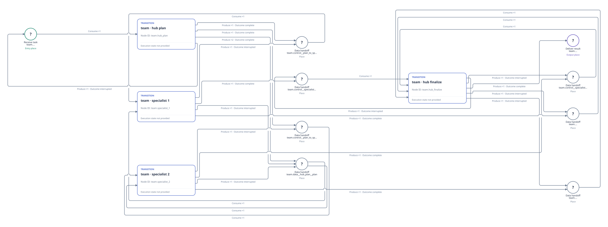

# Office off-t1 业务声明

[English](README.md) | 中文

官方 Viewer 呈现原 off-t1 公开角色流程：hub plan、两个 specialist 与 hub finalization。图从固定版本的公开任务及当前按角色绑定的 managed-tool 声明编译。这是 initial_configured 结构，不是保留运行或 benchmark 评分；其他任务条件有各自的声明。

[](initial-petri.svg)

这是自包含的[官方 Viewer SVG 导出图](viewer-export-provenance.json)；只调整最外层视口以完整保留已渲染的图。下方静态 Viewer 支持选中节点和弧查看详情。

在仓库根目录、已有 RPNH 依赖的环境中打开随附静态 frame：

```bash
python examples/view_declaration.py harnessaudit-office --no-open
```

打开命令打印的本机回环 URL，选择 PetriNet；使用缩放、平移和节点/弧详情。此命令只读静态声明，不创建 Registry、不执行示例、不选择 execution profile。

[精确源码、图结构与范围](source-provenance.json) · [静态 frame](declaration-frame.json) · [返回示例](../README_ZH.md)
