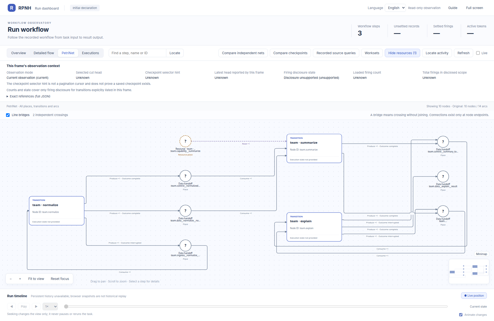

# Hybrid summary workflow

English | [中文](README_ZH.md)

## Official Viewer panorama

The retained official Viewer PN below is an initial declaration: normalize, native summarize and explain, with 10 nodes and 14 arcs. It comes from a frozen source candidate; its [graph.json](graph.json) input is byte-identical to this example. It does not claim recompilation under current main or the original completed runtime state.

[](assets/hybrid-summary-initial-petri.png)

[Image and input provenance](assets/initial-petri-provenance.json) · [Original completed Detailed flow](assets/hybrid-summary-flow.png)

[Local Viewer and reading guide](../../docs/guides/viewer.md) · Click the panorama to open the original full-size image.

Obtain the complete editable closure from installed RPNH:

```bash
rpnh examples export --example hybrid_summary --output /absolute/absent/my-hybrid
cd /absolute/absent/my-hybrid
python -m pip install -e ./examples/native_plugin
```

Keep `examples/_support` and `examples/native_plugin` beside this directory.
Copying `hybrid_summary` alone is not sufficient. The same commands also work
from a source checkout root. Edit `input.txt`, `graph.json`, or the installed
editable plugin handler. The scripted fixture understands only the included
task protocol: arbitrary prompt/graph changes may require editing
`examples/_support/scripted_model.py` or explicitly authorizing a live profile.
Scripted runs still require supported local process/IPC permissions.

This three-node DAG reads `graph.json` and executes it through
`AgentWorkflowGraph` and `run_agent_task`:

```text
scripted/model normalize -> demo/summarize -> scripted/model explain
```

The original Detailed flow linked above comes from the completed deterministic run. It shows the two Agent nodes around native `demo/summarize` and their registered handoffs; it is kept separate from the inline initial-declaration PN.

After installing RPNH and `examples/native_plugin`, run the deterministic mode:

```bash
DEMO_ROOT="$(mktemp -d "${TMPDIR:-/tmp}/rpnh-hybrid.XXXXXX")"
python examples/hybrid_summary/run.py --run-dir "$DEMO_ROOT/run"
rpnh net --run "$DEMO_ROOT/run" --show-resources
```

Use `--input examples/hybrid_summary/variant-input.txt` for the `39`/`13`
variant. To use an authorized real route, add
`--execution /absolute/path/to/execution.json`; no provider or model is
hard-coded and there is no fallback.

See the [examples guide](https://github.com/Deng-0119/RPNH/blob/main/docs/guides/examples.md) for expected evidence and
the distinction between scripted and real-model modes.
