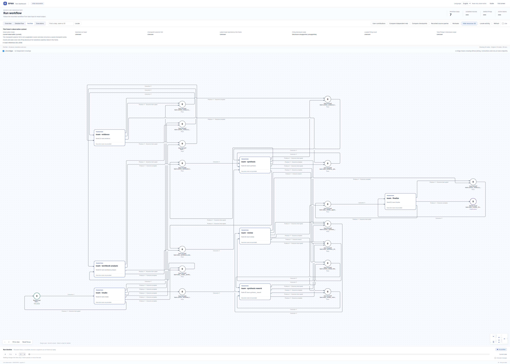

# JB 临床 steering packet

[English](README.md) | [中文](README_ZH.md)

这个真实 provider 案例要求 RPNH 主 agent 自行设计多 agent workflow，完成一项真实的
临床文档与数据任务；它不会加载预设实验图。workflow 需要合并证据审阅和参与者级分析，
最后发布精炼的设计 memo 与 appendix。

[](assets/child-initial-petri.png)

从原 Registry 登记的完整编译声明只读投影，包含所有 place、transition、返弧和分支。此图为 `initial_configured` 静态声明，没有历史 token、firing 或完成态着色；未重跑模型或业务。原编译器 Git 版本未能确定，精确登记版本、原字节哈希和捕获时官方 Viewer 版本见[来源记录](figures/child-initial/provenance.json)。

[只读 Viewer：缩放及节点／弧详情](#static-pn-viewer) · [原运行 Overview 原图](assets/jb-steering-petrinet.png)
<a id="static-pn-viewer"></a>

### 只读静态 PN Viewer

在已具备兼容 RPNH 环境的源码 checkout 根目录运行。此入口只读附带的静态 frame，不打开 Registry 或执行业务。

```bash
python - <<'PY'
import json
from pathlib import Path
from cpn.frontend.server import serve_projection
frame = json.loads(Path("examples/jb_steering_packet/figures/child-initial/declaration-frame.json").read_text(encoding="utf-8"))
class Snapshot:
    def __call__(self):
        return frame["net"]
    def dashboard(self, cursor=None):
        if cursor is not None:
            raise ValueError("Static declaration has no execution history")
        return frame
serve_projection(Snapshot(), host="127.0.0.1", port=0, open_browser=False)
PY
```

打开打印的 localhost URL，选择 **PetriNet → Fit to view**。滚轮缩放、拖动平移；点击节点或弧查看原生详情，长标签可在详情中读取。静态声明没有运行历史；关闭服务用 Ctrl+C。

## 公开来源

任务来源为 Penna 等发表于 *PLOS Neglected Tropical Diseases* 11(7): e0005725
的论文，DOI [10.1371/journal.pntd.0005725](https://doi.org/10.1371/journal.pntd.0005725)，
试验注册号 NCT00669643。准备脚本从  记录的 PLOS 官方链接获取论文
manuscript、S2 统计分析计划和带 codebook 的 S5 数据文件。

本仓库不复制参与者行或原始补充文件。论文页面说明论文本身使用 CC BY 4.0；案例不假设
独立补充文件还具有额外的再发布授权。下载内容始终保留在用户指定的私有目录。

### 数据传输边界

 会把参与者级工作簿文本写入 。运行时，该 packet 会存入
案例 Registry，并经用户选择的 execution route 发送；该 route 可能连接远程 provider。
执行前必须确认来源条款与用户自己的隐私政策允许使用该路线。必填确认参数只记录 operator
的决定，不会修改、脱敏或代替数据授权。

## 复现

使用 Linux／WSL2、已安装 RPNH 的源码 checkout，以及一份明确授权的 execution
selection。下面的命令会下载公开文件，并可能产生付费／外部模型调用；案例不会自行选择
或切换 provider/model。


若已下载官方文件，可同时提供 、 和 ；输出目录仍必须
不存在。runner 会打印 task ID 和 child ，等待 Registry terminal authority，
然后输出注册的最终结果与 PetriNet 摘要。

无需执行模型即可查看真实 run：


本任务没有声明 resource place，因此前两种投影结构相同， 为空；不要
为了展示效果伪造资源节点。

## 验收

将 memo 和 appendix 与 、独立分析 JSON 对照。可靠结果必须区分
每臂 278 名**可评价参与者**与实际入组量；使用精确完成率  后向上取整为每臂
389 名、总计 778 名。结果还应正确解码 323 名 U-MDT 与 290 名 R-MDT，给出基线摘要，
并只把位于每名参与者首次至末次访视区间内的 reaction 日期作为观察事件。

聚合参考值可确定性复算；文字与图拓扑可以不同，因为 workflow 由主 agent 自行设计。
Registry terminal evidence 是必要条件，但不能替代业务验收。 只保留脱敏
的最终成功边界，不发布参与者行、Registry、transcript、路线或模型身份。

如果 run 被用户主动停止，请使用单独的
[checkpoint 恢复指南](../../docs/guides/checkpoint-recovery_ZH.md)。不能仅因为前端关闭就
新建替代任务。
