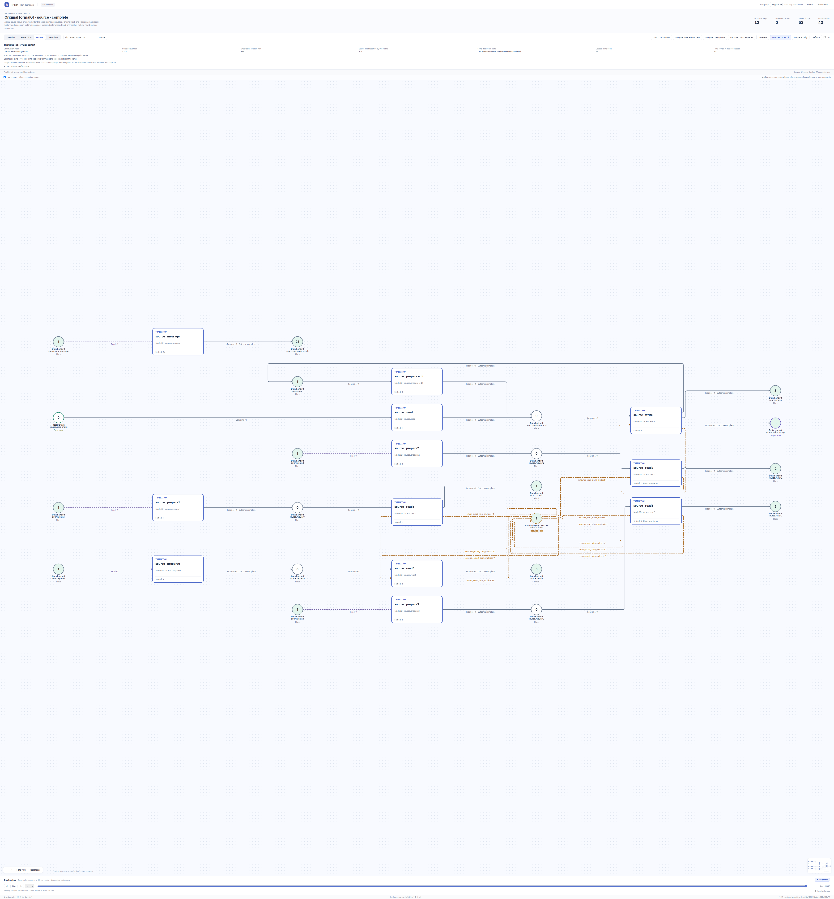
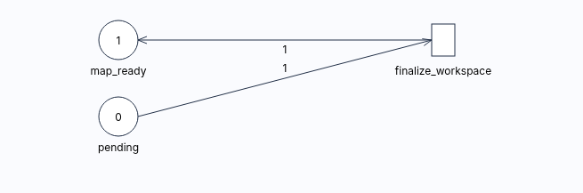

# 实际原生 Viewer 图集

[English](README.md) · [示例](../README_ZH.md) · [图片来源](provenance.json)

先看角色 PN。每张图均可打开原始完整分辨率；图片是原 episode 完成后只读捕获的原生 Viewer PNG，未重画或改名。图内技术运行/检查点身份及观察时间是历史证据，不是访问凭证。此精选图集不分发 Registry 数据库或保存帧回放服务。

| Registry | 完整 PN | 节点 / 弧 | 子执行实例 | 最终观察 head |
|---|---|---:|---:|---:|
| 运维 | [智能体职责](operations-petri.png) | 6 / 9 | 6 | 6125 |
| 开发 | [智能体职责](developer-petri.png) | 3 / 3 | 2 | 1828 |
| QA | [初读与修订发布确认](qa-petri.png) | 6 / 9 | 5 | 4645 |
| 支持 | [初读、事件与确认](support-petri.png) | 6 / 9 | 6 | 5505 |
| 共享 Source | [完整资源控制全景](source-petri.png) | 32 / 36 | 0 | 4351 |

前四张是各自独立的智能体业务 PN。Source 控制规范资源读取、lease、写入与消息，不是智能体 PN。完整全景保留所有分支；近看可打开 [Source 写节点详情](source-write-node.png) 和 [lease 资源详情](source-resource.png)。原图留白和布局保持不变。

## Source 全景与历史切点

[完整分辨率](source-petri.png) · [写详情](source-write-node.png) · [资源详情](source-resource.png) · [真实初始历史切点](source-initial.png) · [真实最后历史切点](source-last.png)

历史视图观察已提交检查点，不控制执行或回滚。当前与历史切点的观察语义不同。开发与 QA 保留此前终态，run02 未重开；所有额外请求的旧历史切点覆盖完整性仍为可选 UNKNOWN。

## 精确智能体 firing 下的执行 PN

这是运维 Registry 中业务 firing 下附属的原始 RPNH 工作区最终化执行定义，不是第五个角色、改名的发布流程，也不替代智能体 PN。[智能体步骤检查器](operations-node.png) 是单独的详情视图。
