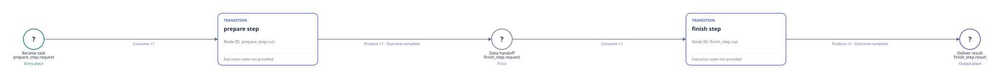
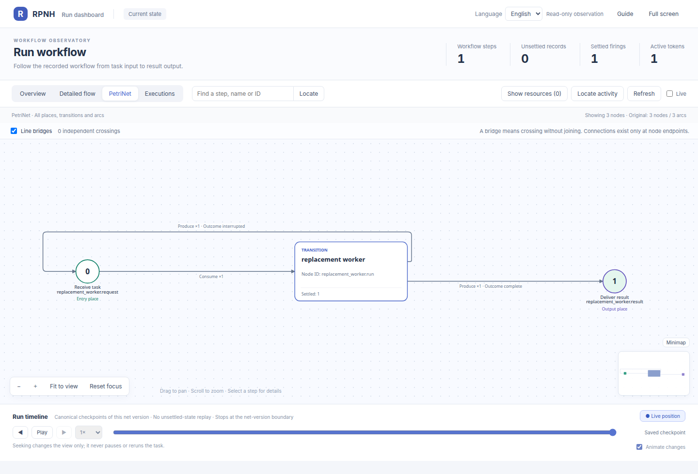

# Native net-operation examples

[English](README.md) | [中文](README_ZH.md)

## Official Viewer initial declaration

This SVG exported from the official Viewer is the compose_serial declaration: prepare_step then finish_step, compiled with explicit inert HOST contract stubs. It is separate from the recorded live-replacement net below and does not execute the two stages.

[](figures/compose-serial/initial-petri.svg)

This is a self-contained [official Viewer SVG export](figures/compose-serial/viewer-export-provenance.json); only its outer viewport is normalized to include the complete rendered graph. Open the static Viewer below for selectable node and arc details.

Click the panorama for the full-size original. From the repository root, with RPNH dependencies already available:

```bash
python examples/view_declaration.py compose-serial --no-open
```

This opens only the static declaration. Use the local Viewer to zoom and select nodes; no run is started. [Source and inert HOST contract scope](figures/compose-serial/source-provenance.json).

## Official Viewer panorama

This original official Viewer capture is the adopted successor in the live-replacement example. It shows that net version only. The compose_serial panorama above is a separate declaration-only net.

[](assets/live-replacement-petrinet.png)

[Local Viewer and reading guide](../../docs/guides/viewer.md) · Click the panorama to open the original full-size image.

## Definition-only example

From the repository root, run:

```bash
python -m examples.net_operations.compose_serial
```

The command prints a complete two-stage `ModuleDeclaration`. It performs no
Registry write and no model call. The symbolic components are prefixed
`prepare_` and `finish_`, the connecting edge is explicit, and both operations
share the same predeclared budget bucket. Supply matching trusted component,
executor, terminal and schema registrations before compiling or running it.

## Live Agent replacement example

`live_agent_replacement.py` is the reproducible task used to validate every
currently executable native net operation in one Registry:

1. Extract obtains the first Agent definition.
2. Branch obtains the successor definition without starting another owner.
3. Instantiate gives that successor an independent symbolic instance.
4. Compose creates the initial serial graph, which executes the first Agent.
5. Replace adopts the successor at a whole-net quiescent boundary. The second
   Agent reads the first Agent's registered workspace file and publishes the
   terminal result.

The image is the actual adopted successor net from the authorized live run
recorded in `live_result.json`. The timeline explicitly stops at the net-version
boundary; the picture does not pretend that both definitions were one static
net.

This command incurs real provider cost. First inspect `rpnh config show`, obtain
the displayed `execution_config_path`, and use an absent directory outside the
repository:

```bash
python -m examples.net_operations.live_agent_replacement \
  --run-dir /tmp/rpnh-net-operations-live/run \
  --execution /absolute/path/from/rpnh-config-show.json
```

The command never changes the selected profile and refuses to reuse an existing
run directory. A PASS requires Registry terminal evidence, one replacement
adoption, preserved workspace ancestry, the expected two-file inventory, and
successful `workspace`, `read_file`, `write_file`, and completion actions. Its
JSON output includes only the configured route summary and Registry evidence;
the full Registry and provider-private audit remain in the supplied run
directory.

Inspect the adopted successor directly with `rpnh net --run RUN_DIR`; add
`--show-resources` or `--resources-only` for the two explicit resource views.
This example declares no Petri resource nodes, so both resource counts are
correctly zero.

The checked-in `examples/net_operations/live_result.json` is a sanitized result
from one authorized real-provider run. It contains no endpoint, credential, local
path, run identity or raw transcript. Historical Reentry and workspace
fork/import plans are not executable and are not represented as live passes.
