# Copy, co-create and reuse an agent project

[中文](README_ZH.md) · [Operator guide](../../docs/guides/project-entry.md)

Start with a complete project, let two controlled contributors revise it, resolve a real conflict into a two-parent revision **M**, and adopt the result before running the original task. Download that exact M into an independent receiver and run the same task there. The package carries definitions, input fixtures, environment requirements, original task materials, verifier, sources and licenses; a bare Module does not provide this complete starting point.

The business PN has two stock `rpnh/default-agent/v1` agents: **implementer** writes and executes the data merger using stock workspace tools; **reviewer** checks the implementation, all instructions and original assertions. The domain algorithm lives in agent-written code. Subordinate execution PNs belong to exact business invocations/firings in the same Registry and handle harness mechanisms such as file materialization and workspace finalization. Their tokens, firings and checkpoints are separate from business marking; AgentLoop logs alone are not execution PNs.

In the recorded journey, both independent projects completed the original task with stock AgentLoop agents; each passed all three original assertions after literal output-path adaptation. The original verifier was visible and the upstream container/test.sh was not run. The 17 original Viewer captures show both completed projects, pre-execution collaboration history and the two PN layers.

## Actual Viewer: project and two PN layers

Actual official Viewer images from the 2026-10-13 native inspection window. [Capture provenance](figures/provenance.json) records the original image bytes and observations.

Open each image at original size to inspect small references; its same-name JSON preserves the exact observation.


Source completed agent overview: implementer → reviewer, two agents and one handoff. source-05 · cut 3474 · selector 3401 · [Exact references, panel text and position](figures/source-overview.json).

## Materials and task

The original task is Terminal-Bench 2 [multi-source-data-merger](https://github.com/harbor-framework/terminal-bench-2/tree/2fd12b88aafdd04a52c298e3940bcb189f9766d6/multi-source-data-merger), frozen at `2fd12b88aafdd04a52c298e3940bcb189f9766d6`. [SOURCES.json](materials/SOURCES.json) records the ten original files and byte provenance. The [original instruction](materials/upstream/multi-source-data-merger/instruction.md), [verifier](materials/upstream/multi-source-data-merger/tests/test_outputs.py), [test.sh](materials/upstream/multi-source-data-merger/tests/test.sh), and full [Apache-2.0 license](materials/upstream/LICENSE) are retained. RPNH-derived code uses [LICENSE-RPNH](LICENSE-RPNH).

Agents must read JSON, CSV and Parquet, normalize equivalent fields, merge by user ID with source priority A > B > C, and produce `merged_users.parquet` and `conflicts.json`. The latter lists conflicting values and selected values. The implementation and reviewer report are also deliverables. Data-source priority is a task rule; it does not resolve collaboration conflicts.

[scenario/generated](scenario/generated/) contains the complete seed, exact lock, initial TEXT fixture and A/B/A-resolved proposal definitions. Original binary Parquet is retained in materials; its portable package representation is an explicitly reversible base64 envelope. No upstream solution or precomputed merger is provided.

## Environment and source binding

Package **0.1.1** uses Python >=3.11,<3.14, pandas **3.0.3**, pyarrow **24.0.0** and `rpnh-harness>=0.1.0rc2`. Use a clean task-local environment bound to the canonical product checkout. The current WSL validation environment uses Python 3.13.12 and these current data libraries. Keep existing libraries when they meet the selected package; do not downgrade a working environment merely to match historical pins.

The frozen upstream Dockerfile still declares Python 3.11/pandas 2.2.3/pyarrow 17.0.0; upstream `test.sh` separately declares Python 3.13/pandas 2.3.3/pyarrow 22.0.0 and its own testing dependencies. Preserve both original files and the original imported package. Version 0.1.1 is a disclosed compatibility variant, not strict upstream-container reproduction. Original-input reads and Parquet/CSV roundtrips passed with the current libraries; business correctness requires separate output verification.

A minimum harness version or successful metadata check does not establish “latest RPNH.” Before a run, record the interpreter, actual `cpn` import location, canonical checkout, precise tested source/revision and local changes, plus a separate verification against remote `origin/main`. Keep that provenance distinct from package version metadata. The driver checks each project's own environment metadata before running; original startup must still establish the approved profile and live owner dispatcher, and the original runtime must validate kernel isolation.

## Run the complete journey

From the canonical checkout, first inspect the entry:

```bash
python examples/project_collaboration/scenario/operate_project.py --help
```

Use the interpreter from the prepared task-local environment. The following variables are operator-selected local paths: `PROJECT_RUN_ROOT` is a fresh, short directory inside the writable workspace; `APPROVED_PROFILE` selects an existing approved profile. Do not publish either private selector or credential contents. With existing explicit authorization for this model/task/budget:

```bash
python examples/project_collaboration/scenario/operate_project.py \
  --root "$PROJECT_RUN_ROOT" \
  --package examples/project_collaboration/scenario/generated/seed-project.zip \
  --definitions examples/project_collaboration/scenario/generated \
  --existing-profile "$APPROVED_PROFILE" \
  --conflict-choice local \
  --authorized-model-run
```

The authorization flag records intent; it grants no credentials, installation permission or model budget. Existing approved credentials/accounts are sufficient; no new account is required. See the [operator guide](../../docs/guides/project-entry.md) for ordinary WSL startup, process-only credential-name forwarding and recovery. A fresh journey is not a recovery command for an existing run.

1. **Import and establish authority.** Import the complete seed into fresh Registry identities, create the project's own protected Branch, and explicitly grant scoped reads and invitations. Supported stop/resume retains the original actor/session; it does not revive expired or revoked readers.
2. **Validate two contributions.** Two controlled local principals submit human-defined Modules through a real deterministic validator operation → stock TEXT → delivery/proposal. Retain input, invocation, firing and result references. These are controlled contributors, not independently authenticated humans or author models.
3. **Resolve the original conflict.** A strengthens implementer/reviewer instructions; B changes the same implementer atom and constrains connected handoff capacities to 1. The first analyzer exposes divergent-atom/coupled-contract conflicts. A-resolved explicitly incorporates B's capacities and cites B's exact proposal/revision and A's `previous_proposal`. Reanalyze A-resolved/B, choose consistently for every conflict, and form genuine two-parent M. Verify both contributions in M. The deterministic validator checks definitions; it does not write the business solution.
4. **Accept and adopt separately.** Protected Branch acceptance leaves runtime unchanged. Compare net/checkpoint/marking before and after acceptance. Use actual runtime marking and explicit token-to-place mappings for adoption; only original adoption receipts establish success.
5. **Restore content before business.** Adopt M → create/approve/accept/adopt a new successor containing base content → create/approve/accept/adopt a new successor containing M content. All three adoptions precede business firing. History remains intact; this demonstrates content restoration followed by execution, not terminal token revival or rollback of external effects.
6. **Download exact M and receive independently.** Export the original two-parent M, not the later single-parent successor. The receiver imports its own downloaded fixture/environment/license closure with new revision/element identities and its own owner authorization. No source session, grant or Registry database is copied.
7. **Run and inspect both projects.** Source uses the final adopted successor; receiver uses its independently imported M. Each uses two stock agents on the original task. Collect settled outputs, implementation, reviewer report, invocation/firing/execution evidence, model attempts and all failures. Native terminal alone is not a passing score.

## Outputs, scoring and Viewer

The driver records requests and checkpoints in `requests/` and `JOURNEY_RESULT.json`. Successful artifact collection writes `artifacts/source/` and `artifacts/receiver/`, each with settled workspace files and reports. `ORIGINAL_ASSERTIONS_PATH_ADAPTED.json` reports the trusted adapter's result. It verifies frozen grader bytes and changes only four output-path strings; all three original test functions retain their assertions. Report this separately from an actual original-layout `test.sh` execution, including dependencies and CTRF/reward if that script was run. The grader is visible, so this is not blind evaluation. A full-instruction review remains separate from the three-test score.

After successful runs, the driver requests actual official Viewer URLs and leaves HOSTs available for review. Review source and receiver agent overview, complete PN, real contributions/conflicts, M's parents, restoration/adoption references, resources and subordinate execution nets where provided by the tested Viewer. Bind each screenshot to its actual revision/net/checkpoint and invocation/firing references. Read expiry or revocation requires a new explicit scoped grant; opening a Viewer does not grant authority. Historical M/base views also require the exact compiler-wire bodies for the retained runtime nets; the driver records read plans after each successful adoption and explicitly unions same-project scopes into the final runtime grant, as described in the operator guide.

**2026-10-13 native inspection window:** native human-input validation, genuine two-parent M, three pre-business adoptions, exact original-M download and independent receiver import with disjoint identities have passed. The first registered credential failure is retained as `NOT_SUBMITTED`, with zero provider HTTP requests. Original-checkpoint recovery retained the same three Registries and original failure/count history while creating a new execution generation. A targeted real no-model recovery regression passed once (27.70s); its two earlier fixture failures remain preserved.

Both original native tasks completed; independent full-instruction review accepted **both** projects. Results below refer to the same original source/receiver executions, not replacement run commands.

| Verified result | Source | Receiver |
| --- | --- | --- |
| Registered requests / model responses | 23 / 22 | 20 / 20 |
| Business firings | 3: one old interrupted firing and two completed roles | 2 completed roles |
| Exact scoped artifact export | 18 files / 47,815 bytes | 20 files / 52,089 bytes |
| Original assertions, path adapted | 3/3 PASS | 3/3 PASS |
| Original `test.sh` | NOT_RUN | NOT_RUN |
| Agent-written implementation, within each exported workspace | `workspace/merger.py` | `solution/merger.py` |

There were **43 registered requests against the authorized maximum of 48**, with 42 responses. Source retains its original single `NOT_SUBMITTED` credential failure, which made zero provider HTTP requests. These are registration/response counts, not a claim about unreported provider retry attempts. Native recovery reused the exact old command ID and launch receipt only after persisted checkpoint-reentry authorization; the execution generation changed, not the run command. Polling merely observed the original executions, and the original HOSTs remained uninterrupted.

For each project, original assertions retain all checks, with only four disclosed `/app` output-literal relocations. The grader was **VISIBLE**; these results are not blind official-container scores. Independent semantic review matched all three original input bytes/hashes and found generic implementations without hardcoded answers. Each output has all four correct rows/20 cells and exactly three field conflicts for user 101 (`name`, `email`, `created_date`). Both Parquet outputs are byte-identical; their conflict JSON differs only by the source's terminal newline. Optional status normalization (`active`/`true`) remains a disclosed instruction ambiguity, not a finding. Receiver `check_out` recomputation was byte-identical to its original deliverables; it did not repair them.

Source and receiver implementation hashes differ. The receiver independently wrote its implementation after importing the exact original M downloaded **before business execution**; no source solution was copied through that package. Each actual Registry business PN has **5 nodes / 6 arcs and two agent roles**. Source has three AgentLoop instances including the old failure; receiver has two. Loop-instance counts are distinct from subordinate execution-net evidence.

Both actual official Viewer capture windows completed with **zero reported gaps**: source captured 101 PNGs and receiver 28 PNGs. Each overview shows two agent nodes/one edge, and each complete business PN shows five nodes/six arcs with unclipped geometry. Actual child execution-net diagrams also fit without clipping after the sidebar layout correction. The receiver execution API returned HTTP 200 with real file-materialization/workspace-finalization `map_ready`/sealed evidence.

Source navigation followed the native **Previous Net Segment** control twice: first to the adopted base-content restoration, then to original two-parent M and its first adoption. Both M parents and all eight supplied historical references were actually visible; returning to the original completed view was verified. All five checked source historical/contribution API requests returned HTTP 200 after the two exact old compiler-wire bodies were explicitly selected in the owner grant. Original Core/read gates remained unchanged.

This bounded journey completed native execution, original path-adapted scoring, full-instruction review and actual Viewer checks in the 2026-10-13 native inspection window. The first browser attempt's socket-path-length failure before HTTP remains preserved. Genuine images and their exact observation references are linked below; the model registration total remains 43.

## Completed source and execution nets


Complete source business PN: five nodes/six arcs; the original interrupted firing remains recorded. source-05 · cut 3474 · selector 3401 · [Exact references, panel text and position](figures/source-petri.json).

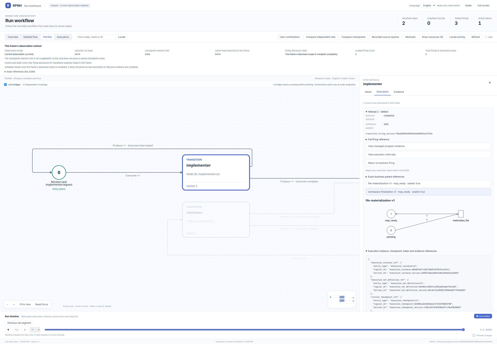

Actual attached file-materialization execution PN, map_ready and sealed; exact business parent and child references are in the companion evidence. source-05 · cut 3474 · selector 3401 · [Exact references, panel text and position](figures/source-execution-materialization.json).

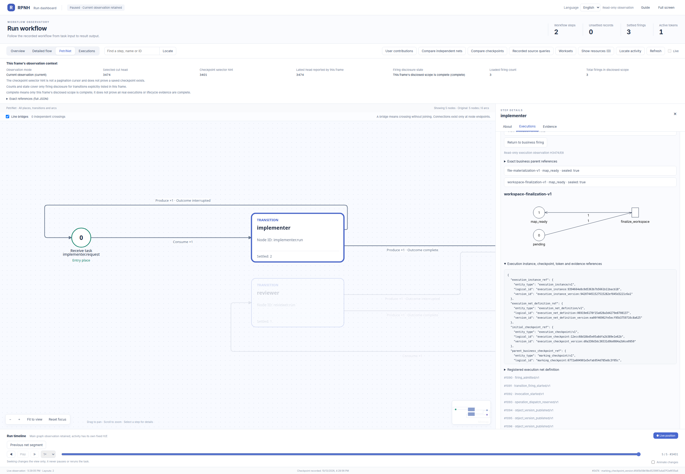

Actual attached workspace-finalization execution PN, with its own checkpoint/tokens and map_ready/sealed evidence. source-05 · cut 3474 · selector 3401 · [Exact references, panel text and position](figures/source-execution-finalization.json).

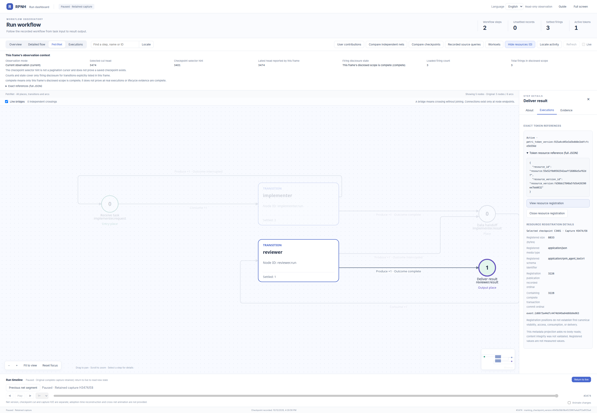

Completed output token resource registration: exact references and registered metadata, not payload-body display. source-05 · cut 3474 · selector 3401 · [Exact references, panel text and position](figures/source-result-resource.json).


## Contributions, exact M and content restoration

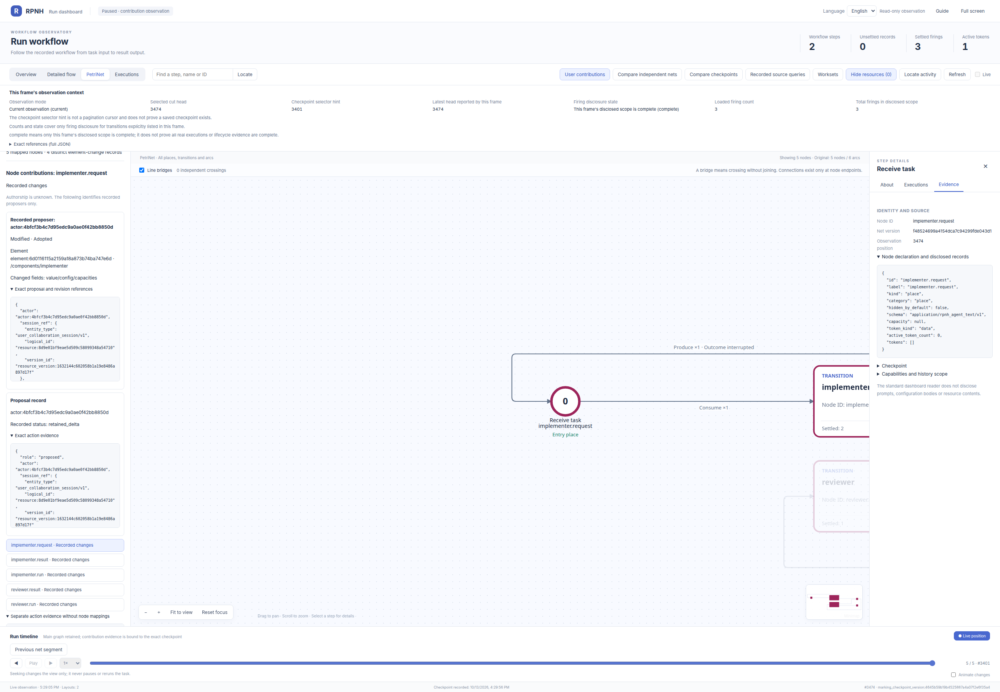

Recorded proposer focus in User contributions; this identifies controlled principals, not verified human authorship. source-05 · cut 3474 · selector 3401 · [Exact references, panel text and position](figures/source-contributor-focus.json).

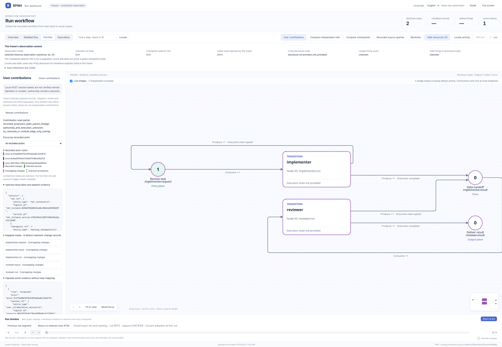

Original M contribution observation at historical cut 574, before business execution; this is not the completed state. source-05 · cut 574 · selector 574 · [Exact references, panel text and position](figures/source-M-contributions.json).

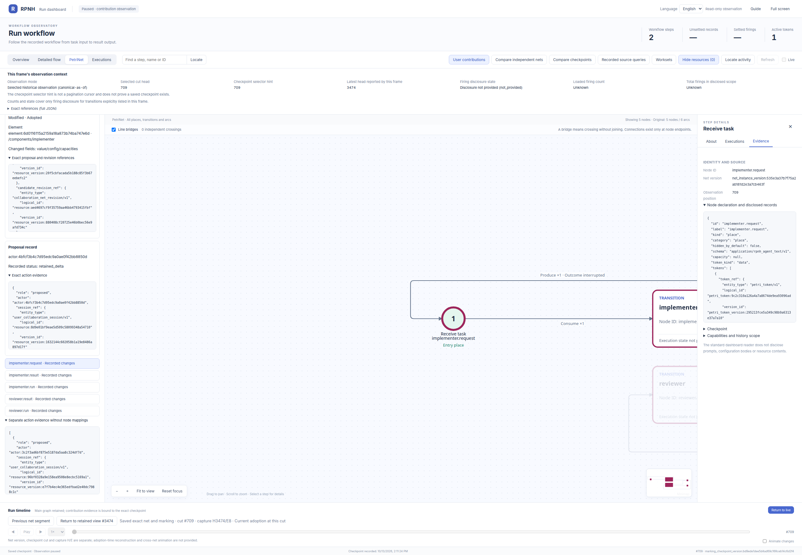

Exact original two-parent M reference, visible in the retained historical panel. source-05 · cut 709 · selector 709 · [Exact references, panel text and position](figures/source-M-reference.json).


First exact M parent reference in recorded element-change evidence. source-05 · cut 574 · selector 574 · [Exact references, panel text and position](figures/source-M-parent-1.json).

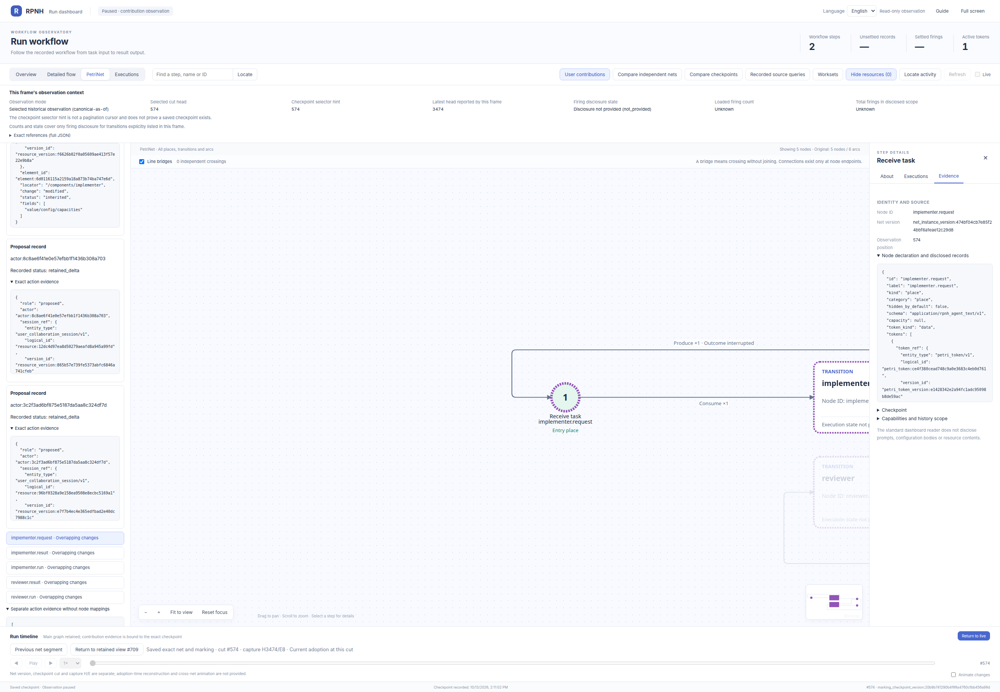

Second exact M parent reference in recorded element-change evidence. source-05 · cut 574 · selector 574 · [Exact references, panel text and position](figures/source-M-parent-2.json).

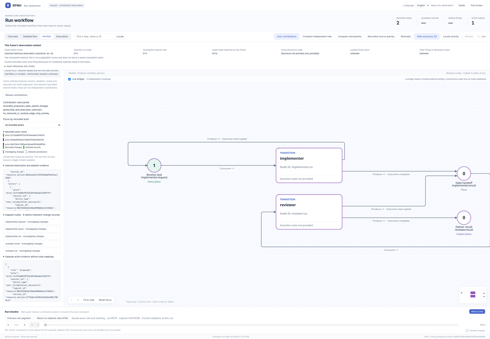

Exact first-M adoption receipt version is visible in the historical selected-observation JSON. source-05 · cut 574 · selector 574 · [Exact references, panel text and position](figures/source-M-adoption.json).

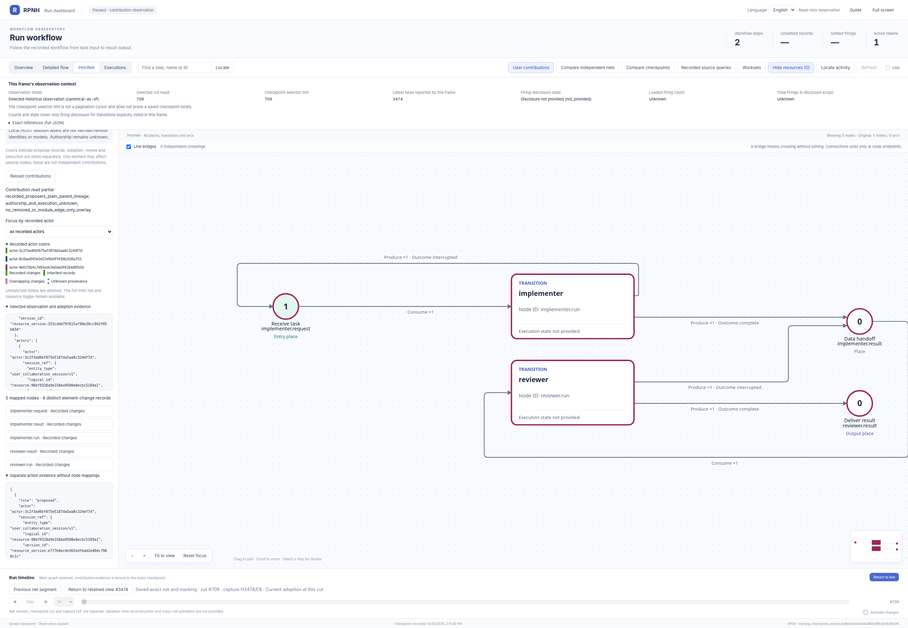

Exact adoption receipt for the new successor restoring base content, before business execution. source-05 · cut 709 · selector 709 · [Exact references, panel text and position](figures/source-base-adoption.json).

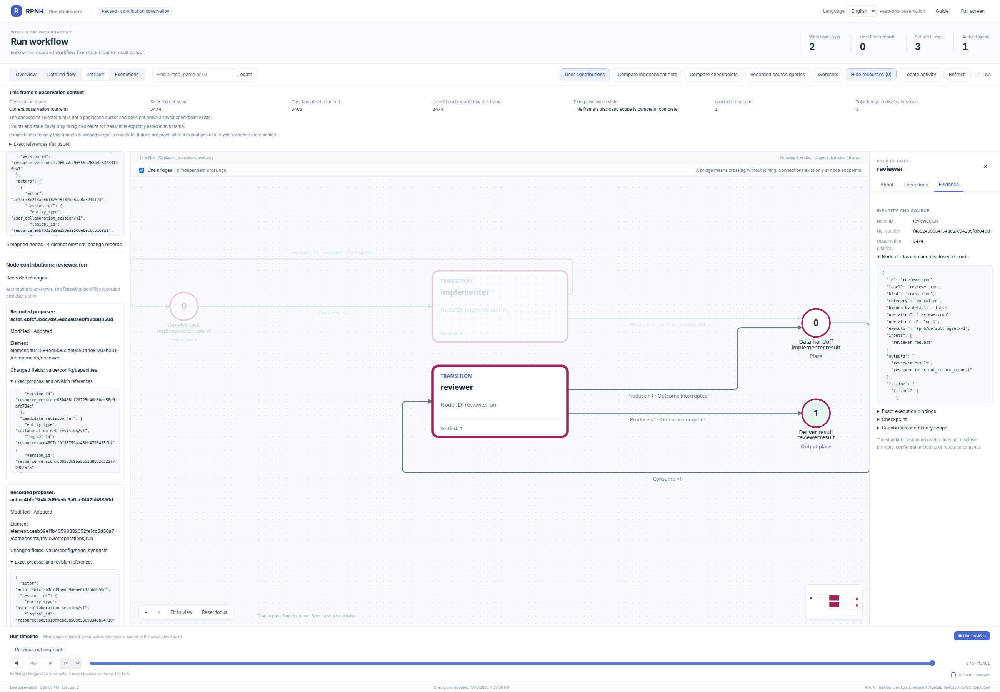

Exact final adoption receipt for the new successor restoring M content. source-05 · cut 3474 · selector 3401 · [Exact references, panel text and position](figures/source-continuation-adoption.json).


## Independent receiver

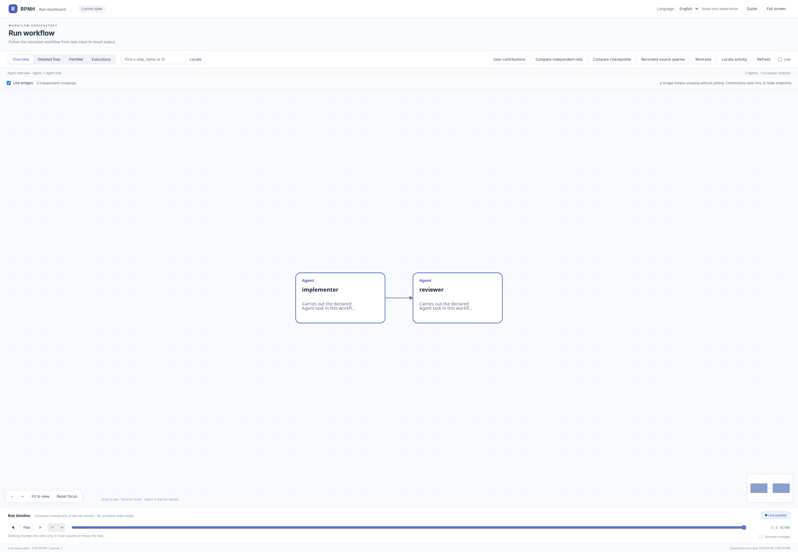

Independent receiver completed overview: two agents/one edge with new local identities. receiver-04 · cut 2441 · selector 2386 · [Exact references, panel text and position](figures/receiver-overview.json).

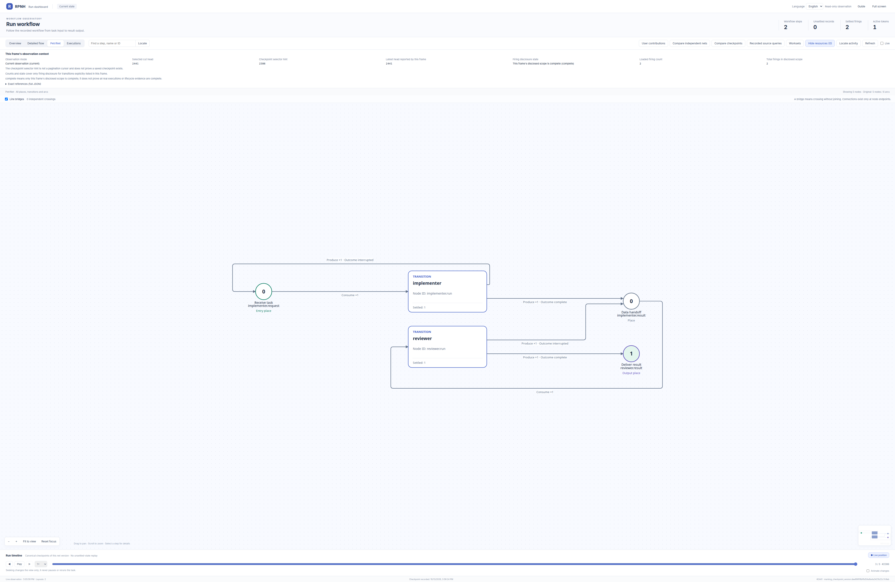

Independent receiver complete business PN: five nodes/six arcs and two completed roles. receiver-04 · cut 2441 · selector 2386 · [Exact references, panel text and position](figures/receiver-petri.json).

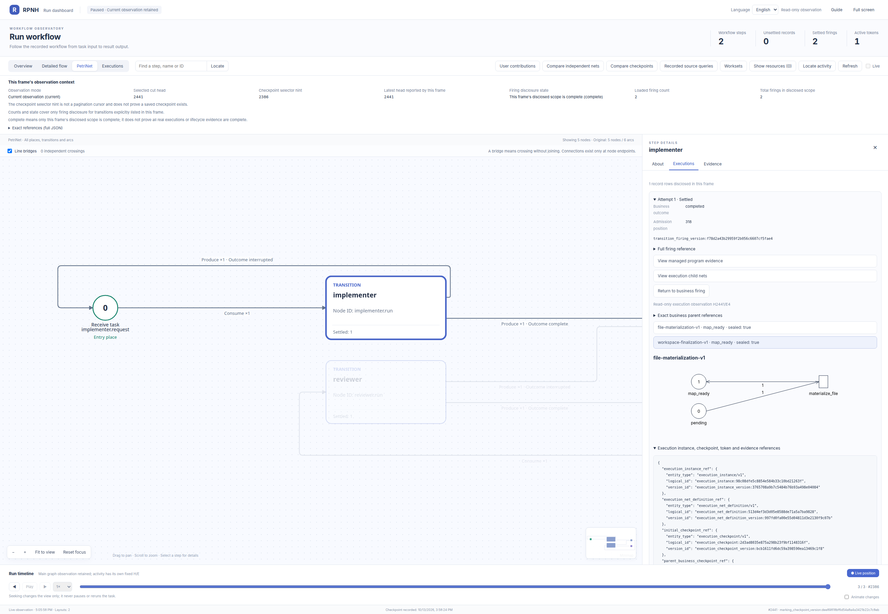

Receiver actual file-materialization execution PN, bound to its own business firing. receiver-04 · cut 2441 · selector 2386 · [Exact references, panel text and position](figures/receiver-execution-materialization.json).


Receiver actual workspace-finalization execution PN, with separate execution checkpoint and evidence. receiver-04 · cut 2441 · selector 2386 · [Exact references, panel text and position](figures/receiver-execution-finalization.json).

## Capture provenance and observation positions

Actual official Viewer images from the 2026-10-13 native inspection window. [Image provenance and per-image records](figures/provenance.json) bind exact source provenance, PNG digests, revision/net/checkpoint and observation position. The 17 PNGs total 4,908,456 bytes and are unchanged; companion JSON omits only localhost URL and local run_dir, retaining original panel text, refs and position. Source capture is H3474/E8 and receiver-04 capture is H2441/E4; a later administrative owner read-grant renewal advanced receiver to H2444, so heads are not claimed equal across windows. Historical cuts, checkpoint selector hints and capture heads remain distinct.
