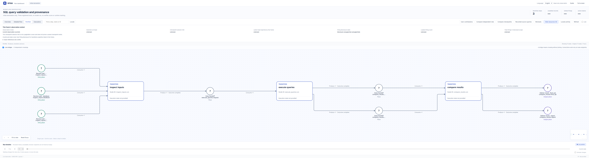
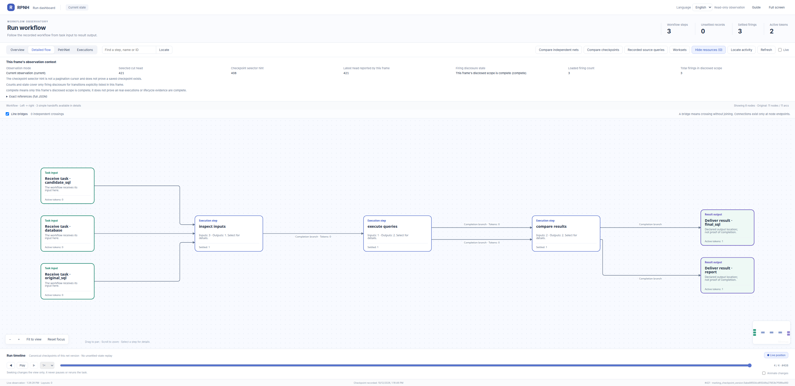

# SQL 查询校验与来源追溯

## 官方 Viewer 完整 PetriNet

[](figures/initial-petri.png)

这张官方 Viewer 原图展示完整声明 PN：**11 个节点（3 个转换、8 个库所）、11 条弧**。来源为 `initial_configured` 声明，没有运行标记或检查点，不是完成态运行的 PetriNet 截图。[截图来源](figures/petri-provenance.json)记录保留的输入与 Viewer 版本。完成态 Detailed flow 保留在[运行记录](#本地完整收尾与真实运行图)中。

[打开原始全景](figures/initial-petri.png) · [在只读 Viewer 中检查节点与弧](#static-pn-viewer)

本例通过原有 Registry/PetriNet 记录真实 SQLite 读取、精确结果比较和最终 SQL 资源。
附带的 [sol.sql](sol.sql) 仅依据固定任务说明、原始输入查询及哈希核验后的数据库独立推导，
未读取 evaluator tests、golden 或预期输出。没有调用 benchmark 求解器、模型或 provider。
原验收器与浏览器截图由独立 evaluator／Viewer 工作完成。

对应的外部任务是 Terminal-Bench 2 的
[`query-optimize`](https://github.com/harbor-framework/terminal-bench-2/tree/2fd12b88aafdd04a52c298e3940bcb189f9766d6/query-optimize)：
在 OEWN SQLite 数据库上生成 `/app/sol.sql`。固定源版本、数据库哈希、许可边界和
评估侧隔离见 [sources.json](sources.json)。固定源码 commit 不等于已解析正式 dataset 发布版。

## 三个操作真正展示什么

1. `inspect_inputs` 接收三个已获准的资源版本：数据库描述、原 SQL、候选 SQL。
   核对数据库字节、SQL 哈希和候选格式，发布数据库结构与查询请求。
2. `execute_queries` 在分别核验哈希的只读快照上实际执行两个查询，发布两个独立的
   结果资源，保留精确列名、有序行、查询计划、输入引用及单次观测时间。
3. `compare_results` 汇合已结算的两个结果，terminal report 指向它们的精确版本，
   比较列和逐行顺序，保留重复行。结果不同仍可以是一次已完成的观察；不代表任务成功，
   CLI 对不等价返回非零。同一操作另发布 `final_sql` 资源，保留候选原文、哈希、比较状态
   及候选查询结果引用；两件产物都来自实际交付的两个结果资源。

HOST 工具走已注册工具 gateway；`PublishResource` 使用现有 Petri 输出绑定，
`derived_from` 精确记录本次交付输入。`ExecutionServices`、`OwnerEventLoop` 和
`Orchestrator` 负责 admission、dispatch、settlement。没有新增调度器、权限、
资源类型或 Registry。最终报告从 `run_terminal_evidence/v1` 读取，不根据 Python
函数结束或本地的等价标志推断 terminal。

数据库输入是明确的外部文件描述（路径与 SHA-256），不声称数据库字节已存在 Registry。
每次操作从一个已打开的文件流复制私有快照，先核对哈希，再由 SQLite 打开。外部文件
被替换或改变会拒绝。执行期间仍需要该数据库；执行后的查询结果和 Registry 只读导出
不再依赖它。此处把数据库当作可信任务输入，不是任意不可信 SQLite 二进制的安全沙箱。

## 使用真实任务输入

在 RPNH 已可用的 checkout 根目录运行：

```bash
python -m examples.query_validation.run \
  --database /app/oewn.sqlite \
  --original-sql /app/my-sql-query.sql \
  --candidate-sql examples/query_validation/sol.sql \
  --run-dir /tmp/query-observation-run \
  --output-dir /tmp/query-observation-export \
  --query-timeout 1800
```

两个目录必须尚不存在。入口强制核对固定数据库和原 SQL 哈希，不会下载数据库、安装
依赖、编写或改写 `sol.sql`、调用模型、读取评估参考文件或运行 grader。候选 SQL
必须由作者独立提供，不能使用上游参考答案冒充作者输出。

SQLite 同时使用 `mode=ro`、`query_only` 和严格 authorizer，拒绝 ATTACH/DETACH、
PRAGMA、写入、临时 DDL 和加载扩展。超过 10,000 行直接拒绝，不截断后报成功。
`--query-timeout` 默认 120 秒、最多 1,800 秒，仅通过 SQLite progress handler 限制
虚拟机执行，不是独立进程的总墙钟或内存沙箱。这些是观察工具边界，不修改官方评分。

产物为 `evidence.json`、`report.json`、`projection.json`、`dashboard.json`，
以及从已结算最终 SQL 资源导出的 `sol.sql`。不等价时仍导出候选，并标记
`equivalent_to_original=false`；文件导出不代表验收成功。
证据包含 SQL 和真实数据行，公开前应核验数据许可及披露范围。`--readback` 可从已有
Registry 重建导出，不重跑查询。每次查询结束后删除私有数据库快照。生成的 Registry
和导出不是应提交的源码。

## 官方 Viewer

```bash
python -m examples.query_validation.view --run-dir /tmp/query-observation-run
```

沿用官方 `RegistryDashboard` 和只读 Viewer。选择详细流程或 PetriNet；本例只有工具，
没有虚构模型 agent 来填充概览。点击 `execute_queries.run` 查请求与两个结果引用，再
点击 `compare_results.run` 查汇合、报告及 `final_sql` 输出。看板只作观察，不产生执行权限。

附带的[初始声明 frame](figures/declaration-frame.json) 由官方编译器与投影函数生成：
三个转换、八个库所、十一条边。不含实际运行结果，也不是浏览器截图。

2026-10-12 本地原生运行达到 terminal `complete`，三个 PUBLISHED firings、五个产物；
精确列名及全部 500 行顺序一致，导出 SQL 与冻结字节一致，五项原生 selfcheck 通过。
单次原查询 163.652 秒、候选 0.320 秒，不据此声称原 verifier 性能通过。Owner loop
正常关闭。完整本地日志保留 SQLite 连接 `ResourceWarning`；未修改 core 连接管理。

## 独立候选与验证边界

原查询在相关子查询中反复扫描无索引的 senses。候选保留原聚合、连接、过滤和顺序，
先物化前 500 个词，再对这些词的 senses 一次分组并排名。固定库确有重复的词／synset
组合，因此保留真实计数，不能简化为 1。最终排序与原查询一致。实际形成和 EXPLAIN
轨迹保留在本地任务证据中；SQL 为 1,186 bytes，SHA256 为
`729471f70d1a64f7b1f2a28cd099d9a345e7f97355e840f55d12f403c781c0b3`。

五项有界 selfcheck 覆盖格式、只读访问、列／顺序／重复行、Registry 来源、最终 SQL
导出及不依赖原库的读回，使用默认原生 AF_UNIX：

```bash
python -m examples.query_validation.selfcheck -v
```

云端准备基线为 `b8d5942e768b2d59862b8e3eb7efa41a274f6307`，当时只能检查显式 pipe
测试通道。本地实际基线为 `e9fc93daf82914940ba48a86e1245b0f3f9f7667` 加本例修改，
两者不是同一源码条件；本地原生运行不使用 pipe flag。selfcheck 使用合成数据，
真实任务使用哈希核验的 50,606,080-byte OEWN 库。库、查询结果行与 Registry 仅留本地。
OEWN 底层许可为 CC-BY 4.0，保留 Princeton/OEWN 署名；固定 SQLite 转换件的再分发
资格仍未核全，已授权本地使用不等于批准再分发。

作者不读取或运行原 verifier，也不接收其预期输出。独立冻结后将候选交给父线程验收；
原任务 PASS/FAIL、环境适配及真实 Viewer 截图以父线程证据为准。固定源码提交不等于
已解析正式 dataset 发布版本。

原 verifier 还核查数据库完整性、精确列和输出、单查询格式/长度，并以五轮中位数要求
候选运行时间不高于 evaluator golden 查询的 1.05 倍。本适配器不仿造、不削弱这些检查，
不声称性能通过。此处计时仅为单次观察，不含快照开销，也不是公平 benchmark。
`original_verifier` 保持 `not_run`，`benchmark_pass` 保持 null。

Example 展示与成熟 harness 对照分开验收；展示来源不要求先跑 baseline，SQL 结果等价
本身也不能证明 harness 更快或更可靠。

## 本地完整收尾与真实运行图

[](figures/recorded-run.png)

这张独立运行截图使用 **Detailed flow**，折叠了三个交接库所，与上方完整声明 PetriNet 全景区分。

独立冻结的 `sol.sql` 在一次 176.76 秒的 evaluator 窗口中通过**未修改上游的六项测试**。只由启动插件映射五个绝对路径，复用本地 Python/SQLite/pytest；原 `test.sh`、Docker 资源限额、CTRF 和 stock harness 均未运行。这是明确适配下的原验收结果，不是完整官方 dataset benchmark。参考内容未进入作者上下文，候选、数据库及验收器字节前后不变。原生不可变资源仍保留发布当时的 `original_verifier: not_run`；后续 evaluator 收据单列，不回写历史。

图来自实际默认 AF_UNIX 完成态：Registry head **421**，三步已结算、零未结算、两个终态 token。原 Viewer 图片字节保留技术 checkpoint footer 和观察时间，无本机文件路径或用户身份映射；不是初始声明图。

按上面的 Viewer 命令打开实际运行，选择 **PetriNet → compare_results.final_sql → Executions → 查看资源登记** 定位最终 SQL；选择 `execute_queries.run` 查看原执行，再将历史滑块移到首个检查点并选择输入库所，定位原输入 token 登记。实际浏览器已核验三步、报告与最终 SQL 登记以及历史输入登记。检查前后 event head/count、writer epoch 和主数据库元数据不变，正常 WAL/SHM 辅助状态另列。标准 Viewer 只展示引用和登记元数据，不展示数据库行或 payload 正文。本任务模型/provider 调用为 0。

<a id="static-pn-viewer"></a>

### 只读声明 PetriNet Viewer

在兼容的 RPNH 环境中，从源码 checkout 根目录打开附带声明；不需要 Registry 或数据库，也不会调用模型或执行任务：

```bash
python - <<'PYTHON'
import json
from pathlib import Path
from cpn.frontend.server import serve_projection
frame = json.loads(Path("examples/query_validation/figures/declaration-frame.json").read_text(encoding="utf-8"))
class Snapshot:
    def __call__(self):
        return frame["net"]
    def dashboard(self, cursor=None):
        if cursor is not None:
            raise ValueError("Static declaration has no execution history")
        return frame
serve_projection(Snapshot(), host="127.0.0.1", port=0, open_browser=False)
PYTHON
```

打开打印的本机地址，选择 **PetriNet → 适应视图（Fit to view）**。缩放、拖动并选中节点或弧，查看完整标签与原生详情。声明不含运行标记或执行历史；按 Ctrl+C 停止 Viewer。查看已有完成态运行时，使用单独的[运行 Viewer 命令](#官方-viewer)。
