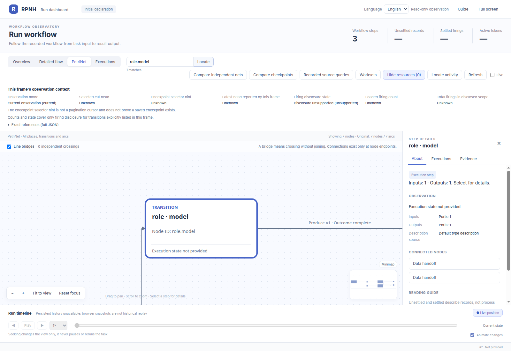
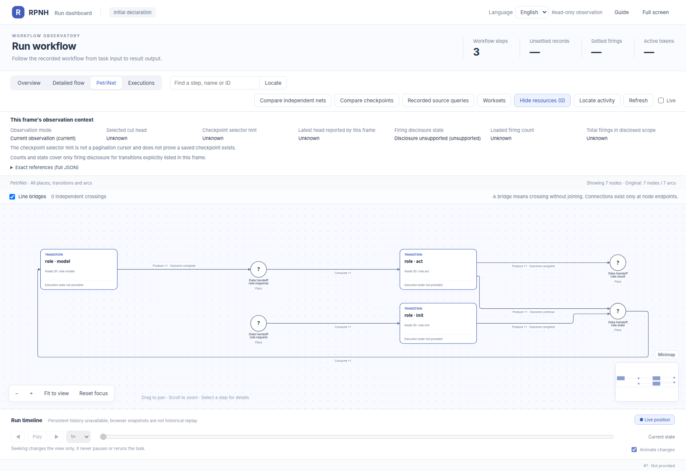
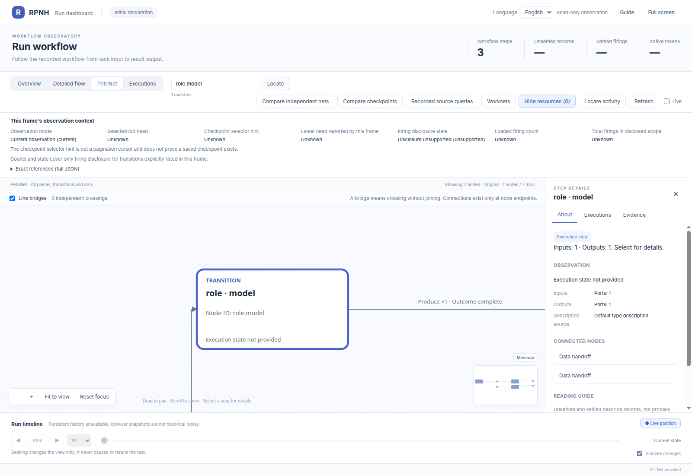
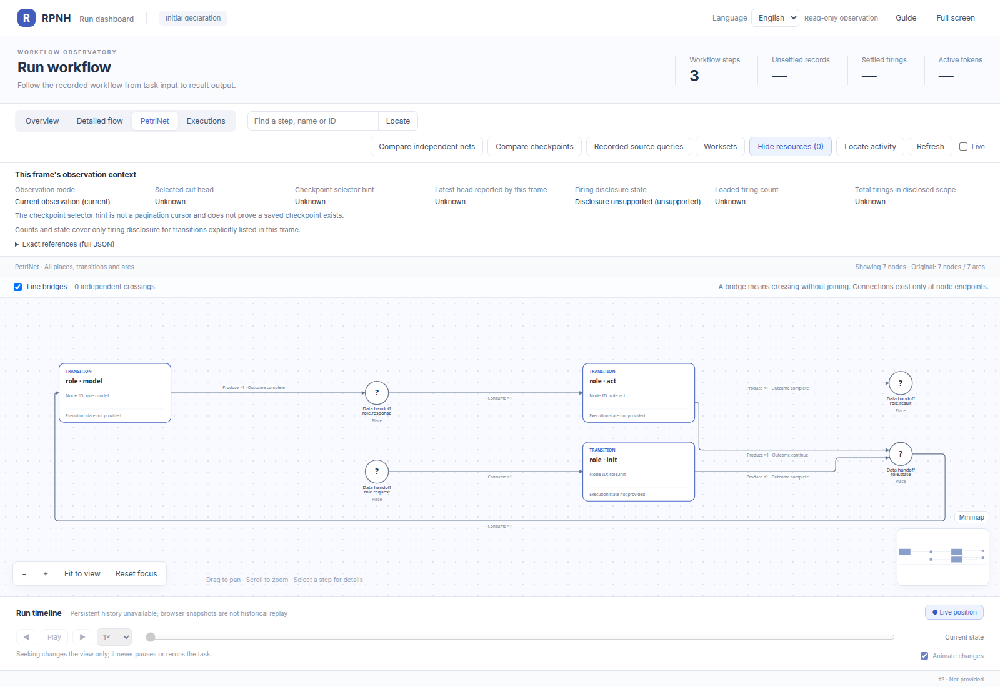

# RRSI v0.6 application 示例

[English](README.md) | 中文

## 官方 Viewer 全景

下方官方 Viewer 全景是 Policy child 的完整声明：prepare、model、grade。RRSI 编排多个独立 child run；这张图不是整个 campaign 的单一 PN，也不是运行结果。下文继续展示四个角色声明及其边界。

[](assets/rrsi.policy.prepare-model-grade/petri-full.png)

[本地 Viewer 与读图说明](figures/policy/README_ZH.md#local-viewer) · 点击全景打开原始大图。

本示例在现有 RPNH Registry 与 PetriNet 运行时上实现公开 RRSI v0.6 方法，展示当前
harness 如何承载 RSI 角色循环、独立评估与分数/成本选择。Analyst、Digester、Proposer、
Critic 与 Policy occurrence 作为独立 RPNH child run 执行，各自保留 Registry 证据。
provider 与模型由用户的 execution profile 选择。

示例自带的 timeout fixture 用于执行两轮 Policy 演化。参考方法与 domain adapter 见
[`google-research/rrsi`](https://github.com/google-research/rrsi)；应用设计见
`DESIGN_ZH.md`，来源说明见 `THIRD_PARTY_NOTICES.md`。

## PetriNet 声明

以下图片由 RPNH PetriNet viewer 呈现，分别对应一个独立 child Module 的初始声明。
图片只展示结构，不表示某次 run、marking、评分或执行成功。Policy 与四个角色的完整
compiled 文档各不相同，即使显示出的拓扑相似也分别保留。
[Policy 全景与本地 Viewer](figures/policy/README_ZH.md)说明下方视图的来源；[角色图片身份记录](results/figure-provenance.json)保留原角色图的源码与 compiled/projection 字节身份。

campaign 协调校准、两轮演化、heldout 评估与导出。每个评分槽位实例化 Policy；
每轮实例化 Analyst、Proposer、Critic，Analyst 的请求还可创建 Digester child。
每次 occurrence 有自己的 Registry 证据，复用声明图不会复用不同 occurrence 的运行状态。

### Policy：prepare、model、grade

request → prepare → model → grade → result。Petri 保留中间 state/response place；Flow 折叠这两个交接点。两图均为初始声明（`initial_configured`）。

上方展示完整 PN 全景，下方保留原 Flow 链接；交互细节可在本地官方 Viewer 中缩放、点击查看。[Petri 原图](assets/rrsi.policy.prepare-model-grade/petri-full.png) · [Flow 原图](assets/rrsi.policy.prepare-model-grade/flow-full.png)。

[Policy 初始声明：完整 Flow 图](assets/rrsi.policy.prepare-model-grade/flow-full.png)

[在本地 Viewer 打开这份声明](figures/policy/README_ZH.md#local-viewer)。

### Analyst

在仓库根目录运行 `python examples/view_declaration.py rrsi-analyst --no-open`。[静态帧](figures/analyst/declaration-frame.json) · [统一启动与离线检查说明](figures/README_ZH.md)。

[](assets/rrsi.role.analyst.png)
[](assets/rrsi.role.analyst-role.model.png)

### Proposer

在仓库根目录运行 `python examples/view_declaration.py rrsi-proposer --no-open`。[静态帧](figures/proposer/declaration-frame.json) · [统一启动与离线检查说明](figures/README_ZH.md)。

[](assets/rrsi.role.proposer.png)
[](assets/rrsi.role.proposer-role.model.png)

### Critic

在仓库根目录运行 `python examples/view_declaration.py rrsi-critic --no-open`。[静态帧](figures/critic/declaration-frame.json) · [统一启动与离线检查说明](figures/README_ZH.md)。

[](assets/rrsi.role.critic.png)
[](assets/rrsi.role.critic-role.model.png)

### Digester

在仓库根目录运行 `python examples/view_declaration.py rrsi-digester --no-open`。[静态帧](figures/digester/declaration-frame.json) · [统一启动与离线检查说明](figures/README_ZH.md)。

[](assets/rrsi.role.digester.png)
[](assets/rrsi.role.digester-role.model.png)

各角色先初始化 state，再调用已注册的 model 操作，随后处理 response。action
transition 可以返回 state 进入下一次 model 步骤，或发布 result。每个角色的
工具声明、额度和绑定仍分别保留。model 细节只放大该操作；可直接打开完整图片，
以原始分辨率检查整个 PetriNet。

## 安装与测试

在 RPNH 源码根目录执行：

```bash
python -m pip install -e .
python -m pip install -e './examples/rrsi_v06[test]'
python -m pytest examples/rrsi_v06/tests -q
```

测试使用脚本化 input port，不调用真实 provider。RPNH 根项目的默认测试发现不会自动
包含这个独立示例，因此应显式运行上述命令。

## 使用自己的 profile 运行

以下命令会调用用户自有 RPNH execution profile 所配置的模型；只有在明确授权本次实验后
才应执行。run 目录和 profile 都应位于仓库之外。

```bash
: "${RPNH_EXECUTION_PROFILE:?Set an authorized RPNH execution profile}"
export RRSI_WORK="$(mktemp -d)"
python examples/rrsi_v06/example.py \
  --run-root "$RRSI_WORK/run" \
  --execution "$RPNH_EXECUTION_PROFILE" \
  --protocol examples/rrsi_v06/protocol.example.json
```

目标目录必须尚不存在。报告写入 `$RRSI_WORK/run/formal-report.json`；每个 child Registry
保留在 `roles/` 或 `policy/` 下。例如可查看一个 Policy run：

```bash
rpnh net --run "$RRSI_WORK/run/policy/evolve-h0/H0/evolve-missing-0" \
  --view --no-open
```

将 execution profile 与生成的运行材料保存在源码仓库之外，通过每次实验的报告和 child
Registry 查看执行过程。

## 完成语义

`formal_rrsi_v06_local_complete=true` 表示冻结 timeout fixture 的计划轮次与 Policy slot
已完成，并具备 Registry、PetriNet 与 provider 证据。脚本测试标记为
`injected_test_runners`，结构验证结果记录在
`execution_evidence.structural_campaign_complete`。通过 `round_decisions`、H0/final 的
evolve 与 heldout 汇总以及 `usage`，查看候选采用、成绩和 token 覆盖情况。

## 部分报告、用量与协作式停止

执行控制修订 `rrsi_v06/execution_control/v2` 保持冻结协议、提示词、评分器、选择公式和
B0 的应用层不重试策略不变。`formal-report.json` 在 child 执行前后以原子替换方式保存。
`report_status` 为 `running`、`incomplete` 或 `completed`，表示报告执行状态，与
`formal_rrsi_v06_local_complete` 独立。中止时保留已知 child 引用、已完成 child 的结果和
评估、已观察的输入尝试；`termination` 记录阶段与错误类型，不包含异常正文。失败 child
不补造 reward，原异常仍原样抛出。若写入失败，最后有效快照可能仍为 `running`；次要错误
通过脱敏备注附在原异常上。进程被强制终止或存储不可用时，不能保证最终报告落盘。

`usage.roles.input_port_invocations` / `usage.policy.input_port_invocations` 统计中立输入端口调用。旧字段 `physical_attempts` 仅作为
明确标注语义的弃用别名保留，不统计 adapter 的探针或恢复调用。`total_tokens` 与既有方法的
`cost_comparable` 仅覆盖可见最终响应的用量。`provider_physical_calls` 和
`provider_physical_total_tokens` 保持未知，`provider_physical_cost_complete` 为 false。
传输细节需与私有 adapter audit 对照，不能发布凭据或原始异常内容。

Python 调用方可以向 `run_formal_campaign`、`run_policy_trial` 或 `run_role_session`
传入 `interruption_requested=<callable>`。该回调连接到既有 Harness owner-stop 与可中断
输入端口边界。旧端口可在提交前停止，但不保证中断进行中的调用。CLI 未新增信号处理器；
本修订不新增重提交、恢复执行逻辑或 checkpoint route。需要有序取消时应使用协作式停止
回调；普通中断在经过报告边界向外传播时会被记录。
