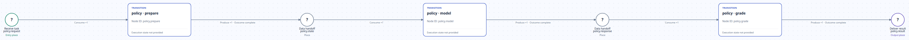
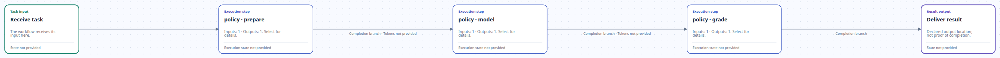

# Policy: prepare → model → grade

English | [中文](README_ZH.md)

[Return to the example guide](../../README.md).

These figures show the `initial_configured` declaration, without execution state, token markings or a success result. The panoramas show the whole structure; use the local Viewer below for details.

Declaration source: [formal_policy.py](https://github.com/Deng-0119/RPNH/blob/34d42d171d7e9a7f803b71467063b55786c2cea8/examples/rrsi_v06/src/rpnh_rrsi/formal_policy.py). Rendered by the [official Viewer at `34d42d17`](https://github.com/Deng-0119/RPNH/tree/34d42d171d7e9a7f803b71467063b55786c2cea8).

request → prepare → state → model → response → grade → result. Flow folds the intermediate state and response places while preserving the operation sequence.

[Petri](#petri) · [Flow](#flow) · [Local Viewer](#local-viewer)

## Petri



[Open the original panorama](../../assets/rrsi.policy.prepare-model-grade/petri-full.png).

## Flow



[Open the original panorama](../../assets/rrsi.policy.prepare-model-grade/flow-full.png).

<a id="local-viewer"></a>

## Inspect the declaration in the local Viewer

From the repository root, use a Python environment with RPNH installed:

```bash
python examples/view_declaration.py rrsi-policy --no-open
```

Open the printed `http://127.0.0.1:PORT/` address; the operating system chooses the port. Keep the terminal running, then press Ctrl+C to stop the Viewer.

1. Select **PetriNet** or **Detailed flow**.
2. Zoom with the wheel or `−` / `＋`, drag the blank canvas to pan, and use **Fit to view** to restore the panorama.
3. Select a node or arc to open its details, or use **Search + Locate** to find a node.

This command reads only the checked-in [static declaration frame](declaration-frame.json) corresponding to the panoramas and uses the official Viewer. It creates no Registry, executes no transition and calls no model. Execution state, token markings and history are not provided.

To inspect a run you already have, set `RUN_DIR` to its exact Registry run directory, then run `rpnh net --run "$RUN_DIR" --view --no-open`. That run has its own state, unlike the static declaration above. See the [Viewer guide](../../../../docs/guides/viewer.md) for more controls.
