# Policy：prepare → model → grade

[English](README.md) | 中文

[返回案例说明](../../README_ZH.md)。

这些图片展示 `initial_configured` 初始声明；不包含执行状态、token marking 或成功结果。全图用于定位，编号局部图用于阅读节点、弧和标签。

声明源码：[formal_policy.py](https://github.com/Deng-0119/RPNH/blob/34d42d171d7e9a7f803b71467063b55786c2cea8/examples/rrsi_v06/src/rpnh_rrsi/formal_policy.py)。使用[官方 Viewer `34d42d17`](https://github.com/Deng-0119/RPNH/tree/34d42d171d7e9a7f803b71467063b55786c2cea8) 渲染。

request → prepare → state → model → response → grade → result。Flow 折叠中间的 state 与 response place；两种视图保留相同的操作顺序。

[Petri](#petri) · [Flow](#flow)

## Petri

[打开定位图原图](../../assets/rrsi.policy.prepare-model-grade/petri-full.png).

[P01](#p01) → [P02](#p02) → [P03](#p03) → [P04](#p04) → [P05](#p05) → [P06](#p06) → [P07](#p07)

### P01

**请求。** `request` → [prepare](#p02)。

完整节点（从上到下，再从左到右）：`policy.request`。

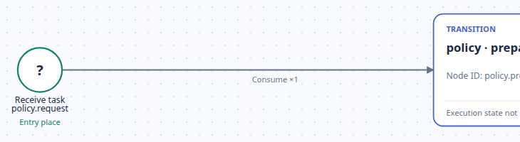

### P02

**准备。** [request](#p01) → `prepare` → [state](#p03)。

完整节点（从上到下，再从左到右）：`policy.prepare`。

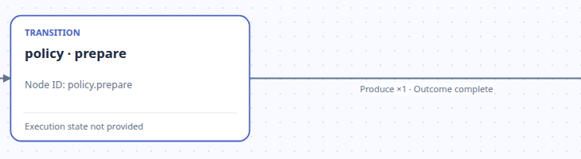

### P03

**状态。** [prepare](#p02) → `state` → [model](#p04)。

完整节点（从上到下，再从左到右）：`policy.state`。

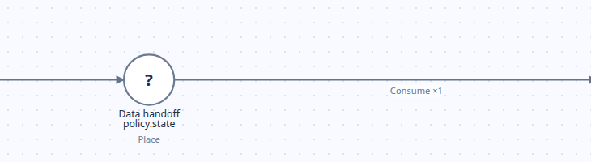

### P04

**模型操作。** [state](#p03) → `model` → [response](#p05)。

完整节点（从上到下，再从左到右）：`policy.model`。

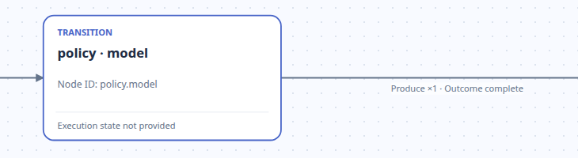

### P05

**响应。** [model](#p04) → `response` → [grade](#p06)。

完整节点（从上到下，再从左到右）：`policy.response`。

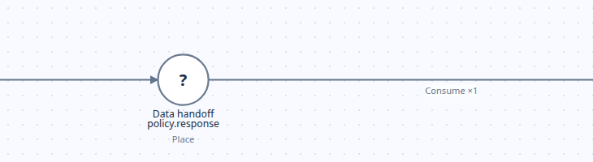

### P06

**评分。** [response](#p05) → `grade` → [result](#p07)。

完整节点（从上到下，再从左到右）：`policy.grade`。

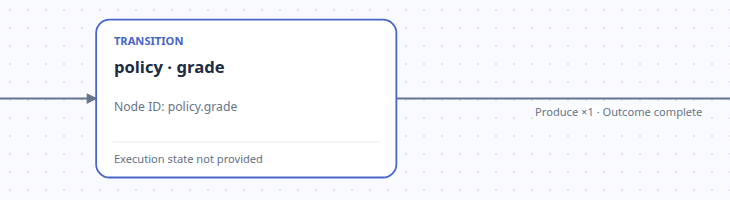

### P07

**结果。** [grade](#p06) → `result`。

完整节点（从上到下，再从左到右）：`policy.result`。

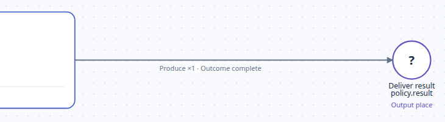

## Flow

[打开定位图原图](../../assets/rrsi.policy.prepare-model-grade/flow-full.png).

[F01](#f01) → [F02](#f02) → [F03](#f03) → [F04](#f04) → [F05](#f05)

### F01

**请求。** `request` → [prepare](#f02)。

完整节点（从上到下，再从左到右）：`policy.request`。

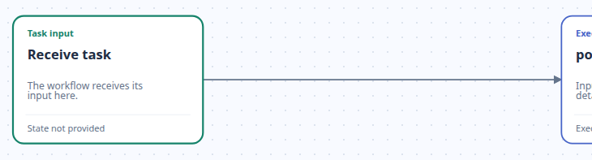

### F02

**准备。** [request](#f01) → `prepare` → [model](#f03)。 到 model 的连线折叠了 [state](#p03)。

完整节点（从上到下，再从左到右）：`policy.prepare`。

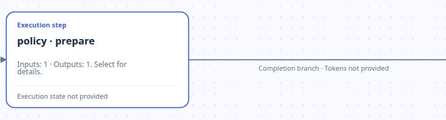

### F03

**模型操作。** [prepare](#f02) → `model` → [grade](#f04)。 到 grade 的连线折叠了 [response](#p05)。

完整节点（从上到下，再从左到右）：`policy.model`。

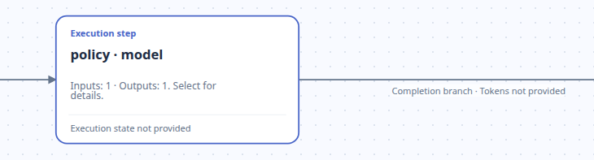

### F04

**评分。** [model](#f03) → `grade` → [result](#f05)。

完整节点（从上到下，再从左到右）：`policy.grade`。

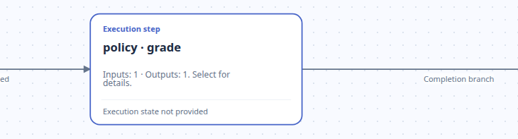

### F05

**结果。** [grade](#f04) → `result`。

完整节点（从上到下，再从左到右）：`policy.result`。

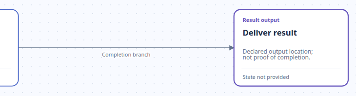

节点 ID 用于辨认 Viewer 中的通用或省略标签；局部图保持原始显示。
