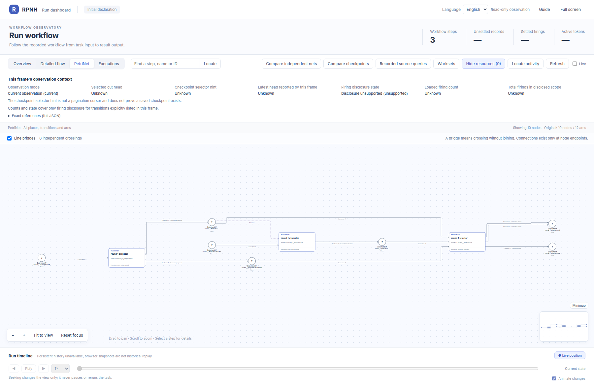
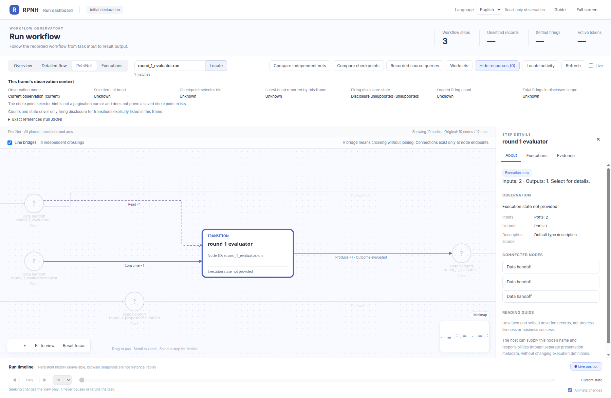
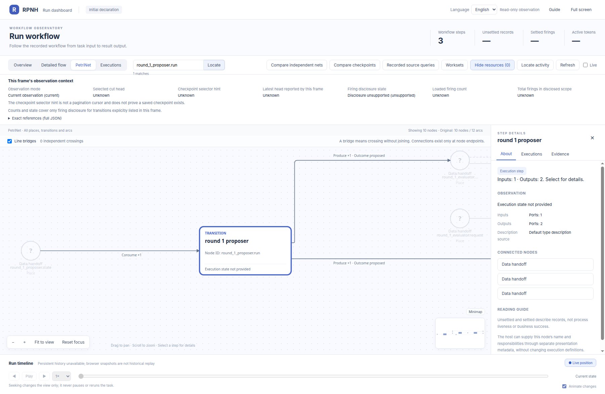
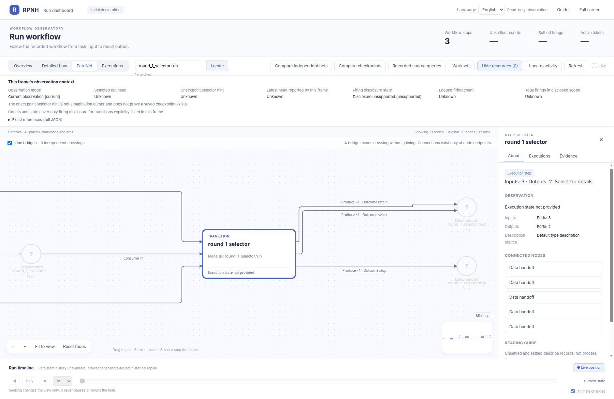

# rsi_one_round_failed_retain: node details

English | [中文](README_ZH.md)

## Complete initial declaration

Start with the complete official Viewer image of this same declaration, then inspect the node captures below. This image contains no runtime state.

Official-viewer close-ups of each transition in the same initial PetriNet.

[Return to the complete PN gallery](../../README.md).

## round_1_evaluator.run

## round_1_proposer.run

## round_1_selector.run

