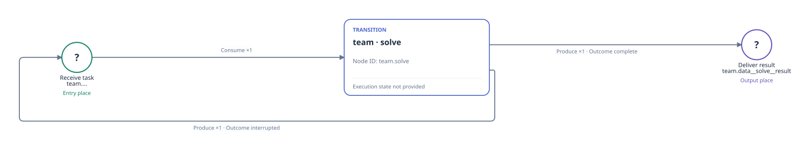

# Per-checkpoint solve declaration

English | [中文](README_ZH.md)

This official Viewer SVG export is the native solve declaration for one checkpoint. session_command is a managed tool inside that Agent; a shell command is not an extra top-level PN stage. The declaration makes no Session call, code change, model call or benchmark evaluation.

[](initial-petri.svg)

This is a self-contained [official Viewer SVG export](viewer-export-provenance.json); only its outer viewport is normalized to include the complete rendered graph. Open the static Viewer below for selectable node and arc details.

From the repository root, in an environment with the RPNH dependencies already available, open the bundled static frame:

```bash
python examples/view_declaration.py slopcodebench --no-open
```

Open the loopback URL printed by the command and select PetriNet. Zoom, pan and select nodes or arcs for details. This command only reads the static declaration; it creates no Registry, runs no example and selects no execution profile.

[Exact source, graph counts and scope](source-provenance.json) · [Static frame](declaration-frame.json) · [Back to example](../README.md)
