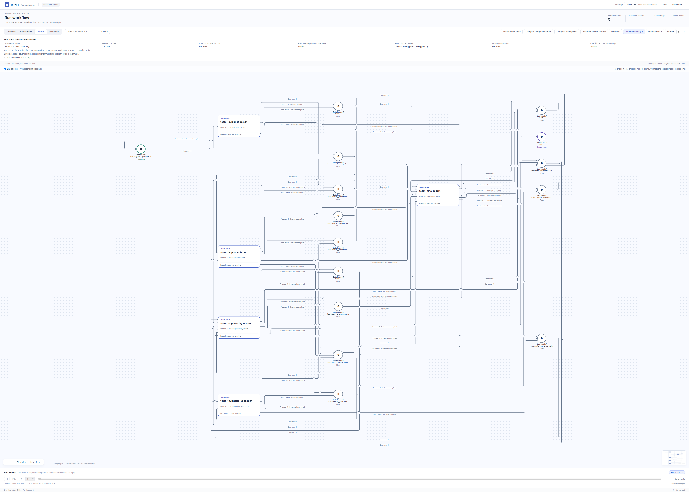

# 3-DOF 动力下降

[English](README.md) | [中文](README_ZH.md)

这个真实 provider 案例把一个数值最优控制问题交给 RPNH 主 agent，并要求它自行设计
多 agent workflow。案例提供验收方程和独立 verifier，不提供固定 workflow 或 solver
实现。

[](assets/child-initial-petri.png)

从原 Registry 登记的完整编译声明只读投影，包含所有 place、transition、返弧和分支。此图为 `initial_configured` 静态声明，没有历史 token、firing 或完成态着色；未重跑模型或业务。原编译器 Git 版本未能确定，精确登记版本、原字节哈希和捕获时官方 Viewer 版本见[来源记录](figures/child-initial/provenance.json)。

[只读 Viewer：缩放及节点／弧详情](#static-pn-viewer) · [原运行 Overview 原图](assets/three-dof-petrinet.png)
<a id="static-pn-viewer"></a>

### 只读静态 PN Viewer

在已具备兼容 RPNH 环境的源码 checkout 根目录运行。此入口只读附带的静态 frame，不打开 Registry 或执行业务。

```bash
python - <<'PY'
import json
from pathlib import Path
from cpn.frontend.server import serve_projection
frame = json.loads(Path("examples/three_dof_powered_descent/figures/child-initial/declaration-frame.json").read_text(encoding="utf-8"))
class Snapshot:
    def __call__(self):
        return frame["net"]
    def dashboard(self, cursor=None):
        if cursor is not None:
            raise ValueError("Static declaration has no execution history")
        return frame
serve_projection(Snapshot(), host="127.0.0.1", port=0, open_browser=False)
PY
```

打开打印的 localhost URL，选择 **PetriNet → Fit to view**。滚轮缩放、拖动平移；点击节点或弧查看原生详情，长标签可在详情中读取。静态声明没有运行历史；关闭服务用 Ctrl+C。

## 公开来源

问题类型来源于 Acikmese 与 Ploen 的 “Convex Programming Approach to Powered
Descent Guidance for Mars Landing”，DOI
[10.2514/1.27553](https://doi.org/10.2514/1.27553)。 还记录 SCvx
论文 [arXiv:1804.06539](https://arxiv.org/abs/1804.06539)，以及仅用于参数来源说明的
公开 G-FOLD 数值案例。本仓库不复制上游代码； 独立、精炼地定义动力学、
限制和验收容差。

## 复现

使用 Linux／WSL2、已安装 RPNH 的源码 checkout，以及一份明确授权的 execution
selection。所选 profile 的 workspace 必须能够使用 agent 选择的数值包；本案例通常使用
NumPy/SciPy。下面的命令可能产生多次付费／外部调用；案例不会自行选择或切换
provider/model。


runner 把 、 和独立 verifier 注册为精确用户任务。主 agent 选择
图，启动一个 child Registry；runner 等待 terminal authority，并打印 task ID、child
、注册结果与 PetriNet 摘要。

无需再次执行模型即可查看真实 run：


本任务没有声明 resource place，因此  为空。workflow 必须用随任务提供
的 verifier 检查其 。把已结算 workspace 中的精确文件复制到
Registry 外后，还可以再次检查：


## 验收

结果必须满足 verifier 的  且无 failure：终端位置误差不超过 0.5 m，
终端速度误差不超过 0.05 m/s，Euler 子步不超过 0.01 s，并满足推力、高度、glide-slope、
速度和干质量限制。 记录一条实际可行轨迹（41.67 s，冲量约
395.28 kN·s），只作为对照，不是强制最优值，也不保证任意 solver iterate 都可行。

图拓扑、数值方法和目标值可以不同。Registry terminal evidence 是必要条件，但不能替代
独立数值验收。 只记录脱敏的最终成功边界；原始 Registry、生成轨迹、
transcript、路线和模型身份保留在私有环境。

如果 run 被用户主动停止，请使用单独的
[checkpoint 恢复指南](../../docs/guides/checkpoint-recovery_ZH.md)，继续同一个 child
Registry。
