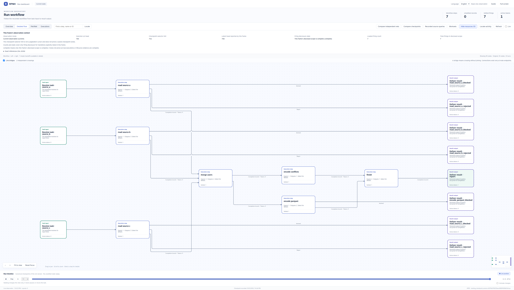

# Multi-source data merger: tool-pipeline extension

[简体中文](README_ZH.md)

This extends the existing deterministic `tool_pipeline` example with a real external task:
[Terminal-Bench `multi-source-data-merger`](https://github.com/harbor-framework/terminal-bench-2/tree/2fd12b88aafdd04a52c298e3940bcb189f9766d6/multi-source-data-merger).
It is a fixed, zero-model HOST implementation, not an agent benchmark, model result, or harness speed comparison.

## What is added

- The original JSON, CSV, and genuine Parquet fixture bytes become three versioned OwnerInput resources. The entry verifies SHA-256 against the pinned upstream manifest, including when `--data-dir` points elsewhere.
- Three independent registered parsing operations feed one three-input PN join. `merge_users` cannot execute with only two successful inputs. No Python ready list schedules the graph.
- Source priority is A > B > C. A conflict decision retains the input resource version, parsed-result version, zero-based row, original field name, and selected source. The parser's Registry operation binding and producer invocation connect those references to the actual call.
- Two separately admitted encoders produce actual Parquet and JSON bytes, stored as base64 byte envelopes in JSON resources, with media type, length, and digest. `finish` requires both resources. Read-only export reconstructs the exact bytes only from the terminal references; it does not rerun the tools.
- The original conflict report format stays unchanged. Extra provenance is in Registry resource envelopes and evidence, not injected into `conflicts.json` or the grader.
- Existing Registry publication, HOST tool admission, Orchestrator, PN compilation, budget declaration, completion, and terminal binding are reused. No core or Viewer changes are required.

The module has seven operations: `read_source_a`, `read_source_b`, `read_source_c`, `merge_users`, `encode_parquet`, `encode_conflicts`, and `finish`.

## Actual local result and limits

The 2026-10-12 local run completed once using the default `OwnerEventLoop` with AF_UNIX, three workers, and the unchanged original JSON/CSV/Parquet inputs. All seven firings were published with business outcome `completed`; the native terminal outcome was `complete`. Three input resources produced eight business resources, including two terminal artifacts. Actual Registry model counts were `[0, 0]`.

Real pandas/pyarrow I/O read source C and wrote `merged_users.parquet`: four users (101–104), integer IDs, the mapped text columns, and optional status. `conflicts.json` contains three conflicts for user 101: name, email, and created date. The original verifier passed all three tests under the explicit offline path adaptation below. Additional saved-Registry checks validate the three-input join, producer references, terminal artifact bytes, and input byte identity; they do not replace the verifier. The first extra readback comparison failed because Python event tuples were compared directly with JSON lists. That failure was retained; JSON-normalizing the check fixed the comparison without rerunning the native pipeline. The corrected read-only checks passed with Registry head ordinal unchanged at 765.

The actual product base was `e9fc93daf82914940ba48a86e1245b0f3f9f7667`, differing from the cloud candidate's `b8d5942e768b2d59862b8e3eb7efa41a274f6307`. The tested environment was Python 3.13.12, pandas 3.0.3, pyarrow 24.0.0, and pytest 9.0.3. No runtime implementation or core change was needed to complete this run. The local additions are the offline verifier launcher and these bilingual instructions.

The earlier cloud run remains a separate, blocked test-transport result: AF_UNIX was denied there and no Parquet engine was available. It produced no terminal artifacts. Local completion does not retroactively change that evidence. This deterministic inspected fixture run is not a blind model evaluation, performance comparison, recovery demonstration, or official released-dataset benchmark. Interactive browser capture is a separate check; request-handler checks do not establish it.

## Launch, export, and verify

Use an existing environment containing RPNH's dependencies, pandas, pyarrow, and pytest. From the repository root, choose a short, writable work directory so the AF_UNIX socket path fits the platform limit. Keep generated files outside the source tree. For a constrained workspace, place `WORK` inside that workspace and route process HOME, temporary files, and caches there:

```sh
WORK=/path/to/short/work
mkdir -p "$WORK/home" "$WORK/tmp" "$WORK/cache"
env HOME="$WORK/home" TMPDIR="$WORK/tmp" XDG_CACHE_HOME="$WORK/cache" \
  PYTHONPATH="$PWD" PYTHONDONTWRITEBYTECODE=1 \
  python -m examples.tool_pipeline.multi_source.run \
  --run-dir "$WORK/run" --output-dir "$WORK/export"
env HOME="$WORK/home" TMPDIR="$WORK/tmp" XDG_CACHE_HOME="$WORK/cache" \
  PYTHONPATH="$PWD" PYTHONDONTWRITEBYTECODE=1 PYTEST_DISABLE_PLUGIN_AUTOLOAD=1 \
  python -m examples.tool_pipeline.multi_source.verify \
  --output-dir "$WORK/export" --report "$WORK/verifier-result.json"
env HOME="$WORK/home" TMPDIR="$WORK/tmp" XDG_CACHE_HOME="$WORK/cache" \
  PYTHONPATH="$PWD" PYTHONDONTWRITEBYTECODE=1 \
  python -m examples.tool_pipeline.multi_source.view "$WORK/run" --no-open
```

Open the loopback URL printed by the Viewer. The CLI does not install dependencies or select the test transport. Fresh run/export paths and a fresh verifier report are required. `--max-in-flight` accepts 1/2/3 without changing PN readiness or source priority. To export a saved run without executing tools, use the run command with `--readback`, the existing `--run-dir`, and a new `--output-dir`.

`artifacts_complete_ungraded` is the native run's result before evaluation. The immutable terminal resource's `original_verifier: not_run` truthfully records that point in time. Later verification is reported separately in `verifier-result.json`; it does not rewrite Registry history.

`verify.py` loads the byte-identical upstream `tests/test_outputs.py` through pytest. It verifies its pinned SHA-256 before execution and unchanged bytes afterward. Only that collected module's `os.path.exists`, `pd.read_parquet`, and `open` names translate the exact two `/app` artifact paths to the supplied export directory, delegating to real filesystem/pandas operations. Test source and assertions are unchanged; no global library monkeypatch, fake rows, mock reader, `/app` write, or `/tests` write is used. Preserve stdout/stderr alongside the JSON report.

This is a narrow **offline launch adaptation**, not the original task container. The untouched upstream `test.sh` is retained but not run: it installs tools and pins pytest 8.4.1, pandas 2.3.3, pyarrow 22.0.0, and pytest-json-ctrf 0.3.5. Existing local versions above differ. CTRF and the shell's official reward file are not generated; the report records the real pytest exit code and per-test phases, with official reward `null`. No official dataset@version has been resolved from the pinned source commit.

## Follow a real conflict through the Viewer

Begin with `export/conflicts.json`, entry `/conflicts/1`: user 101's email values are `john@a.com` (A), `john@b.com` (B), and `john@c.com` (C). A wins, so the selected value is `john@a.com`; the output Parquet contains that same value. These values come from the artifacts and `evidence.json`, **not from a claim that the stock Viewer resource panel renders payload bodies**.

In the actual Registry Viewer, use PetriNet, Executions, Evidence, and history to locate `merge_users.run` and the three `read_source_*.run` operations. `evidence.json` carries each product's resource/version ref, native `reference_provenance.operation_binding_ref`, producer invocation, parents, source refs, and decisions. Match the email decision's `origins` to the source/parsed resources (row 0; A `email`, B `email_address`, C `email`). Historical entry tokens locate consumed inputs even though the final marking no longer holds them.

The merge publishes to `encode_parquet.merged` and `encode_conflicts.conflicts`. Follow the encoders to `finish.parquet` and `finish.conflicts`, then `finish.run` to `finish.final`. `artifact-references.json` binds both exported files to the terminal resources. The stock token-resource panel shows registration metadata; use those refs to cross-check the separate artifact/export payload. The local handoff's `CONFLICT_TRACE.json` supplies the exact run-specific resource, operation, firing, port/place, and historical checkpoint anchors for browser capture; it is not a substitute for that capture.

## Edge-case policy and tests

Core task mappings are unchanged. The optional `status` also maps boolean `is_active`/`active` to `active`/`inactive`. An absent/null/empty optional status is omitted, and the next available source provides it. Required ID/name/email/date fields must exist. Duplicate IDs within one source, ambiguous aliases, malformed IDs/dates, and tampered byte envelopes are rejected rather than silently guessed. Parser row indices are zero-based data rows, excluding a CSV header. These null/missing-field and rejection policies are example choices where the upstream task is silent, not additional official grading rules.

`tests/test_multi_source.py` explicitly separates synthetic adversarial unit cases from the Registry run on original fixtures. It checks priority independent of input insertion order, multiple field conflicts, exact row/field/source/parser references, nullable status, invalid records, source integrity, graph compilation, dependency blocking, no false terminal/artifact creation, and official Viewer read-only routes. `tests/pipe_transport.py` is the existing tool-pipeline test adapter, not a production transport fallback. The local completion reused 24 unit/compilation checks and checked the saved native Registry directly; it did not rerun the three pipe-fixture tests or repeat the successful native run.

```sh
python -m pytest -q examples/tool_pipeline/multi_source/tests/test_multi_source.py
```

## Upstream material and attribution

- Source: `harbor-framework/terminal-bench-2`, commit `2fd12b88aafdd04a52c298e3940bcb189f9766d6`, task by Xin Lan.
- `upstream/SOURCES.json` records exact SHA-256 and Git blob SHA-1 for all copied files; the real Parquet input is 3,639 bytes.
- `upstream/LICENSE` is the repository Apache-2.0 license. Original task instructions, README, environment specification, fixture bytes, tests, and canary comments are preserved unchanged. No task-specific license or external dataset attribution appeared in this task's tree.
- The upstream solution was not fetched or executed. This implementation was written from the task specification and existing RPNH conventions. Public verifier knowledge makes this an inspected deterministic demonstration, not a blind evaluation.
- HOST executor assembly and the test wake adapter follow RPNH `examples/tool_pipeline` at `b8d5942e768b2d59862b8e3eb7efa41a274f6307`.

## Actual completed Viewer capture



The image is the actual default AF_UNIX run at Registry head **765**: seven settled operations, zero unsettled records, one final report token. Detailed flow shows 18 nodes/18 edges from the full 25-node/25-arc PN. The original image retains a technical checkpoint footer and observation time, not a local path or user identity map. It is not a static or initial declaration.

Browser navigation exercised all seven original operations, the final report token registration, and an original historical input token registration. Use the conflict guide above to join the saved decision for user 101/email to `merge_users.run`, the source-A reader and the original entry token. Viewer panels expose references and registration metadata; the artifacts/evidence carry the field values. Event head/count, writer epoch and main database metadata stayed unchanged across viewing. Normal WAL/SHM auxiliary state is recorded separately. The browser and temporary capture server were closed after inspection.
