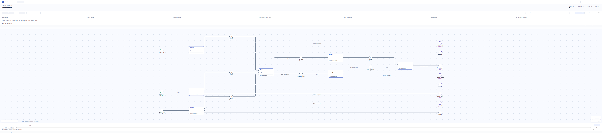

# 多源数据合并：增强现有 tool_pipeline

[English](README.md)

## 官方 Viewer 完整 PN

[](figures/initial-petri.png)

官方 Viewer 展示真实声明的全部 25 个节点和 25 条弧，包括未执行分支。这是 `initial_configured` 静态结构，无运行状态；[来源与图像记录](figures/petri-provenance.json)标明精确输入／编译／Viewer 版本。原运行结果与[完成态 Detailed flow 原图](figures/recorded-run.png)保持不变，后者不是此图的状态来源。

[点击 PN 打开原尺寸；只读 Viewer 细节](#static-pn-viewer)

使用 [Terminal-Bench multi-source-data-merger 原任务](https://github.com/harbor-framework/terminal-bench-2/tree/2fd12b88aafdd04a52c298e3940bcb189f9766d6/multi-source-data-merger) 的真实 JSON、CSV、Parquet 夹具，增强现有 `tool_pipeline`。这是确定性、零模型的 HOST 适配，不是 LLM benchmark 或 harness 性能对照。

## 实际结构

三份原始字节先成为各自的 OwnerInput 资源版本。入口核验与上游清单的 SHA-256 完全一致，不能把另换的数据标成原始夹具。三个解析 operation 可独立启用；`merge_users` 必须等三个成功输出齐备后由原 PN join 启用。合并按 A > B > C 优先级；每条冲突的附加来源证据记录原输入版本、解析结果版本、零起算行号、原字段与最终选中来源。

后续两个 encoder 分别产生真正的 Parquet 和 JSON 字节，通过含 base64、长度、媒体类型与 SHA-256 的 JSON 资源封装入账。`finish` 必须取得两个资源，最终导出只按 terminal 引用恢复原字节，不重跑工具。原 `conflicts.json` 格式不混入额外来源字段。原 Registry 发布、注册工具准入、Orchestrator、PN、预算声明、完成和 terminal binding 均保持原机制，无核心或 Viewer 修改。

七个操作：三路 read、三输入 merge、两个 encode、最后 finish。无需新增一套日志或调度系统。

## 实际本地结果与限制

2026-10-12 本地仅运行一次默认 `OwnerEventLoop` 的 AF_UNIX 路径，三个 worker 使用未改原 JSON/CSV/Parquet 输入。七个 firing 全部为 `PUBLISHED`，业务结果均为 `completed`，原生 terminal 为 `complete`。三个输入资源产生八个业务资源，包含两件终态产物；Registry 实际模型计数 `[0, 0]`。

pandas/pyarrow 真实读取 source C 并写出 `merged_users.parquet`：四个用户 101–104、整数 ID、映射后的文本列与可选 status。`conflicts.json` 含用户 101 的三个冲突：姓名、email、创建日期。未改原 verifier 的三项测试在下述明确离线路径适配下全部通过。另对同一保存 Registry 核验三输入 join、producer 引用、终态产物字节及原输入逐字节一致；这些附加核验不替代原 verifier。首次附加 readback 比较因直接比较 Python 事件 tuple 与 JSON list 而失败，原失败保留；只在检查脚本做 JSON 表示归一化后通过，未重跑原生流程。只读检查前后 Registry head ordinal 均为 765。

实际产品基线为 `e9fc93daf82914940ba48a86e1245b0f3f9f7667`，不同于云端候选 `b8d5942e768b2d59862b8e3eb7efa41a274f6307`。实际环境为 Python 3.13.12、pandas 3.0.3、pyarrow 24.0.0、pytest 9.0.3。完成本次运行无需修改运行实现或 core；本地增加离线 verifier 启动器并更新双语说明。

此前云端 AF_UNIX 权限被拒、Parquet 引擎缺失以及测试 pipe 运行的阻塞证据仍单独保留，当时没有终态产物。本地成功不改写历史结果。这是已查看公开 verifier 的确定性原夹具示例，不是盲评、模型能力、性能优势、恢复能力或正式发布 dataset benchmark。浏览器交互截图须单独验收；request handler 检查不能替代它。

## 启动、导出与验收

使用已有 RPNH 依赖、pandas、pyarrow、pytest 的环境。从产品仓库根执行，选择较短的可写工作目录，以满足 AF_UNIX socket 路径长度限制。生成物放在源码树之外；有工作区约束时，将 `WORK` 放在获准工作区内，并把进程 HOME、临时文件与缓存导向其中：

```sh
WORK=/path/to/short/work
mkdir -p "$WORK/home" "$WORK/tmp" "$WORK/cache"
env HOME="$WORK/home" TMPDIR="$WORK/tmp" XDG_CACHE_HOME="$WORK/cache" \
  PYTHONPATH="$PWD" PYTHONDONTWRITEBYTECODE=1 \
  python -m examples.tool_pipeline.multi_source.run \
  --run-dir "$WORK/run" --output-dir "$WORK/export"
env HOME="$WORK/home" TMPDIR="$WORK/tmp" XDG_CACHE_HOME="$WORK/cache" \
  PYTHONPATH="$PWD" PYTHONDONTWRITEBYTECODE=1 PYTEST_DISABLE_PLUGIN_AUTOLOAD=1 \
  python -m examples.tool_pipeline.multi_source.verify \
  --output-dir "$WORK/export" --report "$WORK/verifier-result.json"
env HOME="$WORK/home" TMPDIR="$WORK/tmp" XDG_CACHE_HOME="$WORK/cache" \
  PYTHONPATH="$PWD" PYTHONDONTWRITEBYTECODE=1 \
  python -m examples.tool_pipeline.multi_source.view "$WORK/run" --no-open
```

打开 Viewer 打印的本机 URL。CLI 不安装依赖，不选择测试传输。run/export 目录与 verifier report 路径须为新路径。`--max-in-flight` 可为 1/2/3，不改变 PN 就绪或优先级。只读重新导出现有 Registry 时，在 run 命令增加 `--readback`，保留原 `--run-dir` 并选择新的 `--output-dir`，不会重跑工具。

`artifacts_complete_ungraded` 是评估前的原生运行结果。不可变 terminal 中的 `original_verifier: not_run` 如实记录当时尚未评分；后续结果单列 `verifier-result.json`，不改写 Registry 历史。

`verify.py` 通过 pytest 加载逐字节未改的上游 `tests/test_outputs.py`，运行前验证固定 SHA-256，运行后核对原字节未变。仅在该已收集测试模块的 `os.path.exists`、`pd.read_parquet`、`open` 名称处，将两个精确 `/app` 产物路径转换为导出目录，并委托真实文件系统/pandas 操作。原测试源码和断言不改，不全局 monkeypatch 库、不伪造行、不 mock reader、不写 `/app` 或 `/tests`。应在 JSON 报告旁保留原 stdout/stderr。

这是明确的**离线启动适配**，没有运行原任务容器。上游 `test.sh` 原样保留但未执行：它会安装工具，并固定 pytest 8.4.1、pandas 2.3.3、pyarrow 22.0.0、pytest-json-ctrf 0.3.5；实际使用上述已有版本。未生成 CTRF 或 shell 的官方 reward 文件；报告记录实际 pytest exit code 和逐测试阶段，official reward 为 `null`。固定源码提交尚未解析为正式 dataset@version。

## 从真实冲突定位 Viewer 来源

先看 `export/conflicts.json` 的 `/conflicts/1`：用户 101 的 email 在 A/B/C 分别为 `john@a.com`、`john@b.com`、`john@c.com`。按优先级 A 胜出，selected 为 `john@a.com`，输出 Parquet 也为该值。这些值来自产物与 `evidence.json`，**不声称 stock Viewer 的资源面板直接显示 payload 正文**。

在实际 Registry 的 Viewer 中，通过 PetriNet、Executions、Evidence、history 定位 `merge_users.run` 与三路 `read_source_*.run`。`evidence.json` 给出每个产物的 resource/version ref、原生 `reference_provenance.operation_binding_ref`、producer invocation、parents、source refs 和 decisions。将 email 决策的 `origins` 对照原输入/解析资源：零起算第 0 行，A 原字段 `email`、B `email_address`、C `email`。终态 marking 已消耗输入时，使用历史 entry token 定位。

merge 发布到 `encode_parquet.merged` 和 `encode_conflicts.conflicts`，两个 encoder 继续到 `finish.parquet`、`finish.conflicts`，再由 `finish.run` 到 `finish.final`。`artifact-references.json` 将两个导出文件绑定到原终态资源。stock token-resource 面板显示注册元数据，可用引用与独立产物/export 正文交叉核对。本机交接 `CONFLICT_TRACE.json` 提供这次实际 run 的精确资源、operation、firing、port/place 和历史 checkpoint 锚点，供浏览器捕获使用，本身不替代捕获。

## 单测与边界策略

单测明确把自造的边界案例与原夹具的 Registry 运行分开，覆盖 A>B>C、多字段冲突、插入顺序无关性、精确来源/解析结果/行/字段引用、原字节完整性、实际准入结算、无假终态及 Viewer 只读路由。本地收尾复用 24 项单元/编译检查，并直接检查已保存的原生 Registry；没有重跑三个 pipe fixture 测试或重复成功原生运行。`tests/pipe_transport.py` 仅为测试适配，不是生产 fallback。可运行：

```sh
python -m pytest -q examples/tool_pipeline/multi_source/tests/test_multi_source.py
```

optional status 对布尔 `is_active`/`active` 映射为 `active`/`inactive`；缺失/null/空值视为无该字段，可由较低优先级补齐。必需字段缺失、同源重复 ID、别名歧义、错误 ID/日期、字节篡改明确拒绝。CSV 行号不含表头。上述空值/缺字段和拒绝策略属于上游未明确规定处的示例选择，不是新增官方评分规则。

## 来源与许可证

原任务作者 Xin Lan；仓库 `harbor-framework/terminal-bench-2` 的 `2fd12b88aafdd04a52c298e3940bcb189f9766d6`。`upstream/SOURCES.json` 给出每份原始文件的 SHA-256 与 Git blob SHA-1，真实 Parquet 为 3,639 字节；附 `upstream/LICENSE`（Apache-2.0），保留原 task、README、Dockerfile、三份夹具、未改测试和 canary。任务树未见额外专用许可证或外部数据署名。

未读取/执行上游 solution；代码依据任务要求和现有 RPNH 约定编写。已读公开 grader，所以不声称盲评。HOST 组装和测试 pipe adapter 沿用 RPNH `b8d5942e768b2d59862b8e3eb7efa41a274f6307` 的 tool_pipeline。

## 实际完成态 Viewer 图

另行链接的[完成态 Detailed flow 原图](figures/recorded-run.png)展示默认 AF_UNIX 的实际运行 head **765**：七步已结算、零未结算、一个最终报告 token。Detailed flow 显示 18 节点／18 边，原完整 PN 为 25 节点／25 弧。原图保留技术 checkpoint footer 和观察时间，无本机路径或用户身份映射；不是静态或初始声明图。

实际浏览器已逐一定位七个原 operation、最终报告 token 登记和历史原输入 token 登记。按上面的冲突指南，把用户 101/email 的已保存选择与 `merge_users.run`、source A reader 和原 entry token 对照。Viewer 显示引用和登记元数据，字段正文来自实际产物／证据；不冒称看板直接展示 payload。查看前后 event head/count、writer epoch 及主数据库元数据不变，正常 WAL/SHM 辅助状态另列。捕获浏览器及临时服务器已关闭。

<a id="static-pn-viewer"></a>

### 只读静态 PN Viewer

在已具备兼容 RPNH 环境的源码 checkout 根目录运行。此入口只读附带的静态 frame，不打开 Registry 或执行业务。

```bash
python - <<'PY'
import json
from pathlib import Path
from cpn.frontend.server import serve_projection
frame = json.loads(Path("examples/tool_pipeline/multi_source/figures/declaration-frame.json").read_text(encoding="utf-8"))
class Snapshot:
    def __call__(self):
        return frame["net"]
    def dashboard(self, cursor=None):
        if cursor is not None:
            raise ValueError("Static declaration has no execution history")
        return frame
serve_projection(Snapshot(), host="127.0.0.1", port=0, open_browser=False)
PY
```

打开打印的 localhost URL，选择 **PetriNet → Fit to view**。滚轮缩放、拖动平移；点击节点或弧查看原生详情，长标签可在详情中读取。静态声明没有运行历史；关闭服务用 Ctrl+C。
