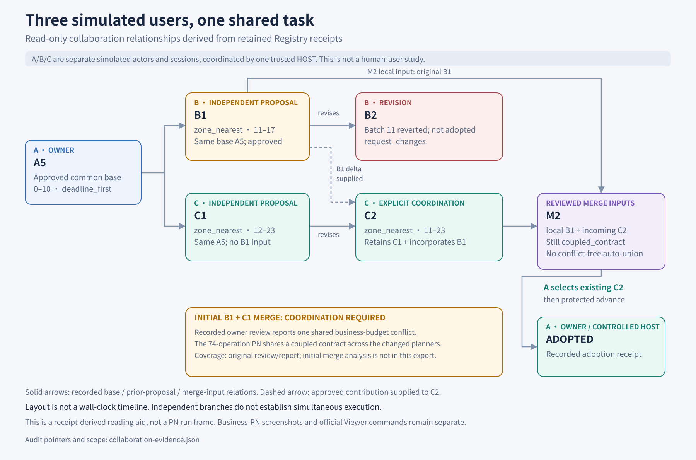
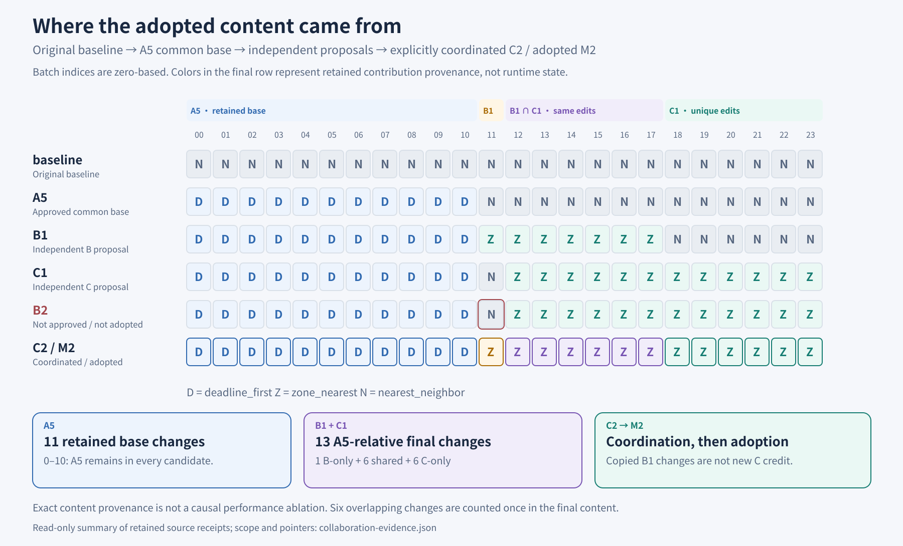
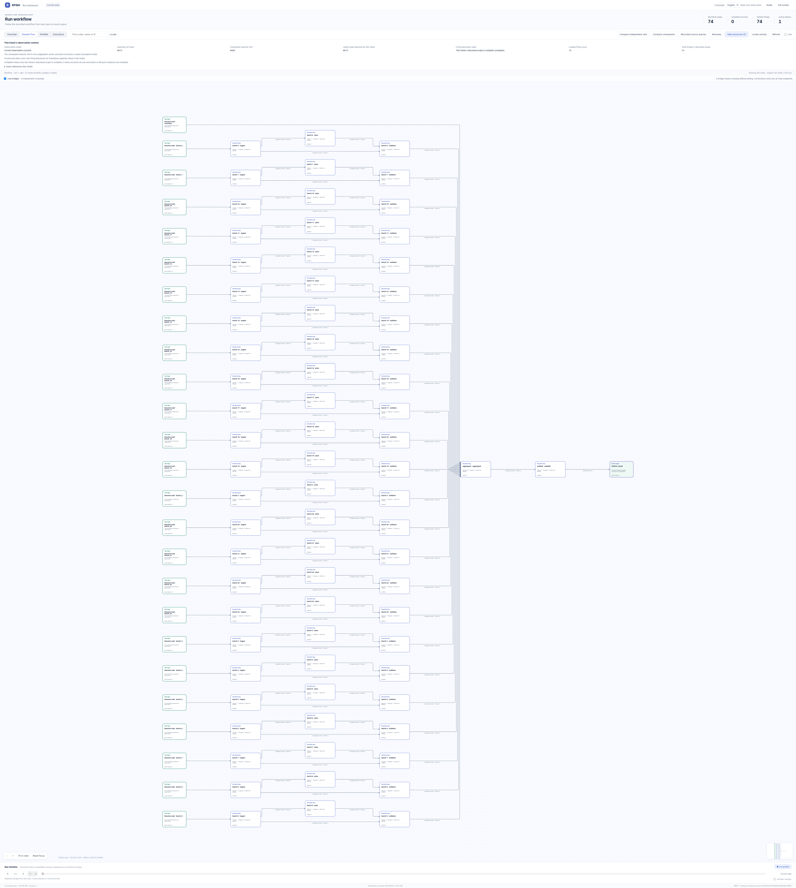

# Multiple users building one task network together

English | [中文](README_ZH.md) | [Detailed results and analysis](../../docs/results/user-collaboration-20261012/README.md)

The story here is **how three independent, controlled simulated user identities branch from a common revision, contribute separately, review and coordinate conflicts, and ultimately adopt one shared task network.** A, B and C have distinct native Registry actors and sessions under one trusted HOST coordinator; they are not three human participants or external accounts. Two real models propose changes. Model choice and user identity are separate dimensions.

## Start with the collaboration

| Role | Contribution to the shared outcome | Recorded native outcome |
| --- | --- | --- |
| A: project owner and initial author | Establishes common revision A5, changing batches 0–10 to `deadline_first`; owns final acceptance and adoption | A5 is reviewed and advanced; its 11 policy changes remain in M2 |
| B: independent contributor | Branches from A5 as B1, changing batches 11–17 to `zone_nearest`; later tries B2 with a different model under the same identity | B1 supplies the unique batch-11 change; B2 actually retracts it, receives a change request and is not adopted |
| C: independent contributor, then coordinator | Branches from the same A5 as C1, changing batches 12–23 to `zone_nearest`; C2 explicitly incorporates B's unique change | C2 contains the union for batches 11–23, which owner A selects for M2 |

[](visuals/collaboration-relations.png)

This diagram reconstructs relationships from native identity, proposal, review, merge and adoption receipts. **It is not a running PN screenshot or a wall-clock timeline.** The B/C fork shows independent version relationships from A5; the retained evidence does not establish simultaneous execution. See the safe fact projection in [collaboration-evidence.json](visuals/collaboration-evidence.json).

### From separate contributions to actual adoption

1. **A common starting point.** After A5 is approved and advanced, B1 and C1 propose changes from that same revision. Neither original task condition supplies the other contributor's proposal. They edit strategy configuration in the existing task network; its topology remains unchanged.
2. **Contributions overlap and also have unique parts.** B1 and C1 make the same six changes on batches 12–17. Batch 11 is unique to B; batches 18–23 are unique to C. Equal values do not count twice as unique contributions.
3. **Review preserves unsuccessful outcomes.** B uses DeepSeek for B1 and Terra for B2 while keeping the same identity, session and cumulative accounting (3 + 1 logical model calls). B2's prose claims to preserve B's contribution, but its actual write retracts batch 11, so review requests changes. B2 is not a parent of M2; matching some final values does not establish adopted authorship. Separately, the first B1/C1 combination has a shared business-budget contract conflict recorded in the original review and report, requiring subsequent C2 coordination.
4. **Coordinate content, then resolve the merge.** C2 revises C1 with approved peer deltas and explicitly adds B's batch 11. Native M2 has B1 and C2 as its two parents. Its merge still reports a coupled-contract conflict; owner A explicitly selects the incoming C2 that already contains the union. The merge algorithm does not construct that union automatically.
5. **Acceptance and adoption both happen.** The protected-branch advance points to M2. A subsequent native adopt receipt records `ADOPTED`, continuous with the original A project and session. Proposal approval, equal content, revision acceptance and final adoption are distinct facts. Owner review, advance and adopt are performed by the controlled HOST for A's session, not through model-granted authority.

[](visuals/final-content-provenance.png)

This content map separates A's 11 retained changes, the six overlapping B/C changes, their unique changes, and C2's explicit reuse of B's content. Integration by C2 does not turn B's contribution into C's independent authorship. The final result retains substantive contributions from both B and C in this recorded case; it does not guarantee a successful joint adoption in every collaboration.

## What task did they build together?

The application is a 24-batch route-planning network: read admitted route inputs, plan with a configured policy, aggregate and publish results, then evaluate with an independent scorer. Models edit the existing configuration; deterministic HOST tools execute the business PN without a model call per route. The collaboration story and the business-runtime panoramas below describe two different layers.

Adopted M2 and the original `nearest_neighbor` baseline are evaluated on fixed development and evaluation sets of 512 routes each. Official sequence scores decrease by about **7.525% / 8.376%**, while mean travel cost increases by about **7.715% / 8.421%**. Time-window failures and unknowns remain, so this is not an all-business-constraints pass. See the [detailed results and analysis](../../docs/results/user-collaboration-20261012/README.md) for paired distributions, tradeoff plots, model-separated token usage and evidence limits. These route outcomes alone do not measure a causal benefit from collaboration.

## Original runtime panoramas of the adopted task network

These unedited 4485 × 5000 PNGs came from the original **development** baseline and adopted-M2 runtime Registries in the official RPNH Viewer. Each shows all 24 batch branches, aggregation, publication and result. The capture has 74 settled firings and zero unsettled; Detailed flow folds 97 handoff places, showing 100 nodes / 123 edges from the full 197-node / 220-arc Petri net. Open the image at original size to inspect the whole workflow.

### Baseline

[](figures/baseline.png)

### Adopted M2

[](figures/adopted-M2.png)

The original footer retains technical checkpoint identifiers and observation times. These identify recorded execution state, not a person or an account. They are not access tokens. The PNGs contain no textual/EXIF metadata. Neither image has been redrawn, relabeled or presented as a new cloud run. Their exact byte identities are in [SOURCES.json](../../docs/results/user-collaboration-20261012/SOURCES.json). Completed execution does not imply all route business constraints passed.

## Open the static structure in the official Viewer

From a source checkout with its compatible RPNH environment already available:

```bash
python examples/view_declaration.py collaboration-baseline
python examples/view_declaration.py collaboration-adopted
```

Add `--no-open` to print the actual loopback URL instead of opening the browser. In the Viewer choose **PetriNet** for every place/transition/arc or **Detailed flow** for the pure-tool flow. Pan, zoom and node inspection use the existing official UI. No model, dataset, provider profile or retained runtime Registry is needed for these bundled frames.

These commands show **initial_configured static declarations** compiled from the recorded baseline and adopted modules, with payloads and runtime identities excluded. Empty/unmarked state is declaration state, not the completed execution shown in the PNGs. There is no execution history, checkpoint replay or live run. Both declarations have the same topology; the candidate uses `deadline_first` on batches 0–10 and `zone_nearest` on 11–23, replacing baseline `nearest_neighbor` everywhere. The exact configuration declarations are [baseline](declarations/BASELINE_MODULE.json) and [adopted M2](declarations/ADOPTED_M2_MODULE.json).

## What is reproducible here

You can read the public aggregate results, inspect both retained runtime images and open the two static structures. The entire real-model experiment is not a standalone download-and-run package: it used an existing installation, admitted routing data, user-owned profiles and private Registry state. Dataset terms and scorer/source pins are in the report. Do not interpret the static Viewer as a public replay of that private runtime.

For building a collaboration application, see the [native collaboration guide](../../docs/guides/user-collaboration.md). For a small self-contained executable workflow, start with [workflow patterns](../workflow_patterns/README.md).
