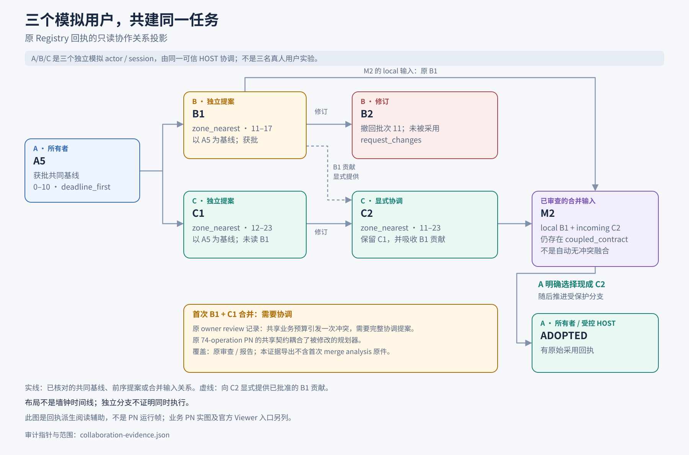
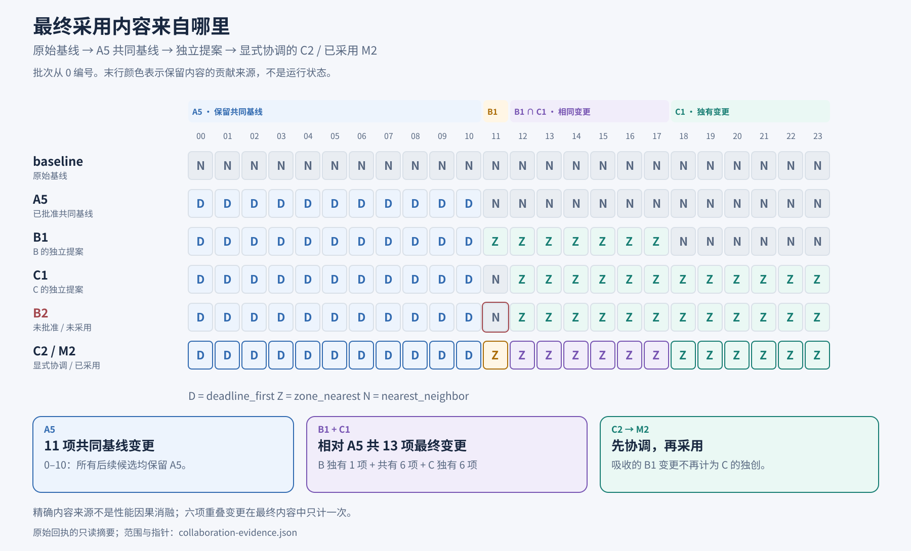

# 多个用户共同构建同一任务网络

[English](README.md) | 中文 | [详细结果与分析](../../docs/results/user-collaboration-20261012/README_ZH.md)

这个例子的主线是：**三个独立的受控模拟用户身份，如何在同一项目内从共同版本分支、分别贡献、审阅与协调冲突，最终采用一个共同任务网络。** A/B/C 有各自的原生 Registry actor 和 session，由同一个可信 HOST 协调；它们不是三位真人或三个外部账号。两种真实模型用于提出修改，模型与用户身份是两个不同维度。

## 先看协作过程

| 角色 | 对共同成果的作用 | 原生记录中的结果 |
| --- | --- | --- |
| A：项目 owner 与初始作者 | A5 建立共同基线，将 batch 0–10 改为 `deadline_first`；负责最后的接受与采用 | A5 经审阅、推进；其 11 项策略保留在最终 M2 中 |
| B：独立贡献者 | 从 A5 提出 B1，将 batch 11–17 改为 `zone_nearest`；随后同一 B 切换模型尝试 B2 | B1 提供独有的 batch 11；B2 实际撤回该项，被要求修改，未采用 |
| C：独立贡献者与后续协调者 | 从同一 A5 提出 C1，将 batch 12–23 改为 `zone_nearest`；C2 再显式吸收 B 的独有项 | C2 形成 batch 11–23 的联合版本，由 owner A 选择并纳入 M2 |

[](visuals/collaboration-relations_ZH.png)

图示依据原生身份、提案、审阅、合并与采用回执重建关系，**不是 PN 运行截图或墙钟时间轴**。B/C 的分叉表示基于同一 A5 的独立版本关系；现有记录没有证明两者在墙钟上同时执行。图的安全事实投影见 [collaboration-evidence.json](visuals/collaboration-evidence.json)。

### 从分别贡献到实际采用

1. **共同起点。** A5 经批准并推进后，B1 与 C1 从同一 revision 分别提出修改；各自原任务条件没有提供另一方的提案。修改的是已有任务网的策略配置，图拓扑保持不变。
2. **独立贡献有重叠，也有独有部分。** B1 与 C1 在 batch 12–17 的六项修改相同；B 独有 batch 11，C 独有 batch 18–23。相同值不能被重复算成独有贡献。
3. **审阅保留未通过情况。** B 的 B1 使用 DeepSeek，B2 切换 Terra，但原身份、session 与累计计数连续（3 + 1 次逻辑模型调用）。B2 的文字声称保留 B 的贡献，实际写入却撤回 batch 11；原审阅要求修改。B2 不是 M2 的父版本，不能因部分值与最终版相同就记为已采用贡献。B1/C1 初次组合则有原审阅和报告记载的共享业务预算约束冲突，随后需 C2 协调。
4. **先协调内容，再处理合并。** C2 基于 C1，获得批准的 peer 增量后明确补入 B 的 batch 11。原生 M2 的两个父版本是 B1 与 C2；其合并仍报告耦合约束冲突，owner A 显式选择已经包含联合内容的 incoming C2。联合内容不是合并算法自动生成的。
5. **接受与采用确实发生。** 保护分支的 advance 指向 M2，随后原生 adopt 回执记录 `ADOPTED`，与原 A 项目和 session 连续。批准提案、内容相同、接受版本与最终采用是不同事实。Owner 审阅、advance 和 adopt 由 A 会话的受控 HOST 执行，不是模型自行授予权限。

[](visuals/final-content-provenance_ZH.png)

这张内容来源图区分 A 保留的 11 项、B/C 重叠的六项、各自独有项，以及 C2 对 B 内容的显式复用。C2 的整合不是把 B 的贡献重新算作 C 的独立创作。最终内容保留了 B 与 C 的实质贡献；这个结论来自本次记录，不保证未来所有协作都能达成联合采用。

## 共同构建的任务是什么？

载体是一个 24 批次的路线规划业务网：读取已准入路线输入，按策略规划，再聚合、发布结果并由独立评分器评估。模型负责修改已有配置；业务 PN 本身由确定性 HOST 工具执行，每条路线不调用模型。协作主线与下方业务执行全景是两层不同的记录。

采用后的 M2 与原 `nearest_neighbor` baseline 分别在固定 development／eval 各 512 条路线上评估：官方序列分数降低约 **7.525%／8.376%**，平均行程成本增加约 **7.715%／8.421%**。时间窗仍有失败和未知，不能概括为全业务通过。完整配对分布、取舍图、按模型独立的 token 使用与证据边界见[详细结果与分析](../../docs/results/user-collaboration-20261012/README_ZH.md)。这些路线结果本身不衡量协作带来的因果收益。

## 已采用任务网的原始 runtime 全景

以下两张未修改的 4485 × 5000 PNG 来自原 **development** baseline 与 adopted-M2 runtime Registry 的官方 RPNH Viewer。每张都包含全部 24 个 batch 分支、聚合、发布和结果；截图有 74 次已结算 firing、零 unsettled。Detailed flow 折叠 97 个交接 place，从完整 197 节点／220 弧的 Petri 网展示 100 节点／123 边。打开原图可查看全流程。

### Baseline

[](figures/baseline.png)

### Adopted M2

[](figures/adopted-M2.png)

原 footer 保留技术 checkpoint 标识与观察时间，指向被记录的执行状态，不是个人或账号身份，也不是访问凭据。PNG 不含文本／EXIF 元数据。两图没有重画、改标或冒充云端新运行；精确字节身份见 [SOURCES.json](../../docs/results/user-collaboration-20261012/SOURCES.json)。执行完成不等于路线业务约束全部通过。

## 用官方 Viewer 打开静态结构

在源码 checkout 中，使用已有且兼容的 RPNH 环境：

```bash
python examples/view_declaration.py collaboration-baseline
python examples/view_declaration.py collaboration-adopted
```

加 `--no-open` 可只打印实际回环 URL，不自动打开浏览器。Viewer 中选择 **PetriNet** 查看全部 place／transition／arc；纯工具流程可选择 **Detailed flow**。平移、缩放和节点查看均使用已有官方 UI。这两份内置帧不需要模型、数据集、provider profile 或保留的 runtime Registry。

命令显示从已记录 baseline／adopted module 编译的 **initial_configured 静态声明**，不含数据载荷或 runtime 身份。空／未标记状态属于声明状态，不是 PNG 中的已完成执行；没有执行历史、checkpoint 重放或 live run。两声明拓扑相同，candidate 在 batch 0–10 使用 `deadline_first`、11–23 使用 `zone_nearest`，替换 baseline 全部采用的 `nearest_neighbor`。完整配置声明分别见 [baseline](declarations/BASELINE_MODULE.json) 与 [adopted M2](declarations/ADOPTED_M2_MODULE.json)。

## 本目录可复现的范围

可以阅读公开汇总结果、检查两张保留的 runtime 全景、打开两份静态结构。完整真实模型实验并非下载即可独立运行：它使用已有安装、已准入路线数据、用户自有 profile 与私有 Registry 状态。数据条款及评分器／源码身份在报告中。静态 Viewer 不代表私有 runtime 的公开重放。

构建协作应用可看[原生协作指南](../../docs/guides/user-collaboration_ZH.md)；需要小型独立可执行 workflow 时，从[工作流模式](../workflow_patterns/README_ZH.md)开始。
