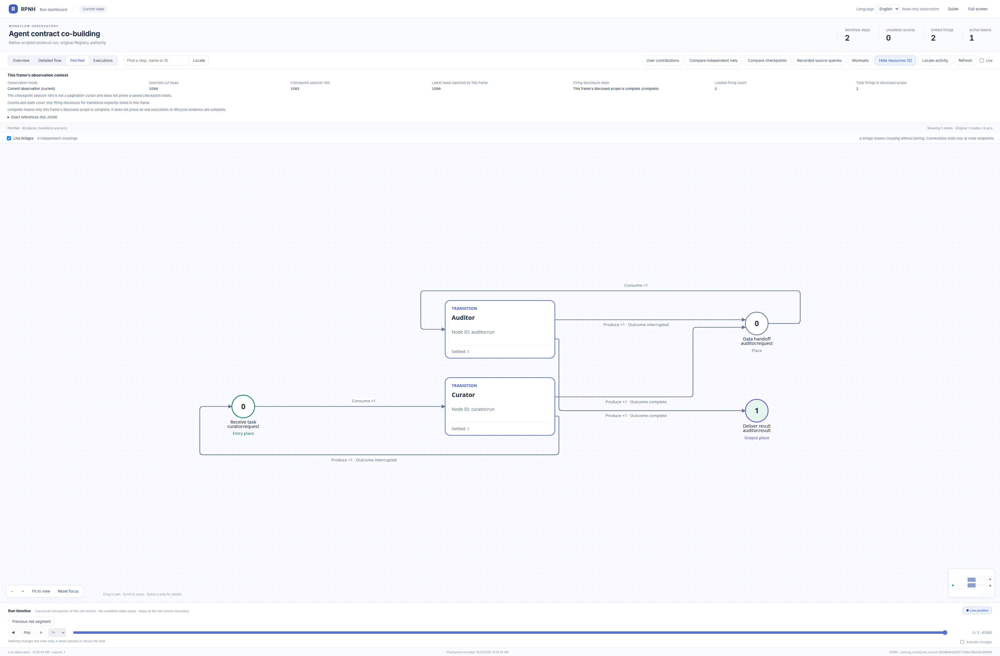

# Two users co-build an agent task network

[中文](README_ZH.md) · [Example catalog](../../README.md) · [Collaboration guide](../../../docs/guides/user-collaboration.md)

Two controlled original Registry principals contribute useful task contracts to a shared network. The original protected Branch and owner adoption accept their exact sequential revisions. The adopted target then runs two real stock `AgentLoop` roles: curator → auditor.

The model driver is a **dynamic deterministic local-process program**. It reads this run's actual tool returns and computes outputs; it is neither a live LLM nor a replay or a set of prefilled answers. This example demonstrates native agent structure, tool protocol, contract co-building and result provenance. It does not demonstrate autonomous analysis, cognitive quality or independent human collaboration.

[](figures/petri-panorama.png)

[Actual official Agent Overview](figures/overview-panorama.png) · [Same-run capture provenance](figures/provenance.json)

The Overview contains two original `registered_agent_binding` identities. Descriptions explain their roles but do not establish identity. The arrow is an original structural handoff path, not an invented execution-order record. The [full main task PN](figures/petri-panorama.png) retains five nodes and six arcs, including framework interruption-return paths that were **not run**. No rework branch is declared. Registered file-materialization and workspace-finalization child nets support the agents’ file I/O; they are separate from this main task PN.

## What each participant changes

| Identity or role | Actual responsibility | Evidence boundary |
| --- | --- | --- |
| Contributor for curator | A deterministic source program changes the curator contract to retain every input ID and index in the handoff | Own original principal, session, source Registry, one successful TEXT-producing firing; not an author agent |
| Contributor for auditor | A second deterministic source program starts from the accepted curator revision and requires per-source reconciliation and explicit count checks | Distinct original principal/session/source Registry; no automatic same-base merge |
| HOST owner | Reviews exact proposals, authorizes protected Branch advances and adopts the combined revision before target execution | Original external control receipts; these are not target PN firings |
| Curator task agent | Uses `read_file`, preserves record lineage, computes the normalized handoff and publishes it with `write_file` | Original agent/executable binding, loop, two turns and three actions |
| Auditor task agent | Reads the actual registered handoff, verifies counts/totals/source lineage and publishes the final report | A distinct original agent binding and loop; same explicitly scripted model configuration |

The declaration chain is [base](declarations/base.json) → [accepted curator contract](declarations/accepted-curator.json) → [adopted combined contract](declarations/adopted.json). The only two definition changes are the respective `operations[0].config.node_synopsis` values. Tools remain the pre-authorized `read_file`, `write_file` and `complete_interaction`; a proposal grants no capability.

Curator changes `retain_source_lineage=false` to `true`; auditor changes `reconcile_sources=false` to `true`. Both complete instructions appear in the adopted executable declaration and in each role's two actual request recipes. Both effects survive in the final report: all four source IDs/indices and four equal reconciliation counts. This is observable protocol adoption, not a claim about a model's internal understanding.

## Recorded result and trace

The 2026-10-12 UTC `fresh03` run completed two main-task firings, two logical AgentLoops, four local scripted turns and six settled actions. The two independent source runs each completed one proposal firing with zero model calls. Target `actual_model_call_counts=[4,0]` means four settled scripted task calls and zero post-limit excess; **external provider calls: zero**. Baseline agent registrations remain history; only the two adopted bindings executed.

The [original synthetic input](fixtures/input.json) contains four records. The [decoded report](results/report.json) has 24 minutes: planning 17, review 7. [verify.py](verify.py) independently recomputes against that input, checks each source ID/index/value and rejects numeric/boolean type substitutions. The [original terminal TEXT product](results/terminal-product.json) and [validation with exact references](results/validation.json) retain the connection to the accepted revision and terminal resource.

Inspect the official Viewer evidence:

- [Curator execution](figures/curator.run-execution.png), [exact binding](figures/curator.run-binding.png).
- [Auditor execution](figures/auditor.run-execution.png), [exact binding](figures/auditor.run-binding.png).
- [First recorded contributor](figures/contributor-1.png), [second recorded contributor](figures/contributor-2.png), [separate owner adoption](figures/owner-adoption.png), [its complete receipt](figures/owner-adoption-ref.png).
- [Source/run and read-only provenance](figures/provenance.json) identifies each image’s capture window. The original HOST supplied contribution and adoption views; the target was also reopened read-only for role and execution views. All three capture windows preserved head/event count 1099 and writer epoch 2 without rerunning the task.

The standard Viewer discloses exact references and bindings, not prompt/resource bodies. Original Registry databases and private identity/session mappings remain local. The two source Registries and the target retain their separate identities and evidence boundaries.

## Run with an existing compatible installation

From the product repository, choose an absent short directory for the native AF_UNIX socket:

```sh
python -B -m examples.user_collaboration.agent_cobuild.run --work-dir ./cobuild-run --serve --port 8775
python -B -m examples.user_collaboration.agent_cobuild.verify --input examples/user_collaboration/agent_cobuild/fixtures/input.json --result ./cobuild-run/export/result.json
```

This uses the existing `local_process` adapter without credentials or external services. It creates new controlled local identities and private runtime evidence. Do not reuse an old work directory or publish its raw export without disclosure review. The source authors and target model choice are intentionally fixed to this permitted scripted protocol task.

To reopen an existing target **without execution, writer authority or new grants**:

```sh
python -B -m examples.user_collaboration.agent_cobuild.view --run-dir ./cobuild-run/target --port 8775
```

The reopen entry shows original target identities, execution and resource references. The contributor panel requires the original `run --serve` HOST and its one-hour read session; reopening does not recreate it. Use the retained contribution receipts and images after that session expires.

## Implementation and validation scope

The example builds two stock single-agent declarations with `AgentStage`/default `AgentLoop` and explicitly connects their ports in an ordinary Module. Contract revisions use the existing plain-proposal and protected-Branch gates. The scripted auditor selects its handoff through typed semantic-input metadata.

Recorded focused checks passed: 31 driver checks and 9 independent result-verifier checks. These checks cover this example’s structural/protocol contracts and result validation; they do not certify live-model reasoning or every product integration.

[The source receipt](figures/provenance.json) distinguishes the executed source window from later read-only presentation/reopen changes. Current source entries are [contracts.py](contracts.py), [run.py](run.py), [scripted_model.py](scripted_model.py), [view.py](view.py) and [verify.py](verify.py). The original [route study](../README.md#historical-route-planning-mechanism-evidence) and [billing example](../native_billing/README.md) retain their own historical business and contribution evidence.
