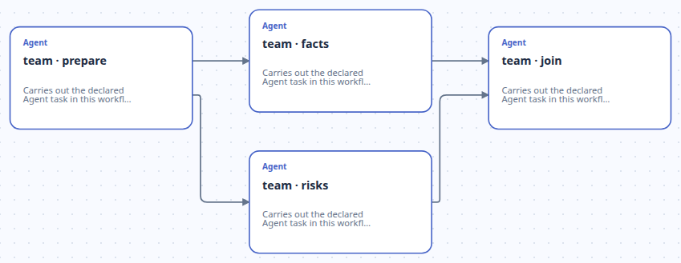
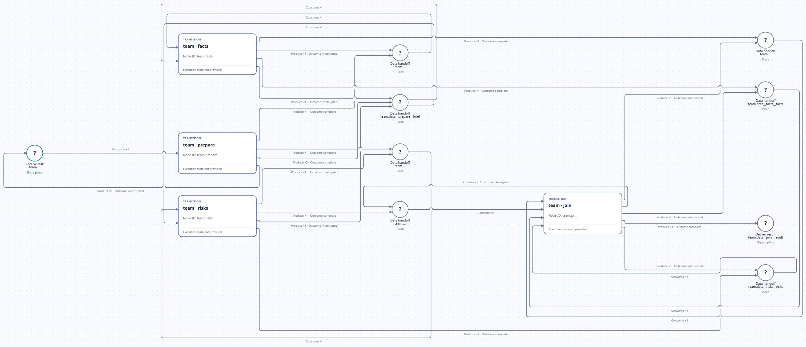
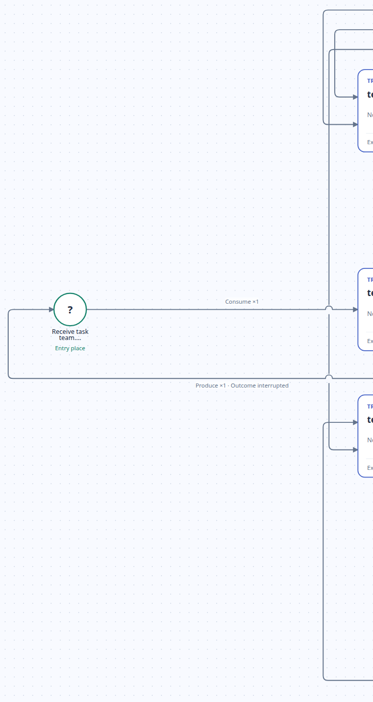
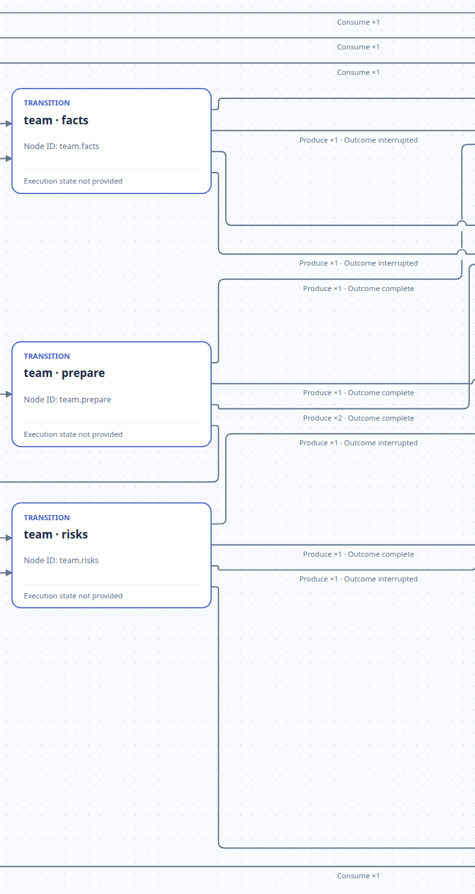
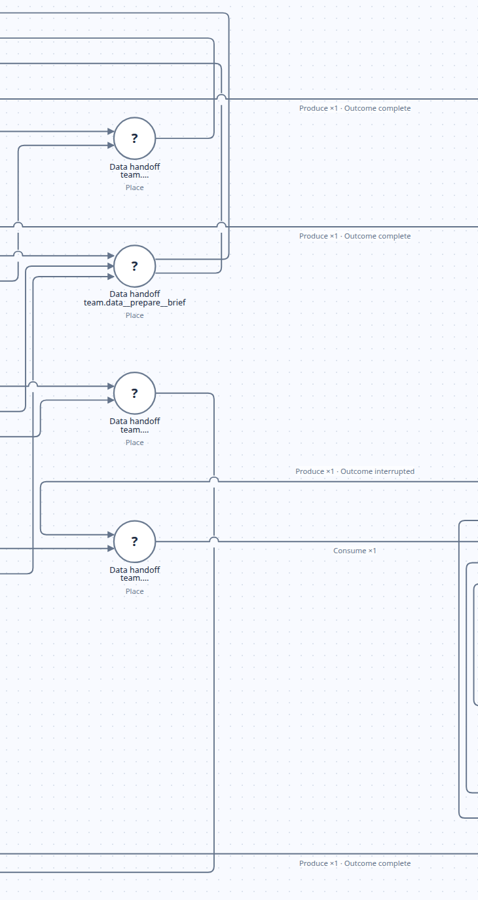
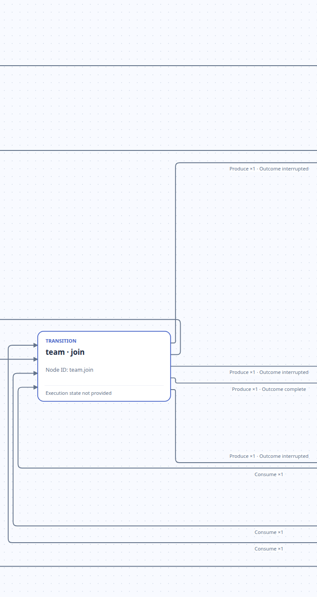
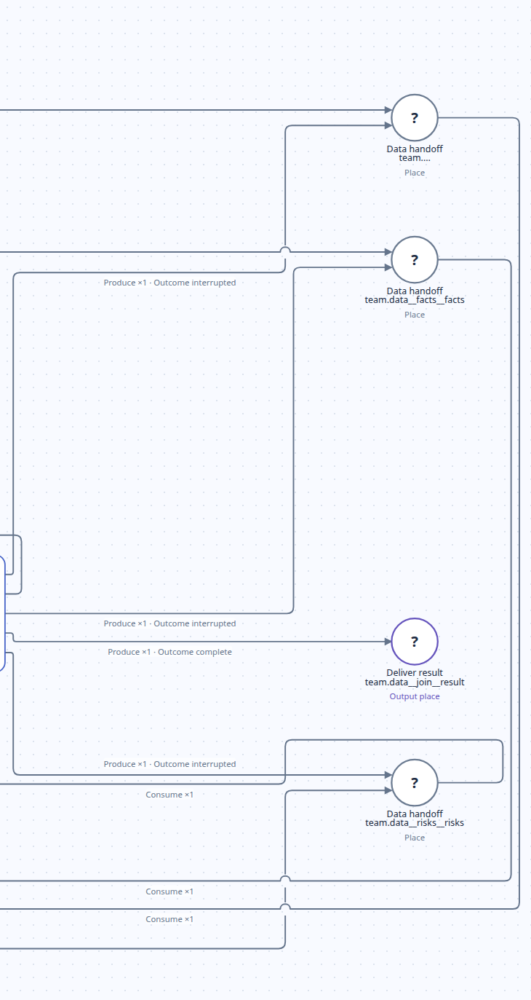

# 并行分叉与汇合

[English](README.md) | 中文

[返回案例说明](../../README_ZH.md)。

这些图片展示 `initial_configured` 初始声明；不包含执行状态、token marking 或成功结果。全图用于定位，编号局部图用于阅读节点、弧和标签。

声明源码：[parallel.json](https://github.com/Deng-0119/RPNH/blob/34d42d171d7e9a7f803b71467063b55786c2cea8/examples/workflow_patterns/scenarios/parallel.json), [run.py](https://github.com/Deng-0119/RPNH/blob/34d42d171d7e9a7f803b71467063b55786c2cea8/examples/workflow_patterns/run.py)。使用[官方 Viewer `34d42d17`](https://github.com/Deng-0119/RPNH/tree/34d42d171d7e9a7f803b71467063b55786c2cea8) 渲染。

prepare 分叉到 facts 与 risks，再由 join 汇合。Overview 仅展示四个 Agent 及四条关系；Petri 保留数据/控制 place、权重和 interrupted 返回分支。

[Overview](#overview) · [Petri](#petri)

## Overview

## Petri

[打开定位图原图](../../assets/pattern_parallel/petri-full.png).

[P01](#p01) → [P02](#p02) → [P03](#p03) → [P04](#p04) → [P05](#p05)

P01–P05 是从左到右的重叠局部图。被边缘截断的连线可在相邻图中继续追踪；桥状交叉不表示节点连接。

### P01

**请求入口。** 请求进入 [P02](#p02) 的 prepare；prepare 中断时返回此入口。

完整节点（从上到下，再从左到右）：`team.ingress__prepare__request`。

### P02

**准备与并行 Agent。** prepare 向 [P03](#p03) 输出控制 place 与两份 brief。facts、risks 分别生成 [P03](#p03)、[P05](#p05) 中的 join 输入；中断分支返回其输入。

完整节点（从上到下，再从左到右）：`team.facts`, `team.prepare`, `team.risks`。

### P03

**分叉交接与 risks 控制。** 前三个 place 把 prepare 接到 [P02](#p02) 的 facts/risks；底部 place 把 risks 完成信号接到 [P04](#p04) 的 join。brief 输出权重为 2，每个分支消费权重为 1。

完整节点（从上到下，再从左到右）：`team.control__prepare_to_facts`, `team.data__prepare__brief`, `team.control__prepare_to_risks`, `team.control__risks_to_join`。

### P04

**全输入汇合。** join 消费 [P03](#p03)、[P05](#p05) 中的两个控制信号和两份分支产物。完成分支生成 result；中断分支归还这四个输入。

完整节点（从上到下，再从左到右）：`team.join`。

### P05

**facts 控制、分支产物与结果。** [P02](#p02) 的 facts、risks 向 [P04](#p04) 的 join 提供产物；join 输出本图中的 result。另一 risks 控制 place 位于 [P03](#p03)。

完整节点（从上到下，再从左到右）：`team.control__facts_to_join`, `team.data__facts__facts`, `team.data__join__result`, `team.data__risks__risks`。

节点 ID 用于辨认 Viewer 中的通用或省略标签；局部图保持原始显示。
